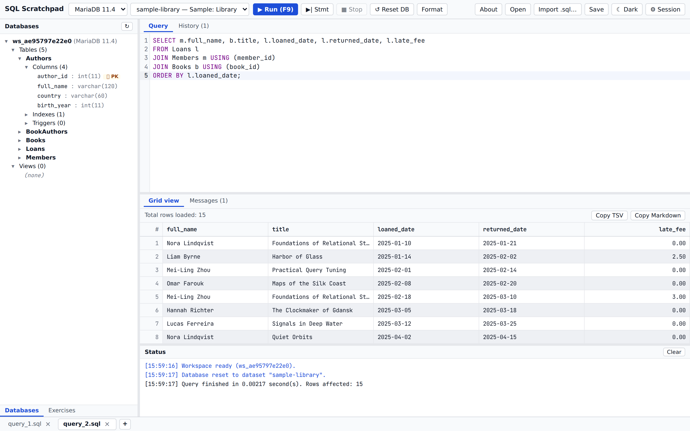

# SQL-Scratchpad

A lightweight, Letos-style SQL playground in the browser backed by real **MariaDB 11.4 LTS** isolated workspaces.



## Features

- **Desktop-style layout:** resizable schema tree (tables, columns with PK/FK/UNI badges, indexes, triggers, views), multi-tab SQL editor, virtualized result grid, Messages pane, and Letos-style status log.
- **CodeMirror 6 SQL editor:** MySQL/MariaDB syntax highlighting, schema-aware table/column autocomplete, error-line highlighting, SQL formatting (`Ctrl+Shift+F`), run selection/script (`F9` / `Ctrl+Shift+Enter`), and run statement under cursor (`Ctrl+Enter`).
- **Real MariaDB 11.4 isolation:** each workspace gets its own MariaDB database and dedicated least-privilege database user (`ws_<hex>`) with pinned connections so transactions, session variables, and temporary tables persist across runs.
- **Session toggles:** toggle `sql_safe_updates`, `ONLY_FULL_GROUP_BY`, `STRICT_TRANS_TABLES`, `autocommit`, and transaction isolation levels directly from the Session drawer.
- **Bring your own SQL:** import `.sql` scripts up to **6 MB** / **60,000 statements** (via the **Import .sql…** toolbar button or drag-and-drop onto the schema tree).
- **Built-in datasets:**
  - `sample-library` — an original 5-table library schema (`Authors`, `Books`, `BookAuthors`, `Members`, `Loans`; 60 rows, 5 foreign keys, `CHECK` constraint, `DATE` and `DECIMAL` columns) written from scratch in portable SQL for both MariaDB 11.4 and SQLite 3.
  - `empty` — a blank database for writing DDL from scratch or importing your own `.sql` files.
- **Self-contained frontend:** fonts (JetBrains Mono) and assets are bundled locally — zero external CDN or font requests at runtime.

## Bring Your Own SQL

Use **Open** to load a `.sql` file into an editor tab, or **Import .sql…** (or drag and drop a `.sql` file onto the schema tree) to populate a workspace database directly:

- Choose **Fresh workspace** (resets to an empty database first) or **Add to current**.
- Runs strictly under the workspace's own unprivileged MariaDB user (never as admin), keeping all isolation and statement-time limits active.
- Supports `DELIMITER` blocks for triggers and stored routines.
- Automatically skips non-applicable dump headers (`CREATE DATABASE`, `USE`, `DROP DATABASE`, `SET GLOBAL`, `LOCK/UNLOCK TABLES`, and session/charset `/*!40101 SET … */` / `DISABLE KEYS` headers) while executing real conditional-comment DDL (`/*!50001 CREATE … VIEW */`, `/*!50003 CREATE TRIGGER */`).
- Automatically strips `DEFINER=<user>@<host>` and `SQL SECURITY DEFINER` from imported views, triggers, procedures, functions, and events and reports every skipped or rewritten statement in the summary.

## Privacy

- **No accounts and no analytics.**
- **No SQL text or imported file contents are logged.**
- **Ephemeral server state:** workspaces exist only while in use and are deleted automatically when idle (2 h idle TTL, 12 h max lifetime in public deployments).
- **Browser-local state:** editor tabs, query history, and UI preferences stay exclusively in your browser's `localStorage`.

## Self-Hosting Quick Start

Prerequisites: Docker Engine and Docker Compose v2.

```bash
git clone https://github.com/hexawulf/sqlyard.git
cd sqlyard
cp deploy/db.env.example deploy/db.env
cp deploy/app.env.example deploy/app.env
```

Generate strong random passwords (for example with `openssl rand -base64 32`), put matching `SQLYARD_ADMIN_PASSWORD` values in `deploy/db.env` and `deploy/app.env`, set `MARIADB_ROOT_PASSWORD` only in `deploy/db.env`, lock down permissions, and start the stack:

```bash
chmod 600 deploy/db.env deploy/app.env
docker compose -f deploy/docker-compose.yml up -d --build
```

SQLyard listens on `http://127.0.0.1:5050` by default. See [docs/SELF-HOSTING.md](docs/SELF-HOSTING.md) for configuration, reverse-proxy setup, and maintenance.

## Documentation

- [Architecture](docs/ARCHITECTURE.md)
- [Self-Hosting Guide](docs/SELF-HOSTING.md)
- [Security & Threat Model](SECURITY.md)
- [Third-Party Notices](THIRD_PARTY_NOTICES.md)

## License

MIT — see [LICENSE](LICENSE). Bundled font and library notices are listed in [THIRD_PARTY_NOTICES.md](THIRD_PARTY_NOTICES.md).
