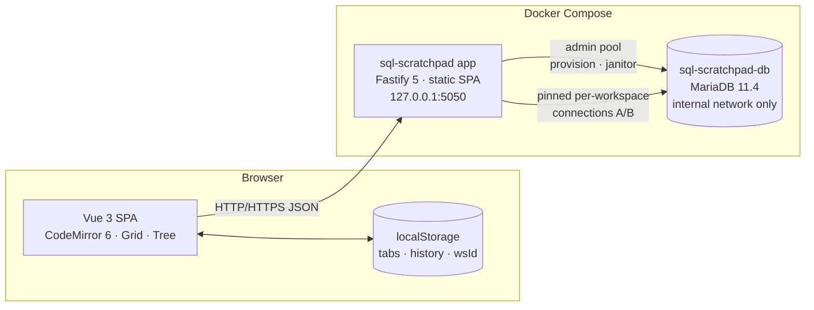

# SQL Scratchpad Architecture

## Overview

SQL Scratchpad is a TypeScript monorepo (`pnpm` workspaces) with three packages and a dedicated MariaDB 11.4 database image:

| Directory | Role |
|---|---|
| `shared/` | Engine-agnostic TypeScript contracts (`EngineAdapter`, `ExecRequest`, `ExecResponse`, `ImportRequest`, `ImportResponse`, `SchemaTree`, `DatasetMeta`). |
| `server/` | Fastify 5 HTTP API, static SPA server, workspace manager, execution engine, SQL import engine, schema introspector, and janitor. |
| `web/` | Vue 3 + Vite + CodeMirror 6 frontend SPA with virtualized result grid, schema tree, import modal, and `localStorage` state persistence. |
| `db/` | MariaDB 11.4 LTS Dockerfile, conservative memory/safety configuration (`db/conf.d/sql-scratchpad.cnf`), and init scripts (`00-admin-user.sh`, `10-sample-library.sh`). |
| `seeds/` | Portable sample dataset (`sample-library.sql`) verified identically on MariaDB 11.4 and SQLite (`sql.js`). |

## Workspace Isolation

SQL Scratchpad relies on MariaDB's own privilege system rather than regex sandboxing:

1. Creating a workspace provisions a fresh database (`ws_<12 hex>`) and a dedicated database user with a 32-byte random password kept only in API process memory.
2. The workspace user receives table/view/trigger/routine privileges **only** on its own `ws_<hex>.*` schema — never global privileges (`FILE`, `SUPER`, `PROCESS`, `CREATE USER`, `GRANT OPTION`, or access to `tpl_*` templates or other `ws_*` workspaces).
3. Resource limits are attached directly to the MariaDB account: `MAX_USER_CONNECTIONS 3`, `MAX_QUERIES_PER_HOUR 100000`, `MAX_UPDATES_PER_HOUR 100000`, `MAX_STATEMENT_TIME 5`.
4. If the API restarts, in-memory workspace credentials are lost and the janitor drops orphaned `ws_*` databases and users on startup; the browser automatically provisions a fresh workspace on the next 404.

## Dataset Cloning

Template databases (`tpl_*`) are seeded once during container initialization. Cloning a template into a workspace uses:

1. Topological sort of tables from `information_schema.REFERENTIAL_CONSTRAINTS`.
2. `SET FOREIGN_KEY_CHECKS = 0`.
3. `SHOW CREATE TABLE` executed inside the destination workspace, followed by `INSERT INTO ws_x.t SELECT * FROM tpl_y.t`.
4. `SHOW CREATE VIEW` / `SHOW CREATE TRIGGER` rewritten without `DEFINER=` and created as the workspace user.
5. `SET FOREIGN_KEY_CHECKS = 1`.

`CREATE TABLE ... LIKE` is **never** used because MariaDB/MySQL drops foreign key constraints when cloning tables with `LIKE`.

## Execution and Import Engines

- **Pinned sessions (`A` and `B`):** each workspace maintains dedicated `mysql2/promise` connections as user `ws_<hex>` so `START TRANSACTION`, `SET SESSION`, temporary tables, and `@variables` persist across clicks. A per-session mutex returns `409 SESSION_BUSY` on concurrent execution.
- **Statement splitting:** `dbgate-query-splitter` splits scripts with MySQL `DELIMITER` support and preserves 1-based start lines for editor error highlighting.
- **Warnings:** statements reporting `warningStatus > 0` run `SHOW WARNINGS` so silent type conversions and notes are surfaced in the status log and Messages pane.
- **Import (`POST /api/workspaces/:wsId/import`):**
  - Separate 6 MB body limit (while `/exec` stays at 256 KB), 60,000 statement cap, and 90 s wall-clock cap.
  - Runs strictly on the workspace's own user connection — never the admin pool.
  - Refuses `mode: "append"` with `409 TRANSACTION_OPEN` if `@@in_transaction = 1`, and restores `@@autocommit` to its prior value in `finally`.
  - Selectively skips dump-level statements (`CREATE DATABASE`, `USE`, `DROP DATABASE`, `SET GLOBAL`, `LOCK/UNLOCK TABLES`, and session/charset `/*!40101 SET … */` / `DISABLE KEYS` conditional headers) while executing real conditional-comment DDL (`/*!50001 CREATE … VIEW */`, `/*!50003 CREATE TRIGGER */`).
  - Strips `DEFINER=<user>@<host>` and `SQL SECURITY DEFINER` on `CREATE VIEW/TRIGGER/PROCEDURE/FUNCTION/EVENT` and lists skipped and rewritten statements separately in the response summary.

## API Summary

| Method & Path | Limit | Purpose |
|---|---|---|
| `GET /api/health` | — | Health check (`{"status":"ok"\|"degraded"\|"maintenance","db":"ok"\|"error","version":...}`) |
| `GET /api/datasets` | — | Available built-in datasets (`sample-library`, `empty`) |
| `POST /api/workspaces` | 3 live/IP, 10/h per IP, 50 global | Create an isolated workspace from a dataset |
| `POST /api/workspaces/:wsId/reset` | — | Reset workspace to a dataset |
| `POST /api/workspaces/:wsId/exec` | 256 KB, 60/min per IP | Execute SQL on pinned session A or B |
| `POST /api/workspaces/:wsId/import` | 6 MB, 20/h & 30 MB/h per IP | Bulk-import a `.sql` script into the workspace |
| `GET /api/workspaces/:wsId/schema` | 120/min per IP | Introspect tables, columns, indexes, FKs, triggers, views |
| `POST /api/workspaces/:wsId/sessions/:session/kill` | — | `KILL QUERY` on a running statement |
| `DELETE /api/workspaces/:wsId` | — | Drop workspace database and user |

## Janitor

A periodic background sweep (every 5 minutes by default):

1. Expires workspaces past their idle TTL (**2 h** default) or absolute max lifetime (**12 h** default).
2. Closes idle pinned sessions (**10 min** default), rolling back any open transaction first.
3. Resets any workspace whose `information_schema.TABLES` size exceeds the 50 MB cap.
